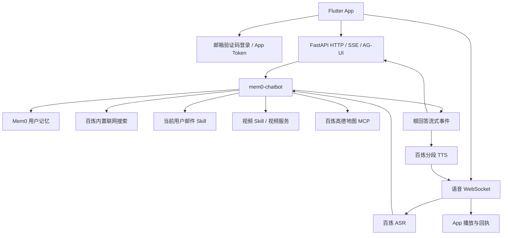

# Agent Voice Server

基于 **FastAPI · LangGraph · Mem0 · PostgreSQL/pgvector** 的对话与实时语音后端，为 [Agent Voice App](https://github.com/coderpwh1024/agent-voice-app) 和 Streamlit 客户端提供服务。

由 [coderpwh](https://github.com/coderpwh1024) 开发和维护，采用 [Apache License 2.0](LICENSE)，版权声明见 [NOTICE](NOTICE)。第三方组件遵循各自的许可证。

后端仓库为 [agent-voice-server](https://github.com/coderpwh1024/agent-voice-server)，与前端 `agent-voice-app` 位于相邻目录。克隆后端后进入同名目录运行：

```sh
git clone git@github.com:coderpwh1024/agent-voice-server.git
cd agent-voice-server
```

项目原名为 `agent-service-toolkit`。为兼容现有部署，Nacos 的 `agent-service-toolkit.yaml` Data ID、服务注册名、缓存目录和 PostgreSQL application name 继续使用原值；登录令牌的签发者与受众也保持原协议，无需迁移配置中心或重新登录。Compose 显式保留原项目名 `agent-service-toolkit`，继续使用现有 PostgreSQL、Redis 数据卷；已有 `-p` 或 `COMPOSE_PROJECT_NAME` 配置仍优先。新生成的部署包与安装目录示例使用 `agent-voice-server`，systemd 单元名和服务账号沿用原值；已有 Linux 部署升级前需按实际安装路径调整单元文件。

项目只运行一个 Mem0 主 Agent，内部实现为 `mem0_chat`，现有对外标识 `mem0-chatbot` 保持不变。它负责日常对话、用户长期记忆、邮件 Skill、视频 Skill 和按需加载的高德地图 MCP 查询；研究、RAG、Supervisor、GitHub MCP 及 `chatbot` 的独立实现和注册均已移除。旧 `chatbot` 请求值只在 API 边界解析到主 Agent，已有 App 无需修改 URL 或参数。

兼容新版 Flutter App 的首选记忆方案为手机端 `MEMORY.md`：App 按需提供相关片段，服务端只返回候选，由手机检查版本并写回。原 Mem0 代码、管理接口和旧客户端行为保留为备选。存储位置、开关、协议、遗忘与隐私边界见[手机端 Markdown 记忆](docs/local-memory.md)。

## 请求与语音链路



文字与语音共用身份绑定、线程授权、模型选择和 LangGraph 检查点。语音直接调用共享 Agent 事件层，不需要再请求 HTTP SSE。

一轮有效输入按以下顺序处理：

1. 校验用户身份与线程归属，恢复历史和待处理业务状态。
2. 优先处理邮件请求与记忆管理指令。
3. 召回当前用户的长期事实，将其作为不可信参考传给主模型。
4. 主模型直接回答，按需使用百炼内置联网搜索，或加载视频 Skill / 高德地图 MCP 后执行受控操作或查询。
5. 根回答流式发送到 UI；实时语音同时断句、合成 PCM 并下发播放。
6. 普通聊天等待 Mem0 提取本轮用户事实后完成。邮件、视频和地图查询分支提前返回，保留各自业务状态。

视频生成、SMTP 接受、TTS 合成与手机播放分别确认。取消语音不会撤回已提交的邮件或视频任务。

## FastAPI 结构

参考 `aigc-platform` 的分层职责，结合当前 psycopg、LangGraph、Mem0 和实时语音实现组织代码，没有引入 ORM、改表或增加 `/api/v1` 等接口前缀。

```text
app/
├── main.py             应用组装
├── lifecycle.py        启动、关闭与资源管理
├── __main__.py         python -m app 启动入口
├── api/                路由、依赖、异常响应与 WebSocket 连接
├── services/           业务流程、模型、记忆、Skill、ASR/TTS 和供应商调用
├── repositories/       PostgreSQL、Redis 和 Mem0 审计数据访问
├── models/             持久化记录与原有 SQL 定义
├── schemas/            Pydantic 请求、响应和事件契约
├── agents/             唯一 Mem0 Agent 及其编排
└── core/               配置、Nacos、模型工厂、日志与基础设施
client/                 Python 客户端与 Streamlit 语音适配
streamlit_app.py         开发聊天界面
```

| 目录 / 入口 | 职责 |
| --- | --- |
| `app/__main__.py` | Uvicorn 启动与日志配置 |
| `app/main.py`、`app/lifecycle.py` | FastAPI 组装、统一异常处理注册与共享资源生命周期 |
| `app/api/chats.py`、`app/services/chat.py` | 对话路由、SSE 封装与模型运行配置、调用服务 |
| `app/api/` | 按业务划分的认证、用户、语音、记忆、邮件、视频、文件、AG-UI 路由 |
| `app/api/dependencies.py`、`app/api/errors.py` | 认证依赖、旧请求值兼容与业务异常到 HTTP 的映射 |
| `app/services/auth.py`、`app/services/email_auth.py`、`app/services/users.py` | 令牌与线程授权、验证码登录、用户资料业务 |
| `app/repositories/` | 用户、文件、视频、语音、验证码和 Mem0 审计数据访问 |
| `app/models/` | 视频持久化记录和 `sql/` 中原有四份数据库定义，继续使用 psycopg |
| `app/schemas/` | Pydantic 请求、响应、语音事件与业务数据契约 |
| `app/agents/mem0_chat.py` | 唯一主 Agent；历史、记忆与业务分流 |
| `app/agents/chat.py`、`app/agents/amap_chat.py` | 主模型调用、提示词上下文与视频 / 地图技能加载 |
| `app/services/amap_mcp.py` | 百炼高德地图 MCP 的鉴权、连接与资源释放 |
| `app/services/skills/` | 邮件与视频 Skill 的受控执行 |
| `app/api/voice_connection.py`、`app/services/voice/` | WebSocket 会话、ASR/TTS 供应商、断句与播放协调 |
| `app/services/memory/`、`app/core/database.py` | Mem0 SDK、长期记忆服务、PostgreSQL 检查点与 Store |
| `app/services/video/` | 视频生成、编辑、异步状态同步与七牛归档 |
| `app/core/` | Settings、模型工厂、日志、模型调用指标与 Skill 定义 |
| `client/`、`streamlit_app.py` | Python 客户端与开发聊天界面 |

服务启动先加载 Nacos 配置，再初始化 PostgreSQL、主 Agent、Mem0、邮箱认证、邮件调度、语音、视频和文件服务；退出时释放连接并取消后台任务。PostgreSQL 不可用时启动失败，不回退到其他存储。

## App 接口与兼容性

| 能力 | 现有接口 |
| --- | --- |
| 邮箱登录 / 注册 | `POST /auth/email/code`、`POST /auth/email/verify` |
| 用户资料 | `GET /users/me`、`PATCH /users/me` |
| 对话 | `POST /invoke`、`POST /stream` 及 `/{agent_id}` 版本 |
| 历史与线程 | `/history`、`/threads`、`/chat-records` 及 `/{agent_id}` 版本 |
| 实时语音 | `/voice/capabilities`、`/voice/protocol`、`/voice/sessions` 与会话 WebSocket |
| 邮件 Skill | `POST /skills/email/send` 与主 Agent 的文字 / 语音调用 |
| 视频制作与管理 | `/videos` 现有创建、列表、详情、修改、删除接口与视频 Skill |
| 文件与记忆 | `/files`、`/memories` 现有接口 |
| AG-UI | `POST /agui/run`、`POST /agui/{agent_id}/run` |

保留这些接口的路径、方法、参数、默认值、响应 schema 和 operation ID。SSE、WebSocket、音频帧、输入去重、回压、插话取消、播放确认和所有权校验沿用原实现。

`tests/contracts/` 保存调整目录前的 OpenAPI 和客户端语音事件 schema，测试会逐项比较，防止内部目录变化影响前端协议。业务层与仓储层的依赖方向由 `tests/core/test_architecture.py` 检查。

`/info` 与 `/voice/capabilities` 只列出 `mem0-chatbot`。语音创建请求的 `agent_id` 默认仍为 `chatbot`，由后端映射到同一主 Agent。继续已有线程时应继续使用该线程原来的标识，后端不改写其所有权或检查点 metadata。

其他 Agent 标识返回 404。旧数据库、历史记录与记忆不在本次收敛中删除或迁移。旧 Nacos 的研究、RAG、GitHub MCP 配置字段仍接受加载，但不能恢复已移除的独立研究能力。主 Agent 使用百炼模型时，普通回答默认开启百炼内置联网搜索；可通过 Nacos 的 `models.dashscope.enable_search` 或环境变量 `DASHSCOPE_ENABLE_SEARCH` 关闭。搜索按模型请求决定是否实际触发，不能把开关开启等同于已完成联网核实。Streamlit 和事件层保留旧历史消息的兼容展示与协议解析。

## 执行过程与恢复

主 Agent 按真实业务边界发布 `execution.progress`，覆盖记忆检索与整理、回复生成、
邮件请求与提交、视频 Skill 加载、地图查询、参数检查和操作。步骤包含运行 ID、步骤 ID、单调递增的
序号、状态和实际耗时；不输出模型内部推理、提示词、供应商原始载荷或虚构进度百分比。

- SSE：现有 `message` 事件中的 `ChatMessage(type="custom").custom_data`。
- 实时语音：现有 `agent.custom.data`；外层 `response_id` 关联助手消息。
- AG-UI：`CUSTOM` 事件，名称为 `execution.progress`。
- 最终摘要：`ChatMessage.response_metadata.execution`，随原有检查点保存，兼容旧消息。
- 恢复查询：`GET /executions?thread_id=...` 或 `GET /{agent_id}/executions?thread_id=...`，
  返回本线程最近 100 个执行快照，经过 bearer 认证和原有线程归属检查。

快照使用既有 PostgreSQL LangGraph Store，按用户和线程隔离；没有新增第一方业务表或
改变既有表结构。执行展示状态独立于模型上下文、音频播放以及视频生成状态。
恢复查询不重放音频、不重新发送邮件、不重新生成视频，也不会自动续跑中断的模型请求。
超过五分钟未更新的运行快照显示“结果待核实”，不能据此推断外部操作失败。

记忆修改和删除的确认提供有期限的 `confirmation_id`，绑定当前操作、候选目标和内容。
App 使用新增的 `memory.confirm` 控制事件，传入 `confirmation_id` 和布尔值 `approved`；
HTTP/SSE 客户端可通过 `agent_config.memory_confirmation` 提交同一结构。
后端在原有线程锁内恢复检查点，再校验当前操作、有效期和用户绑定；旧按钮、重复确认或
操作变化不会触发另一个修改。原来的文字确认和 LangGraph `approval.submit` 继续支持，
两种确认机制保持独立。

Flutter 客户端在助手消息中展示可折叠步骤，历史详情复用同一组件。重新连接或打开历史时
合并持久快照，按运行 ID 和序号去重；实时文字仍由文字流更新，恢复数据不插入正在输出的
文字流。前台按需刷新执行状态，并按视频记录 ID 去重刷新聊天中的视频；进入后台、账号/
服务地址变化或销毁控制器后停止刷新。视频每 10 秒查询，单个任务最多自动查询 120 次，
用户仍可进入详情刷新。停止回答不撤回已提交的邮件或视频任务。

语音页面支持三种 `POST /voice/sessions` 的 `input_mode`，可通过
`GET /voice/capabilities` 的 `input_modes` 查询：

- `conversation`（默认）：保留原有点击或唤醒双工、ASR 自动提交和 TTS 播放。
- `text`：不连接 ASR、不需要麦克风；发送 WebSocket `input.text`，复用原有 Agent、
  邮件/视频/记忆工具、确认、执行状态、文字流和 TTS。二进制输入及 `input.commit`
  返回可恢复的 `audio_input_disabled` 错误。
- `transcription`：要求 `activation="tap"`、`turn_detection="manual"`，实时发送原有
  PCM 帧，结束录音后发送 `input.commit`；`transcript.partial` 用于识别预览，
  `transcript.final` 表示本次提交的转写完成（可能为空）。仅转写不调用 Agent、不写入
  对话消息、不触发工具或 TTS；业务输入返回可恢复的 `transcription_only` 错误。

客户端将听写文字回填输入框供用户编辑，关闭并删除仅转写会话释放容量，随后使用同一
`thread_id` 创建 `text` 会话，在用户点击发送后提交 `input.text`。文本与听写模式都要求
点击激活，不需要唤醒词。`session.ready` 返回实际 `input_mode`；省略该字段的旧请求与
已有持久化会话继续使用 `conversation`。所有模式沿用认证、用户绑定、线程所有权、
输入幂等、取消、播放确认和会话上限规则。没有执行过 Agent 的新线程历史返回空消息列表。

## 配置与运行

项目支持 Python 3.12–3.14，固定 uv 版本见 `deploy/uv-version`。参考 `.env.example` 和 `config/environments/` 准备 Nacos、PostgreSQL 和对应模型配置后运行：

```sh
uv sync --frozen
uv run python -m app
```

开发界面：

```sh
uv run streamlit run streamlit_app.py
```

运行时聊天、记忆 Prompt 与邮件 / 视频 Skill 由 Nacos 加载。密钥放在配置中心或忽略的环境覆盖文件中，不提交到仓库。

高德地图 MCP 使用百炼的 Streamable HTTP 接口，在主 Agent 收到地图相关请求时按需连接。将以下字段合并到现有 Nacos `agent-service-toolkit.yaml`（使用部署环境实际的 Data ID、Group 和命名空间），保留原有配置；API Key 使用同一区域的百炼密钥，不写入仓库：

```yaml
models:
  dashscope:
    api_key: <百炼 API Key，若现有 Nacos 配置已有该项则无需重复>
mcp:
  amap_maps:
    enabled: true
    url: https://<百炼工作空间域名>.cn-beijing.maas.aliyuncs.com/api/v1/mcps/amap-maps/mcp
    timeout_seconds: 20
```

地图 MCP 默认关闭，仅接受百炼 `https` 地图端点；启用后启动时校验 Nacos 和密钥配置。当前允许查询天气、地点、地理编码、距离和路线，不调用 IP 定位或修改类工具。地图结果属于外部不可信数据，调用失败时返回可重试提示。接口通过已有文字、SSE、AG-UI 和语音 Agent 链路提供，无需新增路由。

手机 App 对“我现在在哪”“我附近有什么”等当前地点请求按需申请前台定位权限，并在本轮 `input.text.device_location` 中传递经纬度、精度和 UTC 采集时间。语音转写得到这类请求后，服务端发出 `location.request`（含 `request_id`、`input_id`），App 以 `location.result` 回复 `ok`、`denied` 或 `unavailable`；`ok` 时附同格式的 `device_location`。坐标只在当前 Agent 运行中使用，不写入聊天消息、检查点或语音记录。坐标须为五分钟内采集；拒绝权限、定位失败或等待超时会继续处理原问题，并请用户提供地点。指定地名的查询不需要手机定位。
语音定位回复的等待上限由 Nacos `voice.session.location_timeout_seconds` 控制，默认 40 秒，以覆盖手机冷启动定位。

## 验证

```sh
uv run ruff format --check .
uv run ruff check .
uv run pyrefly check
uv run pytest
./scripts/smoke_test.sh postgres agui
```

pytest 默认使用 `importlib` 收集模式，避免不同测试目录内同名文件发生模块冲突。Docker 集成测试需显式传入 `--run-docker`；真实模型、SMTP、视频与对象存储仍需相应外部服务和凭据。

冒烟脚本使用 `tests/smoke/server.py` 注入测试专用 Prompt，并关闭外部业务能力，只对接隔离的测试数据库和所选追踪服务。正式启动入口仍从 Nacos 加载 Prompt，不提供本地替代规则。
