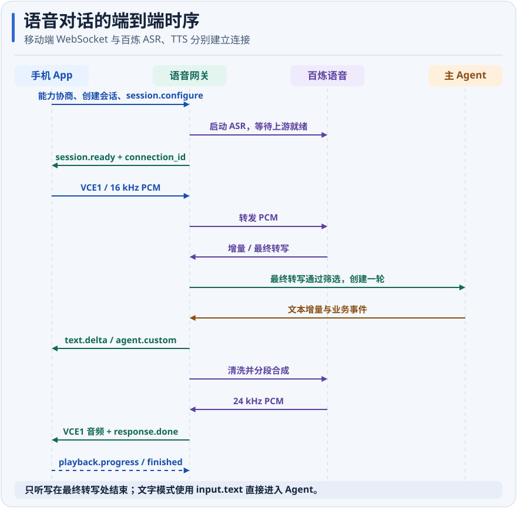
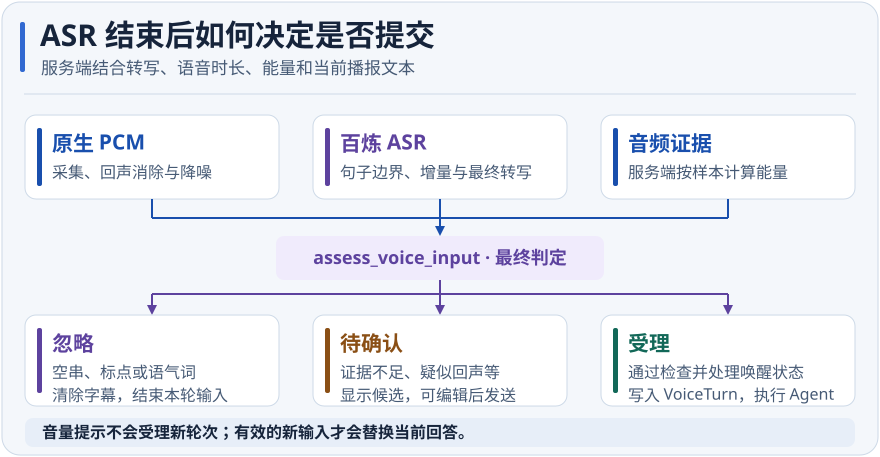
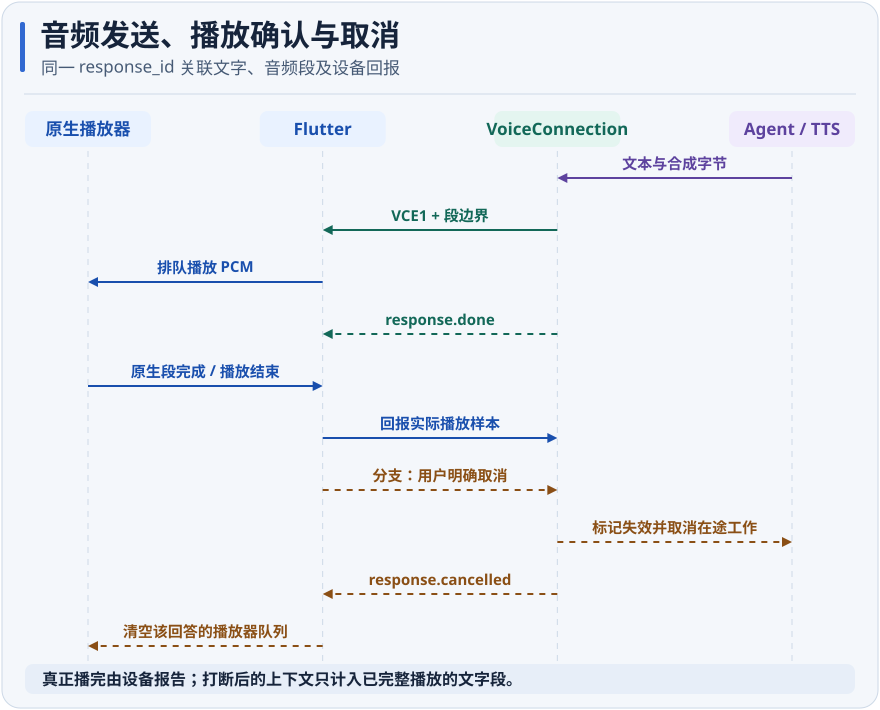
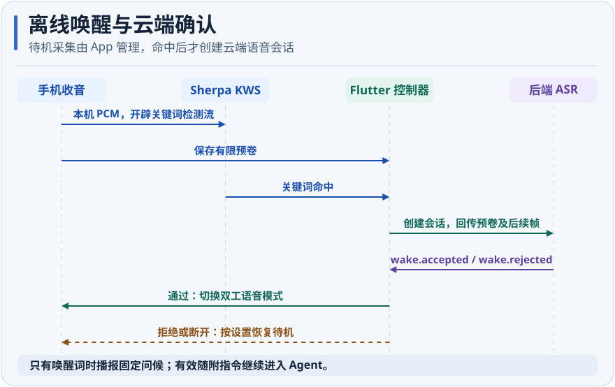

# 实时语音架构与端到端流程

一次通话包含三条并行路径。手机与语音网关交换控制事件和 PCM，网关分别接入百炼 ASR（语音识别）与 TTS（语音合成），Agent 对接所在线程与业务服务。必须区分 ASR 有结果、服务端回答完成、手机实际播完三个时间点。

## 能力协商与会话

1. Flutter 请求 `GET /voice/capabilities`，检查协议版本、输入/输出格式和 TTS 模型的音色目录，加载可选模式、唤醒、客户端能量阈值和记忆能力。
2. `POST /voice/sessions` 校验身份、用户和线程、音色及语言。每个用户最多两个未过期且状态为 `created` 或 `connected` 的会话。服务端返回 `session_id`、`thread_id` 和到期时间。WebSocket 对会话归属、过期状态、音色和进程内活动容量再次检查。
3. Flutter 发首个 `session.configure`。服务端最多等待 10 秒。需要收音时，服务端等待百炼 ASR 就绪，再回 `session.ready` 和新的 `connection_id`；Flutter 的 ready 等待预算为 12 秒。随后传输音频或文字。复用 thread 可恢复上下文，重连会创建新的语音会话和连接。
4. 后端 `VoiceConnection` 用独立任务运行 WebSocket 收发、ASR 上行/回读、输入工作者和计时器。上/下行队列容量来自配置，输入队列最多等待两项，单连接最多受理 500 个轮次；轮次工作者逐轮处理。每个回答的生成与合成任务并行，控制 JSON 和二进制 PCM 共用一个连接。

| 输入模式 | 客户端流程 | 服务端行为 |
| --- | --- | --- |
| `conversation` | 点击说话或离线唤醒，持续发送 PCM | 通常由 ASR 定界、审查最终转写并自动提交。回传字幕、文字、业务卡片和音频。 |
| `text` | 键入发送，启动纯播放模式 | 接收 `input.text`，使用同一 Agent 与 TTS；音频和 `input.commit` 返回可恢复错误。 |
| `transcription` | 点击开始录音，结束时发送 `input.commit`，把最终转写回填输入框 | 强制 `tap + manual`，只做 ASR，可返回空文本。App 随后关闭听写会话；用户发送时可复用同一线程建立文字会话。 |

源码：[语音路由](../../app/api/voice.py)、[会话和协议 schema](../../app/schemas/voice.py)、[Flutter 控制器](https://github.com/coderpwh1024/agent-voice-app/blob/069a5ca/lib/features/voice_session/voice_session_controller.dart)。

## 音频、识别和输入判定

**原生采集。** Android 以 `AudioRecord` 采集，通话模式按设备支持启用 AcousticEchoCanceler 与 NoiseSuppressor，以 `AudioTrack` 播放。iOS 由 `AVAudioEngine` 与 `AVAudioSession` 管理采集、转换、路由和播放，通话用 `.voiceChat` 与可用的 voice processing。Flutter 的 `AudioBridge` 用平台通道收 PCM 与播放回调，使用 `VoiceSocket` 在音频与 JSON 消息之间分发。

**帧契约。** App 上行 PCM16 小端、16 kHz 单声道，下行 24 kHz 单声道。VCE1 帧头 45 字节，包含魔数、类型、连接 ID、回答 ID、段序号与帧序号。上行回答 ID 为零 UUID、段序号为 0、帧序号从 0 递增，后端校验连接与顺序并限制非实时灌入。单帧负载最大 6400 字节，后端下行以不超过 4096 字节切分。帧头整数为网络字节序，PCM 样本仍为小端。控制帧的 `event_id` 作连接内防重，受理的 `input_id` 另做会话级持久去重。

**供应商协议。** 配置下发所用 Qwen Audio 3.1 ASR/TTS 模型经 `auto` 选中 `inference`。ASR 用 `run-task` / PCM / `finish-task` 以及句子事件，适配层统一成网关内部的 speech started/stopped 与转写事件。手动模式将一个任务内的句子拼成最终结果；自动模式按结束句提交。代码也支持 `realtime` 的 session/update、Base64 audio append/commit 及增量音频。切换模型时，协议、端点和对应音色目录须一起匹配。

**避免把噪音当指令。** `transcript.partial` 用于字幕。最终识别通过 `assess_voice_input` 检查文本、句子边界、20 ms 窗口能量和仍在播报的文字。空/纯语气词忽略，低能量、疑似误转写或回声走 `transcript.review`，允许用户修改后明确发送。有效最终转写通过 `submit` 建立轮次。缺少供应商边界时，无法应用完整的音频时长/能量判断，仍继续走文字检查。听写模式直接返回本次转写。

源码：[Android 音频](https://github.com/coderpwh1024/agent-voice-app/blob/069a5ca/android/app/src/main/kotlin/com/coderpwh/agent_voice_app/MainActivity.kt)、[iOS 音频](https://github.com/coderpwh1024/agent-voice-app/blob/069a5ca/ios/Runner/VoiceAudioEngine.swift)、[Flutter 音频桥](https://github.com/coderpwh1024/agent-voice-app/blob/069a5ca/lib/core/audio/audio_bridge.dart)、[推理协议](../../app/services/voice/providers/alibaba_inference.py)、[转写判定](../../app/services/voice/input_filter.py)。

## Agent、TTS、播报与插话

**并行回答。** `submit` 保存 VoiceTurn，发送 `input.accepted`，再经线程锁组装执行上下文。本机记忆和定位按轮次有独立等待预算。LangGraph 增量经 `text.delta` 即时发给 App，另送入 `SpeechText`。该组件按标点、长度和计时切段，跳过代码块、URL 和 Emoji，保留可读的链接标题；首段目标上限 24 字符，首段等待窗口 180 ms，之后 400 ms、单段上限 160 字符，完整 Markdown 或 URL 可能需要继续缓冲。这些是分段参数，不是端到端时延承诺。

**两条完成线。** 合成按回答建立 TTS 通道，发送 `audio.segment.started`、二进制帧和 `audio.segment.done`。仅当该段尚无音频且错误可重试时，最多尝试三次；已送出部分音频后失败则记录 `tts_failed`，流式文字仍可正常显示。Agent 与 TTS 都收尾后发送 `response.done`，它还携带执行和音频各自状态。原生播放器在段/回答真正播放结束时回调 Flutter，随后发 `playback.progress` 和 `playback.finished`。Android 依据 `AudioTrack.playbackHeadPosition` 计算已播放帧，iOS 依据 `.dataPlayedBack` 回调。PostgreSQL 记录已确认的播放样本。

**插话是两级判断。** 播放期间 Flutter 可用 RMS 连续高能量帧发 `input.speech_hint`。自动提示默认不暂停播放器，手动提示可暂缓播放。服务端延时约 0.8 秒发送 `playback.resume`；Flutter 对手动暂缓还有约 1 秒的本地恢复兜底。经审查的新输入受理后，才替换当前回答。主动停止发 `response.cancel`，客户端立即清播放队列；服务端标记失效、取消当前生成与 TTS、优先回 `response.cancelled`，双方丢弃迟到的无效音频和增量。下一轮上下文只补充设备确认完整播放的文字段，既有邮件或媒体任务按各自状态继续。

**定位与字幕。** Flutter 的 `VoiceHomePage` 按连接、收音、思考和播报状态展示控件，并允许编辑待确认转写。需要设备地点的文字可随输入上送定位；ASR 轮次可以复用近期位置或发 `location.request` 等待手机回传。位置权限不可用时保留明确提示，当前请求仍可按已有地名继续。

**关闭与恢复。** 服务端检测会话、JWT 到期、空闲或上游异常，关闭在途任务并保存轮次。App 在主动退出时先发 `session.close`，释放音频和 Socket，再尽力 HTTP 删除会话。后台、配置变化或视频播放切换会暂停/结束语音资源；视频播放器成功释放后，按原助手、音色和线程恢复。新连接延续线程时，按保留标识恢复历史和执行快照。

源码：[VoiceConnection](../../app/api/voice_connection.py)、[文本分段](../../app/services/voice/speech_output.py)、[已播上下文](../../app/services/agent_runner.py)、[语音仓储](../../app/repositories/voice.py)。

## 离线唤醒

1. Flutter 确认能力和麦克风权限，启动原生待机录音。随应用打包的 Sherpa ONNX KWS（关键词识别）在独立 Isolate 中处理 PCM。待机音频留在本机环形缓冲。Android 和 iOS 的常驻能力受 App 生命周期和系统麦克风规则约束。
2. 本机命中后，App 快照预卷并有限缓存握手期间的后续音频。创建 `activation=wake_word` 会话，收到 `session.ready` 后补发预卷和后续帧，再继续实时上行。确认前保留待机采集，避免切换 Android 录音链时丢失词尾。
3. 后端使用 ASR 与唤醒词前缀匹配。弱音量的特例允许确认唤醒词，随后命令仍进入复核。确认后的只唤醒轮播固定问候；带有效命令时可在问候后继续执行 Agent。App 收到 `wake.accepted` 后切到双工采播。错误、不匹配或超时走拒绝与资源清理；启用待机时可以恢复监听。

源码：[Flutter KWS](https://github.com/coderpwh1024/agent-voice-app/blob/069a5ca/lib/core/audio/wake_word_detector.dart)、[唤醒匹配](../../app/services/voice/wake_word.py)、[语音协调器](../../app/api/voice_connection.py)。

## 对照症状看链路

| 症状 | 核对点 |
| --- | --- |
| 建连后一直等待 | `session.configure` → ASR 握手 → `session.ready`，再核对模型/音色兼容和超时配置。 |
| 有字幕却未受理 | 按 `input_id` 核对 `transcript.final`、`transcript.review`、唤醒确认和音频证据。 |
| 已显示文字，首音较慢 | 按 `response_id` 看 `first_text`、TTS ready、合成分段、`first_audio`、发送、Flutter 收帧与原生入队。 |
| 显示完成但声音还在播 | 核对 `response.done` 与设备 `playback.finished` 的差距；追踪已确认样本及播放器队列。 |
| 插话误停或说话没打断 | 分别看当时的客户端音量提示、ASR 最终转写判定和 `response.cancelled` 的具体原因。 |

对应 Nacos 快照与代码缺省值见 [Nacos 配置](03-nacos.md)。已有计时口径见[回复耗时说明](../reply-timing.md)。
