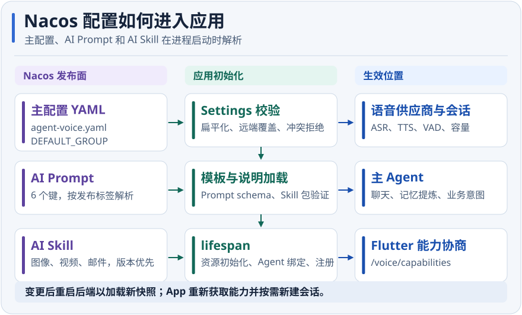

# Nacos 配置、AI Prompt 与 Skill

2026-11-25 使用 Nacos CLI 1.0.4 读取本机 Nacos 3.2.4，作用域为 `public`。普通配置是 `DEFAULT_GROUP / agent-voice.yaml`。下列远端值来自本次查询，代码缺省值用于解释快照没有定义的字段。未查询测试与生产实例。

## 三类发布资源



1. **主配置。** `NacosIntegration.load_remote_config()` 启动时读取 YAML。主 Data ID 缺内容时可尝试旧名 `agent-service-toolkit.yaml`。本次 CLI 在同分组列到主名，旧名未返回资源。远端键展开到 Settings，同一设置的新旧路径若冲突则拒绝应用。远端不能覆盖 Nacos 引导配置。标准环境启用必需存储校验。
2. **AI Prompt。** 应用按六个键与 `MEM0_PROMPT_LABEL` 查询发布模板，要求键一致、版本存在、正文有值。主配置没有覆盖 Prompt 键和标签，沿用默认 `latest`。模板不完整时，启动流程失败。即使本机 Markdown 模式绕开云端 Mem0，主 Agent 仍使用 Nacos 聊天模板。
3. **AI Skill。** 启用的 Skill 在启动期下载，显式版本优先于标签。加载器检查 ZIP 大小、路径、条目数量和 `SKILL.md` 元数据，只把说明交给受控代码。业务入口、schema、权限、幂等和持久化由项目实现。包内脚本不在服务端运行。
4. **生命周期。** 应用当前在启动时批量装配配置、模板和 Skill。变更发布后需要重启后端加载。App 重新拉取 capabilities；已有语音会话的音色在替换后失效时须重建会话。

源码：[Nacos 集成](../../app/core/nacos.py)、[Settings](../../app/core/settings.py)、[Skill 包装载](../../app/core/skills.py)、[应用生命周期](../../app/lifecycle.py)。

## 语音参数与生效位置

| Nacos 配置路径 | 本机配置或代码缺省值 | 生效位置 |
| --- | --- | --- |
| `voice.enabled` | 远端 `true` | 语音可用性、连接仓储和资源 |
| `models.dashscope.realtime.{stt_model,tts_model}` | 远端 `qwen-audio-3.1-asr-flash-streaming` / `qwen-audio-3.1-tts-flash` | 语音适配器分别建立上游 ASR/TTS |
| `models.dashscope.realtime.{stt_protocol,tts_protocol,url}` | 协议未显式覆盖，代码 `auto` 推导为 `inference`；远端设置 WSS 基址 | 自动选端点路径，也支持分别指定 WSS；远端 `proxy: null` |
| `models.dashscope.realtime.{voices_model,voices,upstream_timeout}` | 远端目录绑定当前 TTS，有 6 个音色；上游超时 30 秒 | 启动校验、capabilities、创建会话和实际合成 |
| `voice.session.{max_sessions,duration_seconds,idle_seconds,queue_size,location_timeout_seconds}` | 远端 8 / 1800 秒 / 120 秒 / 64 / 10 秒 | 进程内活动连接、会话到期、空闲回收、音频队列、本轮定位 |
| `voice.vad.{silence_ms,threshold,model}` | 远端 500 ms 与 0.2；缺省 `near_meeting_16k` | Qwen inference 的句尾静音、噪声阈值与 VAD 模型。Realtime 使用 server VAD 对应参数。 |
| `voice.vad.{client_rms_dbfs,client_frames}` | 未覆盖，缺省 −42 dBFS、3 帧 | App 播放中发出语音提示；ASR 最终提交另行判定 |
| `voice.input_filter.{min_speech_ms,min_active_ms,rms_dbfs}` | 未覆盖，缺省 120 ms / 80 ms / −55 dBFS | 后端估计有效时长、低音量复核和回声判断 |
| `voice.wake` | 未覆盖，启用“小美小美”，默认要求 ASR 确认，预卷 4000 ms，确认 10 秒，KWS score 1.5、threshold 0.25 | Flutter 本地关键词检测和后端确认 |
| `voice.audio_metrics_seconds` | 未覆盖，缺省 5 秒 | App 汇总电平、削波和音频处理能力 |
| `voice.llm.enable_thinking` | 未覆盖，缺省关闭 | 语音 Agent 生成的独立思考开关 |

`models.dashscope.realtime` 是现行集中路径，旧 `voice.realtime` 仍能映射。供应商端点、密钥和自定义问候完整值留在配置中心。

源码：[字段映射](../../app/core/nacos.py)、[语音配置推导](../../app/core/speech.py)、[模型参数应用](../../app/services/voice/providers/alibaba_inference.py)。

## AI Prompt 发布版本

通过 `nacos-cli config-get <key>.json nacos-ai-prompt` 读取发布记录，核对键、版本和模板内容。应用用 AI SDK 的 `get_prompt` 按标签解析。另以 Nacos AI 客户端接口确认 `latest` 返回相同版本。状态模板需要恰好一个 `{status}` 占位符。

| 键 | 本机版本 | 消费位置 |
| --- | --- | --- |
| `mem0-chat-system` | 1.0.1 | 主 Agent 系统角色、记忆边界与对话要求 |
| `mem0-memory-status` | 1.0.0 | 对话运行时记忆状态 |
| `mem0-memory-intent` | 1.0.1 | 识别更新、删除等显式记忆命令 |
| `mem0-memory-match` | 1.0.1 | 从已召回候选中定位目标 |
| `mem0-fact-extraction-instructions` | 1.0.1 | Mem0 候选提炼指令 |
| `mem0-fact-extraction-system` | 1.0.2 | 事实提取系统规则与结构化输出约束 |

源码：[Prompt 契约](../../app/schemas/prompts.py)、[对话系统 Prompt](../../app/agents/mem0_chat.py)、[记忆命令](../../app/agents/memory_commands.py)、[Mem0 SDK 适配](../../app/services/memory/mem0_sdk.py)。

## AI Skill 与产品开关

| Skill | 配置版本 | CLI 核对 |
| --- | --- | --- |
| `manage-user-images` | 1.0.4 | 启用、在线，`latest` 指向同版；下载的 `SKILL.md` 与仓库相同 |
| `manage-user-videos` | 1.5.2 | 启用、在线，`latest` 指向同版；下载的 `SKILL.md` 与仓库相同 |
| `send-current-user-email` | 1.1.0 | 启用、在线，`latest` 指向同版；发布包兼容字段沿用旧项目名和 YAML 版本写法，业务说明与仓库相同 |

三项 Skill 超时均配置 20 秒。图像、视频、文件上传、邮箱认证和 Langfuse 都在本机快照启用。图像配置 `qwen-image-3.0`，全局并发 4、每用户活跃任务 2、编辑轮次上限 5。SMTP 选择 SSL，定时邮件时区为 `Asia/Shanghai`。云端 Mem0 启用，召回 Top 5、阈值 0.3，可重排 20 个候选；主模型 `qwen4-max`，百炼搜索开关显式为 `false`。高德 URL 和 Key 有配置；是否能查询需要在实际部署环境验证。

本机记忆段未显式覆盖，代码默认启用，候选提炼预算 20 秒、本轮设备参考等待 3 秒。图像/视频 REST 开关与对话 Skill 开关独立，语音路径同时依赖服务和相应 Skill。

## 只读核对方式

```sh
nacos-cli profile list
nacos-cli config-list --data-id 'agent-voice*' --group DEFAULT_GROUP
nacos-cli skill-list --output json
nacos-cli skill-describe manage-user-images --output json
```

正文核对使用 `config-get`，在进程内解析并仅输出允许公开的字段。Skill 复核使用 `skill-get --version` 下载到临时目录。新版本核对时同时比较主配置、AI 发布标签和下载的说明。
