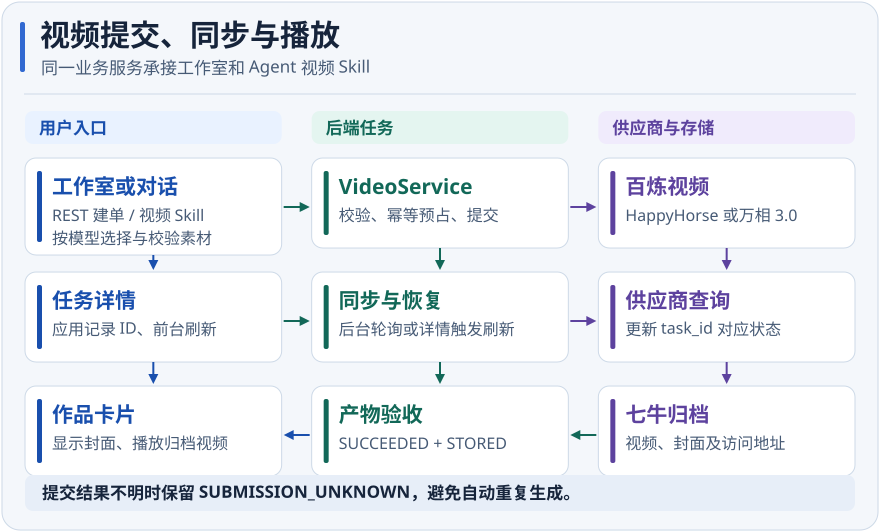
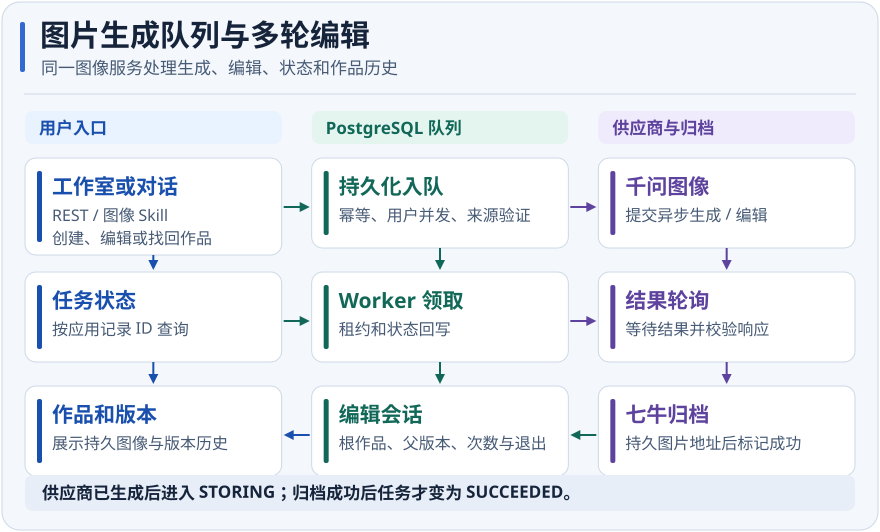
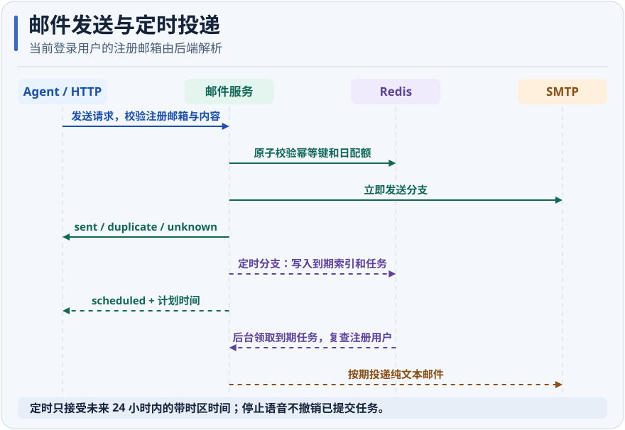

# 图像、视频与邮件业务流程

图像、视频有工作室和对话两个入口，最终进入同一领域服务。邮件在 Agent 或 HTTP 入口绑定当前已登录用户。语音回复可以确认任务已受理，产物和投递状态要由业务服务回报。

## 视频生成、编辑与播放

1. **工作室入口。** App 选择模型、图像素材、时长和模型支持的参数。文件经 `POST /files` 上传，业务提交携带 `Idempotency-Key`。生成走 `POST /videos`。工作室编辑页通过 `PATCH /videos/{record_id}` 修改标题或封面。视频内容编辑由对话 Skill 调用 `VideoService.edit`，校验归属、可用资产和模型参数。后端区分应用记录 ID 与供应商任务 ID。
2. **对话入口。** 普通对话模型先调用 `load_video_skill`。加载 Nacos 视频说明后，由模型生成结构化动作。支持创建、详情、列表/计数和符合条件的编辑。当前用户、显式意图、已有记录和当前参数由服务器校验。中断后再次连接时，以检查点中的草稿和业务记录为准。
3. **执行与恢复。** `VideoService` 按用户、幂等键和请求摘要预占 PostgreSQL 记录。只有新记录调用百炼；同键同参数回放，同键异参冲突。供应商提交回复丢失时状态为 `SUBMISSION_UNKNOWN`，服务不自动重复付费生成。后台持有工作者锁，约每 300 秒刷新一轮，详情入口也能触发单任务更新。
4. **作品回传。** 百炼成功后转存七牛视频和封面，归档完成后置 `STORED`。App 只有收到 `SUCCEEDED + STORED` 和有效归档视频地址才开放播放。语音消费 `video.task`、`video.list` 与执行事件，历史恢复读取消息元数据。视频播放前暂停或关闭语音资源，播放器释放后按原连接偏好恢复。

支持 HappyHorse 生成、万相 3.0/Prime，以及 HappyHorse 已有视频编辑。各模型的时长、分辨率、帧和音频选项以视频 schema 为准。

实现入口：[视频 REST](../../app/api/video.py)、[视频服务](../../app/services/video/service.py)、[视频 Skill 路由](../../app/services/skills/video_chat.py)、[视频字段规则](../../app/schemas/video.py)、[Flutter 视频 API](https://github.com/coderpwh1024/agent-voice-app/blob/069a5ca/lib/features/videos/data/video_api.dart)。

## 图像生成与多轮编辑

1. **入口与排队。** 工作室的 `POST /images` 或 `POST /images/{image_id}/edits` 校验参数和当前用户素材。Agent 由 `ImageVoiceSession` 识别图像创建、编辑、近期浏览、搜索或查详情，调用同一服务。创建先写 PostgreSQL 队列并返回任务，保留幂等键、来源、模型和排队状态。
2. **执行与终态。** Worker 按全局容量尝试领取，用租约协调重复领取和恢复。新任务提交千问，后续轮询供应商。提交结果不明时置 `SUBMISSION_UNKNOWN`；供应商成功后先进入 `STORING`，校验并归档到七牛，获得持久地址后才标记 `SUCCEEDED`。
3. **多轮编辑。** LOOP 记录根作品、父版本、当前版本、次数与退出动作。新一轮沿最近可用版本继续，失败版本保留历史和错误。服务在事务中校验用户和并发条件。停止和完成关闭编辑上下文，已经提交的生成任务仍按队列推进。配置快照的最大编辑次数是 5。
4. **前端回显。** 工作室按记录查询与轮询，作品及版本详情均可恢复。语音页消费结构化图像任务、列表或 LOOP 状态，按当前回答挂载卡片和刷新；资源地址来自后端业务结果。普通文本里的 Markdown 图片由独立的消息内容组件处理。

实现入口：[图像 REST](../../app/api/image.py)、[图像队列](../../app/services/image/service.py)、[队列和 LOOP 仓储](../../app/repositories/image.py)、[图像对话](../../app/services/skills/image_voice.py)、[Flutter 图像 API](https://github.com/coderpwh1024/agent-voice-app/blob/069a5ca/lib/features/images/data/image_api.dart)。

## 邮件立即发送与定时投递

1. **进入与校验。** 对话支持立即、定时、补充草稿和取消草稿，按当前消息判断指令；HTTP 入口为 `POST /skills/email/send`。后端从认证登录用户查询注册邮箱，仅接受纯文本主题和正文。定时必须带时区且落在未来 24 小时内。
2. **幂等与排期。** Redis 将用户、请求 ID 与当日配额原子校验。立即发送由当前请求调用加密 SMTP；定时发送先写 Redis 到期队列与任务，返回 `scheduled`。后台每秒查询，到期领取前重新查注册用户。计划时间和 SMTP 结果是两个状态。
3. **回执。** 成功为 `sent`，相同请求的已送达回放为 `duplicate`。投递结果不确定为 `unknown`，服务不自动再次发送。停止本轮播报不会撤销已排期或已向 SMTP 提交的邮件。登录验证码与用户邮件发送共用 SMTP 接线，验证码走独立的 Redis 限流与核销流程。

实现入口：[邮件 Agent 命令](../../app/agents/email_commands.py)、[邮件 HTTP](../../app/api/email_skill.py)、[Redis 与投递](../../app/services/skills/email.py)、[时间与内容校验](../../app/schemas/email_skill.py)、[邮箱认证](../../app/services/email_auth.py)。
