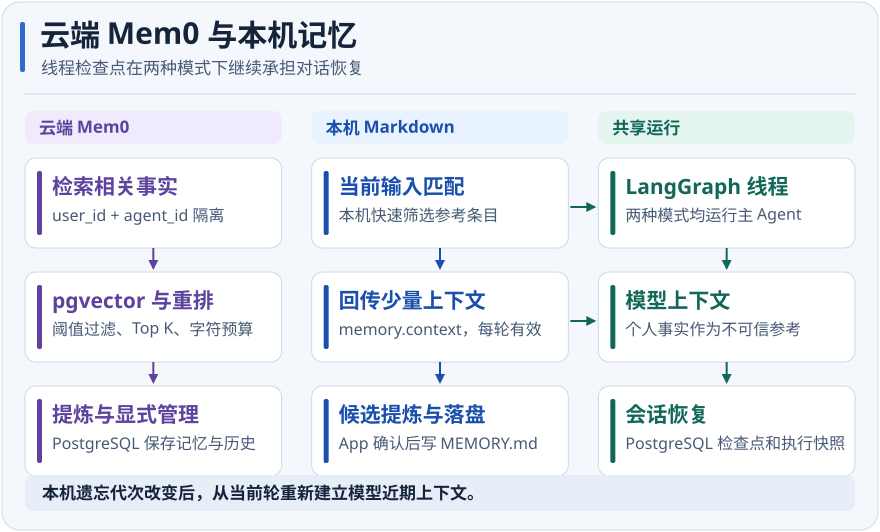

# 会话与长期记忆

三种数据服务于不同目的。LangGraph 检查点保存线程对话和待处理状态，执行快照描述本轮进度，长期记忆提供用户相关事实。Flutter 可在本机 Markdown 与云端 Mem0 两种长期记忆模式间切换。切换在新会话创建时生效。

## 会话上下文与执行恢复

- **线程历史。** HTTP、AG-UI、语音共享 LangGraph Checkpointer；`thread_id` 串联当前用户的对话与业务草稿。主 Agent 的聊天 Prompt 取最近至多 20 条消息，由运行时上下文裁剪进一步约束。
- **语音交付补充。** PostgreSQL 额外记录 VoiceTurn 的输入、回答、执行状态、音频状态、段落与设备已播样本。插话后在新一轮构建输入时补入有效的播放记录，避免假设用户听过其他段落。
- **执行快照。** Store 按用户、线程、运行序列保存步骤、作品和待确认信息。实时自定义事件和历史回查给 Flutter 提供一致的执行状态。历史展示和模型本轮读取的上下文有各自范围。

源码：[Graph 检查点装配](../../app/lifecycle.py)、[已播上下文](../../app/services/agent_runner.py)、[执行历史](../../app/services/execution.py)。

## 云端 Mem0

1. **召回。** 最新用户请求按 `user_id + agent_id` 查询 pgvector 候选。阈值筛选后，配置了独立重排则先取更大的候选集合，再取 Top K；重排失败时沿用候选原排序。字符预算约束注入量。召回失败会带状态继续普通对话。
2. **注入。** 事实内容以不可信参考加入聊天 Prompt，运行时状态单独传入。历史与记忆既不授予业务操作权限，也不能替代当前用户意图。
3. **提炼。** 普通回答后，以当前用户消息及受限对话上下文调用 Mem0。提取结果通过结构校验，PostgreSQL 保存向量事实与变更历史。`memory_status=saved` 表示写入处理完成，新增条目可能为零。媒体、地图或显式操作等路径可能提前返回，保留各自结果状态。
4. **管理。** App 的云端记忆页通过 `/memories` 查询、分页、改删和查看历史。对话中的显式修改/删除先选候选、生成预览与带时效的 `confirmation_id`。服务在校验用户、请求内容、有效期与记录版本后执行。语音发 `memory.confirm`；HTTP/SSE 传 `agent_config.memory_confirmation`。LangGraph 的业务 `approval.submit` 使用独立的 interrupt ID。

源码：[Mem0 服务](../../app/services/memory/mem0_service.py)、[SDK 构建](../../app/services/memory/mem0_sdk.py)、[对话记忆命令](../../app/agents/memory_commands.py)、[云端管理路由](../../app/api/memories.py)。

## 手机本机 Markdown

1. **选择与保管。** App 在后端支持时默认按本机设置协商 `memory_mode=local`，也能切换云端模式。手机以服务地址和用户 ID 划分账户空间，保存 `MEMORY.md`。Android 使用 no-backup 本地目录，iOS 在 Application Support 下排除备份并应用文件保护。
2. **回答前取参考。** 后端发 `memory.context.request`，App 用词项匹配挑选小量相关条目，经 `memory.context` 回传，最多 8 条、3000 Unicode 码点。后端只在本轮作用域读取，等待超时发 `memory.context.unavailable` 并用空参考继续。
3. **回答过程独立提炼。** App 收到带稳定 `turn_id` 且可提炼的 `input.accepted` 后，把待处理来源写入本机。后台请求 `POST /local-memories/extract`。服务端先过滤凭据形态和“本句别记”等明确请求，再返回结构化候选。候选证据须出现在本轮原文，目标 ID 须来自本次提供的条目。App 依据本机规则决定自动应用或要求确认，最终写回当前文件。
4. **一致性与清除。** 本机写入按账户串行，通过临时文件刷新后重命名。版本、修订和遗忘代次防止迟到请求复活已改删的事实；遗忘代次变化时，Agent 在该线程中从当前轮重新建立模型近期对话边界。历史可独立查阅。手机文件无自动云同步；本轮精选参考和提炼输入仍可能传给后端与模型。

源码：[设备记忆回传](../../app/api/voice_connection.py)、[候选提炼](../../app/services/memory/local_extraction.py)、[Flutter 本机存储](https://github.com/coderpwh1024/agent-voice-app/blob/069a5ca/lib/core/memory/local_memory_store.dart)、[本机数据与一致性说明](../local-memory.md)。
