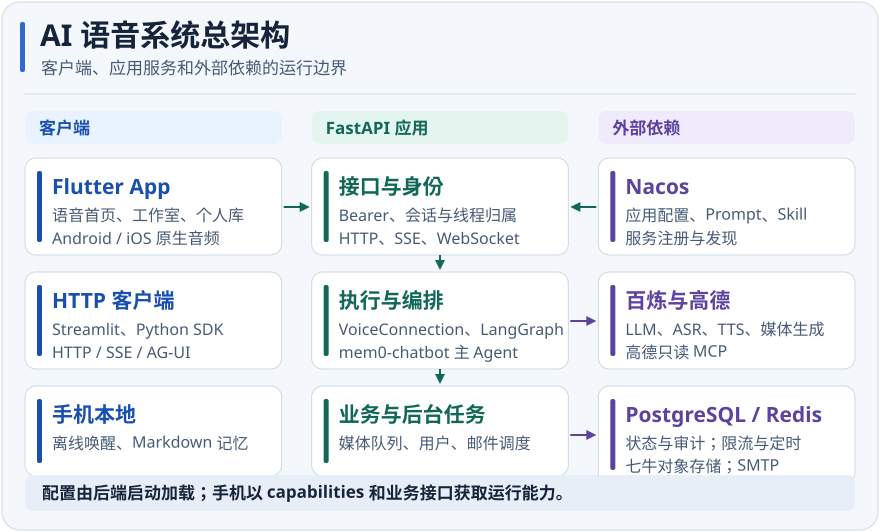
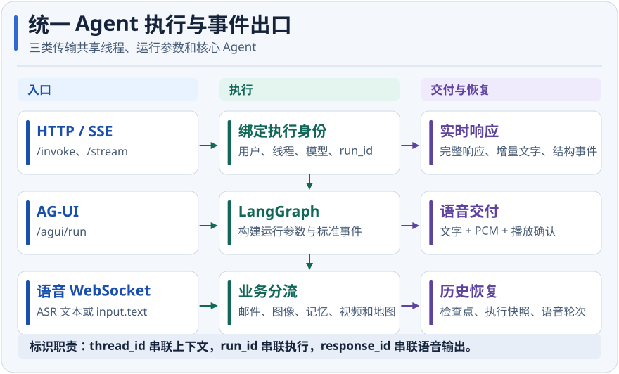

# AI 语音系统架构总览

面向 Flutter、后端和运维开发人员。先用本页定位请求入口、业务归属和数据落点，再沿[实时语音](02-realtime-voice.md)追踪音频、转写、回答和播放确认。

- [实时语音架构与端到端流程](02-realtime-voice.md)
- [Nacos 配置、AI Prompt 与 Skill](03-nacos.md)
- [图像、视频与邮件业务流程](04-media-and-email.md)
- [会话与长期记忆](05-memory.md)

本文对应后端 `8bcff3c`、Flutter App `069a5ca`，配置观察范围为 2026-11-25 本机 Nacos `public / DEFAULT_GROUP`。代码路径描述当前实现，生产部署的启用项、版本和容量由目标环境决定。

## 系统边界

**Flutter 是完整业务端。** `main.dart` 组装应用，登录态与服务地址决定后续请求。语音页用控制器维护会话、录音、播放、消息和执行进度；原生音频由 Android 和 iOS 分别实现。个人库、图像和视频工作室、记忆与对话归档通过各自的 HTTP API 访问。Streamlit 通过 Python SDK 提供开发聊天与文本流展示，Python 语音客户端还可直接消费 WebSocket 协议。

**FastAPI 统一承接身份、语音与业务入口。** 路由和 Pydantic schema 定义协议。服务层负责业务规则和供应商调用，仓储层负责持久化。应用进程依次读取 Nacos、启动 Langfuse 与 PostgreSQL Checkpointer/Store、设置主 Agent、初始化 Mem0 和业务资源，再注册 Nacos 实例。退出时关闭连接、停止后台任务和注销实例。标准启动依赖 PostgreSQL。

**数据归属按用途划分。** PostgreSQL 保存线程所有权、Graph 检查点、执行快照、语音会话/轮次、用户、媒体任务和上传记录。Redis 保存邮箱验证码及邮件的限流、幂等和定时状态。七牛保存头像、素材、图像、视频与视频封面。手机保留登录状态、本机唤醒模型和本机记忆文件。阿里云百炼承担 LLM、语音和媒体生成。高德地图、SMTP 和 Langfuse 分别承担只读地理查询、投递和观测。

实现入口：[应用启动](../../app/lifecycle.py)、[接口注册](../../app/api/routes.py)、[PostgreSQL 初始化](../../app/core/persistence.py)、[Flutter 应用装配](https://github.com/coderpwh1024/agent-voice-app/blob/069a5ca/lib/app.dart)、[Streamlit](../../streamlit_app.py)、[Python 语音客户端](../../client/voice.py)。

## 从用户输入到对话事件

1. **入口。** `/invoke` 返回完整结果，`/stream` 将增量文字与消息写入 SSE，`/agui/run` 编码为 AG-UI 的 run、消息和工具事件。Flutter 语音页的点击说话、听写后发送和键入文字共用语音 WebSocket，文字可在该连接中直接走 `input.text`。
2. **执行身份。** API 从 Bearer 取出当前用户，校验请求用户与线程归属；`build_run_input` 装配模型、消息、`thread_id`、`user_id`、检查点和本轮作用域；运行登记写入 `app_runs`。线程锁协调同一线程的并发写入。服务只注册 `mem0-chatbot`，旧请求值 `chatbot` 由 API 映射，原有历史归属和值继续兼容。
3. **业务分流。** 主 Agent 先处理邮件，再处理图像，再处理显式云端记忆命令。普通对话阶段加载相关记忆，并由聊天模型按需选择视频或地图能力。当前百炼搜索开关以配置快照为准。模型发现多个工具调用或参数无效时，代码会返回提示而不提交业务动作。
4. **响应与恢复。** SSE 与语音通过 `graph_events` 归一化增量、消息、工具与自定义事件，并过滤标记为 `skip_stream` 的内部输出。AG-UI 由专用适配器编码，`/invoke` 直接等待图执行结果。语音对文字之外另发音频、合成结果和播放控制。执行层按 `run_id` 和序号保存快照，Flutter 按 `response_id` 挂载卡片并合并历史，语音轮次另存播放确认。恢复动作不应重放文字增量或重新提交任务。

| 标识 | 作用 |
| --- | --- |
| `user_id` / `thread_id` | 定位身份和对话所有权，线程可跨语音连接复用 |
| `session_id` / `connection_id` | 定位持久语音会话与一次物理 WebSocket 连接 |
| `input_id` / `turn_id` | 输入防重与落库标识，后者可关联手机记忆来源 |
| `run_id` / `response_id` | 执行观测与语音回合交付 |
| 应用记录 ID / 供应商任务 ID | 前者供业务列表、详情与卡片定位，后者供后台供应商轮询 |

实现入口：[聊天路由](../../app/api/chats.py)、[AG-UI](../../app/api/agui.py)、[输入构建](../../app/services/chat.py)、[统一事件](../../app/services/agent_runner.py)、[主 Agent](../../app/agents/mem0_chat.py)、[执行快照](../../app/services/execution.py)。

## 支撑能力与故障定位

| 切入点 | 顺着哪里看 |
| --- | --- |
| 登录、资料与上传 | `/auth/email/code` 使用 Redis 验证码与限流，`/verify` 核销验证码、查建 PostgreSQL 用户并签发 JWT。资料走 `/users/me`，素材走 `/files` 并按用户绑定解析上传记录。 |
| 定位、天气和路线 | 本轮定位来自手机，经新鲜度判定后注入当前运行。高德接入通过 MCP 工具发现和只读操作白名单；涉及当前位置且无可用定位时，回复请用户授权定位或提供地点。 |
| 历史与执行轨迹 | `/history` 读消息，`/chat-records` 以 UTC 日期组织近 30 日内有活动的记录，`/executions` 回查执行快照。图像、视频和确认由结构化字段恢复。 |
| 延时与运维 | `/health` 返回服务状态，启用追踪时附带 Langfuse 连接结果；语音首字、首音与播放确认是不同指标。图像、视频和邮件分别有后台工作者，定位任务时优先按应用记录 ID 与错误码查询。 |

实现入口：[认证服务](../../app/services/email_auth.py)、[文件服务](../../app/services/files.py)、[定位作用域](../../app/services/location.py)、[地图编排](../../app/agents/amap_chat.py)、[对话归档](../../app/services/chat_records.py)、[健康检查](../../app/api/health.py)。

## 部署与接口边界

- `python -m app` 是 Uvicorn 入口。Compose 组织 FastAPI、Streamlit、PostgreSQL 和 Redis；Linux 部署另外提供 systemd 和 Nginx 示例。Nginx 对 API 透传 WebSocket Upgrade 并关闭响应缓冲，以支持双向语音与 SSE。
- Nginx 示例的上传上限为 8 MiB，本机 Nacos 文件服务上限为 20 MiB。若部署沿用该反向代理值，较大的素材会在到达 FastAPI 前被拦截，因此部署侧应以两层实际限额核对上传行为。
- 语音的连接容量来自当前 Python 进程的活动连接字典。线程归属、每用户活跃会话判断和持久状态在 PostgreSQL，对应多进程扩容时的不同边界。

实现入口：[Uvicorn 入口](../../app/__main__.py)、[Compose](../../compose.yaml)、[Nginx 示例](../../deploy/nginx/agent-voice-server.conf)、[语音路由](../../app/api/voice.py)。

## 本次验证范围

后端两批定向测试共 942 项通过，覆盖语音、配置、Agent、记忆、AG-UI、SSE、图像、邮件与相关管理接口。Flutter 的语音协议、语音控制器、听写、设备记忆和媒体事件定向测试 35 项通过。Nacos 本机快照已只读回查。真机录放、百炼实时通话及真实媒体生成和 SMTP 投递未在本次执行。
