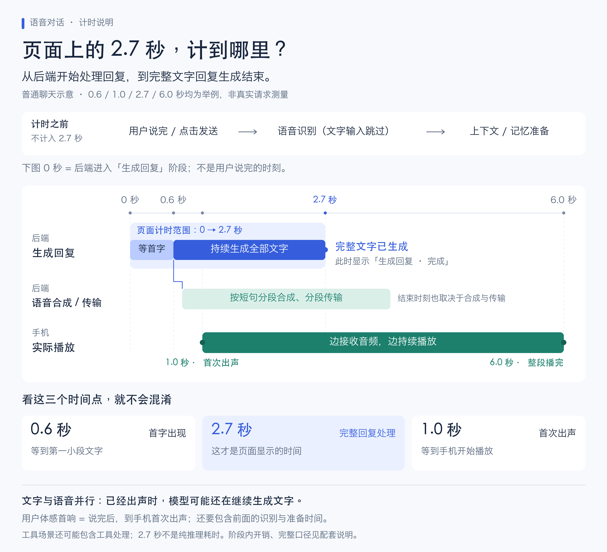

# “生成回复 · 完成 · 2.7 秒”究竟表示什么

页面上的 **2.7 秒，是后端“生成回复”阶段的处理耗时**。普通聊天中，这个阶段从开始处理回复，到取得完整的文字回复结束。语音可以在文字尚未生成完时开始播放。



[高清 PNG](diagrams/reply-timing.png) · [可缩放 SVG](diagrams/reply-timing.svg)

图中的 0.6、1.0、2.7、6.0 秒均为解释用示例，**没有关联某条真实请求的测量结果**。各条时间线共用同一个起点、按相同时间比例绘制；语音合成和传输条的起止也仅作示意。

## 先认清 0 秒在哪里

图中 0 秒位于后端进入 `chat.answer` 阶段时。语音输入的识别、本轮上下文和记忆准备发生在此之前；文字输入跳过语音识别。

因此，用户说完以后到首次听见声音的等待，还包含图中 0 秒之前的处理时间。不能用“生成回复 2.7 秒”直接表示用户体感首响。

## 四个时间各自回答什么问题

| 指标 | 起点 → 终点 | 图中示例 | 如何理解 |
| --- | --- | --- | --- |
| 首字出现 | 本图回复阶段开始 → 首段文字出现 | 0.6 秒 | 后端开始处理回复后，多久能看到第一小段文字 |
| 完整回复处理 | 本图回复阶段开始 → `answer_chat()` 完整返回 | 2.7 秒 | **页面当前显示的“生成回复”耗时** |
| 首次出声 | 本图回复阶段开始 → 手机首次实际播放声音 | 1.0 秒 | 本例中，文字还没生成完，声音已经开始播放 |
| 整段播完 | 本图回复阶段开始 → 手机播放完本轮全部声音 | 6.0 秒 | 包含后续播放时间；本例实际播放从 1.0 秒持续到 6.0 秒 |

本图首字出现的起点是“回复阶段开始”。严格的模型首 Token 耗时（TTFT）应从实际模型请求开始计算。阶段起点到真正调用模型之间还有程序处理和进度发布，因此两者可能有小幅差异。前端记录的首字到达时间又使用手机接到 `response.started` 后启动的时钟，也不与本图共享完全相同的起点。

## 为什么已经听到声音，还在“生成回复”

当前链路会把模型流式产生的文字累积为短句，逐段交给语音合成，再把音频发到手机播放。后端生成后续文字、合成音频，以及手机播放已有音频，可以同时进行。

图中 1.0 秒手机已经出声，模型仍持续生成文字，直到 2.7 秒结束。后续音频继续播放到 6.0 秒。因此，模型处理耗时、语音合成耗时、播放时长存在重叠，不能直接相加作为整轮耗时。

## 2.7 秒包括和不包括哪些环节

| 环节 | 是否计入“生成回复” |
| --- | --- |
| 收音、语音识别、前面的本机上下文请求与记忆检索 | 不计入 |
| 阶段开始进度的落库、发布，以及阶段内程序处理 | 计入 |
| 模型调用、供应商网络等待、首 Token 等待、后续全部文字生成 | 计入 |
| 在 `answer_chat()` 内执行的视频技能、参数提取及工具请求 | 工具场景计入；主图仅展示普通聊天 |
| 后续 Mem0 模式的记忆整理 | 不计入 |
| 本机模式独立请求的记忆提炼、手机 MD 落盘 | 不作为这个阶段的完成条件 |
| 全部语音合成、手机收齐音频、界面渲染与完整播报 | 不作为这个阶段的完成条件；语音可以与它并行 |

它是后端阶段的实际经过时间，不能精确等同于模型供应商内部的纯推理耗时。并行任务产生的资源竞争等也可能间接影响经过时间，当前指标不会拆分这些影响。

## 前后端如何得到这个数字

后端在主 Agent 中用两个真实调用边界记录阶段状态：

```python
await progress("chat.answer", "生成回复")
response = await answer_chat(model, prompt, config, video=video)
await progress("chat.answer", "生成回复", "succeeded")
```

`ExecutionTrace.step()` 在开始时记录单调时钟，在步骤结束时计算 `duration_ms`。开始时间先记录，再落库和发布开始事件；结束耗时在发布完成事件之前计算。

快照通过语音 WebSocket 的 `agent.custom` 事件推送，事件数据类型为 `execution.progress`。恢复时通过 `GET /{agent_id}/executions?thread_id=...` 读取同一套步骤与耗时。接口沿用用户和线程权限校验。

前端读取 `steps[].duration_ms`，除以 1000，保留一位小数：

```dart
'${(step.durationMs! / 1000).toStringAsFixed(1)} 秒'
```

例如 `2700ms` 显示为 `2.7 秒`。前端没有为这一项重新启动计时器，也没有用动画估算耗时；保留一位小数意味着显示结果经过舍入。

## 三种“完成”要分别理解

1. **生成回复步骤完成**：`answer_chat()` 已正常返回。返回的也可能是业务错误说明，不保证业务操作成功。
2. **服务端响应结束**：语音路径等待 Agent 执行和语音合成任务结束后发送 `response.done`。客户端收到时，仍可能有尚未播完的音频。
3. **手机播放结束**：手机完成实际播报，并按现有语音协议反馈播放进度和结束事件。

整次执行还可能处于等待补充、等待确认、失败或待核实状态。视频任务的后台生成也有自己的业务状态；“提交视频任务完成”不等于成片已经生成。

视频技能等子步骤发生在“生成回复”内部时，它们的耗时已经包含在父步骤中，也不能再与父步骤相加。

## 源码定位

- 后端阶段边界：`app/agents/mem0_chat.py` 的 `_mem0_chat()`。
- 后端时钟与快照：`app/services/execution.py` 的 `ExecutionTrace.step()`、`publish()`、`finish()`。
- 模型首输出与完整调用日志：`app/core/model_metrics.py`。
- 语音并发与响应结束：`app/api/voice_connection.py` 的 `generate()`、`speak()`、`execute()`。
- 执行恢复查询：`app/api/chats.py` 的 `executions()`。
- 前端显示：相邻 `agent-voice-app` 仓库中的 `lib/features/execution/execution_progress.dart`。
- 前端快照解析与语音首字、音频到达计时：`lib/core/api/execution_models.dart`、`lib/features/voice_session/voice_session_controller.dart`。

本文按当前代码边界解释计时，没有修改运行时行为，也没有用示例时间替代真实链路性能测量。
