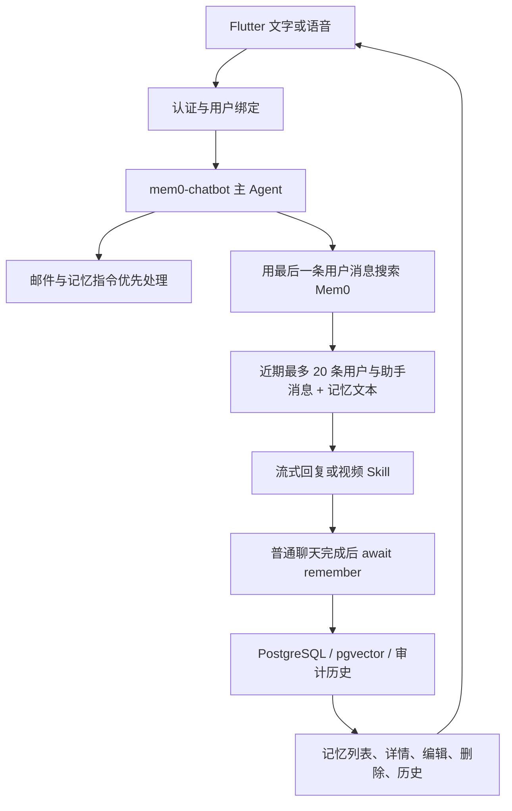
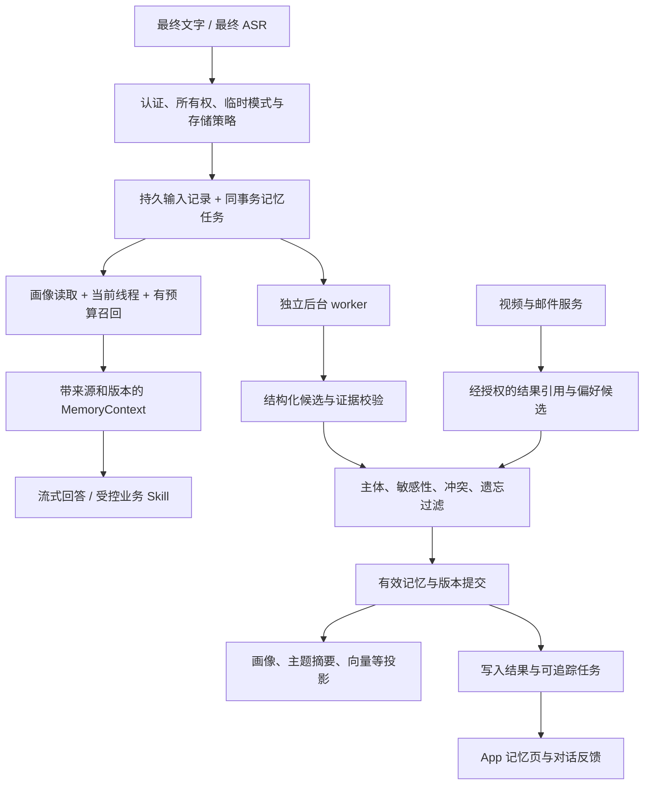

# 个人语音智能体记忆方案深度调研与项目设计建议

调研日期：2026-11-11。研究对象：`agent-voice-server` 与相邻的 Flutter 项目 `agent-voice-app`。

后续实现已根据用户进一步确认采用“手机端 MD 为权威正文、按需提供参考、服务端返回候选”的路线，详见[当前实现说明](../local-memory.md)。本文保留调研时的比较与初始推荐，实施参数及功能边界以当前实现说明和代码为准。

## 1. 决策结论

**建议把第一方案改为由本项目控制的分层记忆系统：PostgreSQL 作为事实来源，核心画像直接读取，事件与历史按需检索，后台整理生成可追溯的主题记忆。Mem0 保留为第二方案和迁移期间的对照基线。**

第一方案不以替换一个 `add/search` SDK 为终点，而是形成下面的产品闭环：

1. 用户说过的重要信息，有可靠来源与写入回执。
2. 不需要用户重复询问，就能应用称呼、回答风格等核心偏好。
3. 能接续人物、事情和项目，并区分过去与现在。
4. 找不到提炼后的事实时，仍可在授权范围内搜索历史原文。
5. 用户能看见它记了什么、为什么用它、如何纠正，以及遗忘是否完成。

技术选择分成三项，避免把产品架构与第三方引擎混为一谈：

| 决策 | 建议 | 原因 |
| --- | --- | --- |
| 第一方案的架构 | 自有分层记忆，复用 LangGraph、Pydantic、PostgreSQL、pgvector | 符合现有部署、安全、语音和管理界面；可以精确定义纠正与遗忘 |
| 第一方案的实现 | 首期复用现有模型调用和数据库能力；LangMem 的结构化提炼组件通过验证后按需采用 | 不因框架替换再引入一套 Agent 运行时；不必新增生产依赖才能开始 |
| 第一方案的外部引擎候选 | **优先验证 Hindsight**；用相同数据与自有实现对照 | PostgreSQL 路线、事件上下文与多路召回具有适配潜力，但中文效果、成本、删除语义仍需实测 |
| 第二方案 | Mem0 2.2.1 适配器 | 复用现有投入，保留可切换能力；不再独占画像、写入政策或用户可见的数据模型 |

这是一项基于代码与公开证据的设计推荐，**不是已完成效果实验后的胜出结果**。本次没有读取真实用户记忆、线上配置或 `.env`，没有调用付费模型，也没有改造业务代码。实施前应按第 11 节建立基线，验证关键假设。

## 2. 调研方法、产品识别与证据边界

### 2.1 本次如何核实

资料优先级：官方源代码及对应版本 > 官方技术文档 > 官方产品与隐私说明 > 其他资料。搜索用于发现线索，核心判断回到第一方资料；不采用第三方榜单、社区体验或厂商宣传分数证明本项目的效果。

本文使用以下区分：

- **代码事实**：能够从本地实现、测试或开源源码直接核实。
- **官方披露**：厂商公开说明，未由本次独立复现实验验证。
- **设计推导**：结合项目需求提出的取舍，不表示竞品内部就是这样实现。
- **待验证**：公开材料不足，或必须用本项目数据测量。

后端基线提交：`201d9517a7e149c922aaaf4507112922d2d2d28a`。
前端基线提交：`38d0ff877897ce1e71ee7d7ccaba144a4357cbf3`。
联网资料按调研日读取；除 Mem0 使用固定 `v2.2.1` 源码链接外，外部 `main` 和官网页面会变化，实施时应再次固定版本与 commit。

### 2.2 三个重点产品的识别

| 用户提供名称 | 本文采用的对象 | 识别边界 |
| --- | --- | --- |
| Hermes Agent | Nous Research 的开源 Hermes Agent | 官方文档域名为 `hermes-agent.nousresearch.com`，源码组织为 `NousResearch` |
| TodayAI | `today.ai` 的 Today 个人助理 | 存在其他同名服务；本文按该官网研究，尚未取得用户提供的具体链接 |
| Muse | Meta 的个人 AI Agent，`muse.ai` | 不是 `use-muse.com` 的同名桌面助手，也不是名为 MUSE 的研究框架；对象仍待用户链接最终确认 |

Muse 的上述识别由 [Meta 发布说明](https://about.fb.com/news/2026/09/introducing-muse-personal-ai-agent/) 与 [Muse 官方安全页面](https://muse.ai/security-and-privacy)交叉确认。同名的 [use-muse.com](https://www.use-muse.com/) 也宣传记忆能力，但不能把它的删除、录音或存储能力归给 Meta Muse。

### 2.3 覆盖范围与缺口

重点研究 Hermes、Today、Muse，横向核对 Mem0、LangMem、Letta、Hindsight、Zep/Graphiti、Honcho、Supermemory、OpenClaw、OpenViking、EverMemOS/EverOS。它们分别代表可见记忆文件、用户画像、情景记忆、时间关系、后台整理与托管记忆服务等路线。

未登录体验 Today/Muse，未检查其私有代码，未测量真实线上延迟与计费。因此，无法从公开产品说明确认它们使用哪一家向量库、是否用了 Mem0、具体合并提示词、检索权重或准确率。全文不把这些未知项补写成“实现方案”。

## 3. 当前前后端实现审计

### 3.1 现有链路



图中回复后的记忆整理属于同一次 Agent 执行，不等于首个文本 token 必须等待写入：模型已经可以流式输出，但本轮最终完成仍受写入耗时影响。

### 3.2 后端已经做对的部分

| 位置 | 已核实的行为 | 设计意义 |
| --- | --- | --- |
| [主 Agent](../../app/agents/mem0_chat.py) | 强制 `user_id/thread_id`，保留检查点与记忆对话状态 | 长期记忆与线程历史不是同一种存储 |
| [聊天提示词构造](../../app/agents/mem0_chat.py) | 记忆以 `untrusted_user_memories` 数据块进入上下文 | 不把用户记忆提升为系统授权 |
| [Mem0Service](../../app/services/memory/mem0_service.py) | 按 `user_id + agent_id` 过滤，超时、容量上限、可选重排及降级 | 不是无用户隔离的 SDK 演示接线 |
| [SDK 适配](../../app/services/memory/mem0_sdk.py) | 使用 PostgreSQL 历史，校验提炼 JSON，关闭 Mem0 telemetry；检查向量维度 | 避免默认 SQLite 构造与无效输出被当作成功 |
| [审计仓储](../../app/repositories/mem0_history.py) | PostgreSQL 历史与短期提炼参考，用户级 advisory lock | 已处理跨进程串行与管理操作审计 |
| [对话管理](../../app/agents/memory_commands.py) | 选择候选、预览、过期确认、批量目标及变更冲突处理 | 已具备适合语音的安全操作基础 |
| [管理 API](../../app/api/memories.py) | 查询、分页、修改、删除、清空及历史；当前用户绑定 | 更换引擎应保留这层产品能力 |
| [历史对话](../../app/services/chat_records.py) | 从 LangGraph 检查点构建最近 30 天的 UTC 日期视图 | 有历史数据基础；30 天是该视图口径，不能推断底层只保存 30 天 |

运行时聊天、提炼、意图与匹配提示词从 Nacos 加载；本地 [schema](../../app/schemas/prompts.py) 能说明字段与验证，但不能证明生产提示词内容优劣。本次未读取 Nacos 配置，因此不把“线上提示词写错”作为结论。

### 3.3 Mem0 2.2.1 的实际能力，不能套用旧版印象

[依赖声明](../../pyproject.toml) 与锁文件固定 `mem0ai==2.2.1`。同时检查了本地已安装 SDK，重点结论如下：

1. `Memory._search_vector_store()` 不只有向量相似度，还调用关键词查询和实体辅助评分。`_entity_store = None` 是惰性初始化状态，不能解释为关闭实体能力。
2. 最终候选以语义候选集构造；关键词与实体分数参与排序。这与“词法结果作为独立候选来源做并集融合”存在区别。
3. PostgreSQL `keyword_search()` 使用 `to_tsvector('simple', ...)` 与 `ts_rank_cd`。函数名与周边代码使用 BM25 术语，不代表这条 SQL 本身实现了严格 BM25。
4. 默认提炼走 additive pipeline；出现“我搬家了”不能据此假定旧地址一定已自动失效。产品要定义显式纠正与时间有效性。

外部交叉依据：[Mem0 v2.2.1 主实现](https://github.com/mem0ai/mem0/blob/v2.2.1/mem0/memory/main.py)、[同版本 pgvector 适配](https://github.com/mem0ai/mem0/blob/v2.2.1/mem0/vector_stores/pgvector.py)。当前官方概念文档还明确区分 Platform 和 OSS 的检索能力，不能把托管版图记忆等能力归给本地部署。[官方说明](https://github.com/mem0ai/mem0/blob/main/docs/core-concepts/how-it-works.mdx)

此外，已安装 SDK 的词形还原和可选 spaCy NER 路径以英文模型为中心；这提示中文、昵称、中文无空格短句需要专门评测，**不等于已经证明所有中文实体都无法抽取**。[同版本词形还原](https://github.com/mem0ai/mem0/blob/v2.2.1/mem0/utils/lemmatization.py)、[spaCy 模型加载](https://github.com/mem0ai/mem0/blob/v2.2.1/mem0/utils/spacy_models.py)

### 3.4 效果不足的具体风险与可检验假设

以下是代码能够解释的潜在失败路径；没有真实失败样本和线上追踪时，不把它们全部写成已经发生的根因。

| 风险 | 代码证据 | 可能的用户体感 | 如何验证 |
| --- | --- | --- | --- |
| 查询缺少上下文 | `_retrieve_facts()` 只传最后一句用户文本 | “他后来怎么样”“按老习惯”无法定位对象 | 对比原始查询与带近期实体的查询 |
| 核心偏好依赖检索命中 | 没有独立画像必读层 | 问技术问题时没有应用称呼、简洁风格 | 询问与偏好无词面关联的问题 |
| 证据在模型边界丢失 | `search()` 返回 `list[str]`，不携带 ID、来源、有效期 | 无法解释为什么这么回答，旧值与新值难区分 | 追踪候选到 prompt 的字段保留率 |
| 长期记忆主要是事实文本 | `MemoryRecord` 无一等的事件、主题、有效区间字段 | 记得零碎偏好，接不上整件事情 | 跨线程询问事情经过、决定和原因 |
| 历史不能作为普通聊天召回后备 | 查到检查点不等于主 Agent 有历史检索工具 | 没提炼出来的信息像从没聊过 | 在第 21 条以外放证据，检查能否回查 |
| 写入绑定回答成功 | `answer_chat()` 成功后才 `remember()` | 模型失败或部分取消时，明确说过的信息可能未提炼 | 模型失败/取消/重连的输入回放 |
| 业务分支提前返回 | 邮件、记忆命令以及带 `video_status` 的回复可提前结束 | 视频偏好、项目决定未进入统一记忆整理 | 对比普通聊天与视频流程相同偏好 |
| 写入结果不够细 | `remember()` 返回 `None`；零条结果也可标记 `saved` | 不知道“记住了什么”，误以为已经新增 | 空提炼、重复事实、实际 ADD 三种对照 |
| 队列串行影响交互 | lifespan 创建单 worker，默认最多 8 个 pending | 某个慢写入使后续读取也等待 | 并发用户读写压测，不以单轮耗时推断 |
| 纠正后仍缺统一时间模型 | 有显式更新和历史，但没有业务有效期契约 | “现在住哪里”混入旧信息 | 过去、现在、计划、取消的同字段测试 |

`hnsw=False` 是现有配置事实，但不意味着小规模数据检索必然慢，也不证明召回错误来自索引；没有代表性数据与执行计划，不建议先开 HNSW“治效果”。

### 3.5 前端现状与真正缺少的交互

已检查 [记忆页](../../../agent-voice-app/lib/features/memories/memories_page.dart)、[详情与编辑](../../../agent-voice-app/lib/features/memories/memory_detail_page.dart)、[分页控制](../../../agent-voice-app/lib/features/memories/memory_feed.dart)、[API 模型](../../../agent-voice-app/lib/core/api/memory_models.dart)、[API 调用](../../../agent-voice-app/lib/core/api/api_client.dart)、[语音控制器](../../../agent-voice-app/lib/features/voice_session/voice_session_controller.dart)和相关测试。

- 已有列表、分页、刷新、编辑、删除、清空、变更历史和写入结果不确定时的复查提示。
- `memory_status=saved` 当前显示“记忆处理完成”，没有错误地把它直接渲染为“新增成功”；新方案应保持这一区分。
- 详情在存在 `source_thread_id` 时显示“来源：聊天中提炼的记忆”，但没有精确消息定位和原文证据跳转。
- 列表统一归为“关于你”，缺少人物、事情、当前项目、待确认、已失效等视角。
- 语音确认已发送 `memory.confirm`，并检查确认 ID 和过期状态；不能另做一套无关联的确认按钮。
- 当前没有统一的“本次用了哪些记忆”“刚记住的内容”“停止自动记忆”“此话题以后别再提取”闭环。

前端使用暖白、墨黑、低饱和橄榄色的编辑式视觉；建议沿用 [前端 AGENTS.md](../../../agent-voice-app/AGENTS.md) 的主题、排版和 48×48 操作热区。初期无需用复杂关系图替代可读的列表和主题页。

## 4. 三个重点产品的实现与启示

### 4.1 Hermes Agent：小核心、历史原文、独立扩展

**代码/官方文档可证实的结构**：`MEMORY.md` 保存常用事实与经验，`USER.md` 保存用户偏好和画像；默认容量分别是 2,200 与 1,375 字符。会话开始时生成固定快照，模型用受控记忆工具维护内容；超限需要整理，不能无限堆积。这种快照有前缀缓存优势，但本会话内写入不会自动改写既有系统快照。[持久记忆文档](https://hermes-agent.nousresearch.com/docs/user-guide/features/memory)

历史回忆是另一条路径：SQLite FTS5 搜索真实消息，并可围绕命中消息展开上下文；不是仅对摘要再摘要。源码还处理会话 lineage 与 profile 边界。因此它的“记住过去”不要求每条信息预先升级成核心记忆。[session_search 源码](https://github.com/NousResearch/hermes-agent/blob/main/tools/session_search_tool.py)

写入工具提供内容扫描、匹配检查、容量控制与原子批次等约束；这比要求模型“自觉别乱记”更可执行。[记忆工具](https://github.com/NousResearch/hermes-agent/blob/main/tools/memory_tool.py)、[存储实现](https://github.com/NousResearch/hermes-agent/blob/main/tools/memory_tool_store.py)

外部 provider 是可插拔扩展：文档披露了逐轮预取、响应后同步、受支持的会话结束提炼和内置写入镜像。内置核心层与外部长期检索可并存。[provider 文档](https://hermes-agent.nousresearch.com/docs/user-guide/features/memory-providers)

**对本项目的设计推导**：

- 应借鉴核心信息确定性读取与历史检索分离，而不是复制两个全局文件。
- 多用户后端继续用 PostgreSQL；不能把一个 `~/.hermes` 目录当成全体用户共享记忆。
- 不照搬会话开始后永远冻结的画像：手机用户可能长期沿用线程，编辑后应通过 `profile_revision` 使下一轮读到新值。
- 用户偏好仍以不可信参考进入模型，不因为竞品把文件注入系统 prompt 就提高本项目数据的信任等级。
- 文件可以是导出与阅读形式，不必是唯一事实来源。事务、权限、并发、审计由服务控制。

### 4.2 TodayAI：围绕生活对象持续组织

**官方产品披露**：Today 把记忆与人物、日程、偏好、项目和目标连接起来，中文介绍称其为个人知识图谱，提供版本、编辑和遗忘能力。能力页更谨慎地说明：并非所有输入永久保存，管理能力与可用性依产品体验而异。[中文产品页](https://today.ai/articles/zh-Hans)、[能力说明](https://today.ai/articles/capabilities)

首页以人物、旅行计划、学习、设计项目等对象展示记忆，并将其连接到后续行动；这是产品组织方式的证据，不能反推数据库 schema。[Today 官网](https://today.ai/)

关于存储，应特别区分宣传与数据处理：中文页有本地优先表述，而隐私政策明确包含账户历史、云端与第三方 AI 处理。**因此无法得出“所有记忆仅存在设备、不上传服务器”的结论。**[隐私政策，第 1C 节](https://today.ai/privacy)

**对本项目的设计推导**：

- 把“扁平的关于你列表”推进为“关于你 + 人与事 + 正在进行的主题”。
- 一个主题页聚合当前状态、关键决定、尚未完成事项与来源，不要求用户重讲整个故事。
- 本项目当前没有通用日历、健康连接器或主动任务系统；不能借研究记忆之名默认加入全天监控、健康画像与自动提醒。
- 优先做好被动聊天中的持续理解；主动建议作为后续独立能力，以用户订阅、触发条件和通知权限为前提。

**未公开/待验证**：图谱实现、实体消歧方法、提炼模型、后台整理调度与准确率，没有在本次查到的官方资料中充分披露。不能声称 Today 使用某种 GraphRAG、Mem0 或具体图数据库。

### 4.3 Muse：可检查的持久工作空间与独立权限边界

**官方披露**：Muse 为用户提供隔离的云端 VM，客户端连接该环境；用户文件与生成内容保存在其中，数据与凭据具有隔离设计。这是持久工作空间的架构，不代表模型参数本身记住了用户。[安全技术文章](https://muse.ai/blog/security-and-safety-for-ai-agents-our-approach-with-muse)

记忆能够通过对话或 `MEMORY.md` 等文件检查、修改和删除。遗忘入口会在记忆与支持文件中搜索有关主题并尽力清理；官方使用的表述并不是对所有备份及衍生数据的即时彻底删除保证。[记忆与遗忘说明](https://muse.ai/security-and-privacy)

同一官方材料也说明，外部行动由独立 Sentinel 控制，Agent 不能仅凭自己生成的计划授予自己权限。本文关注的是这一分离原则，不把 Sentinel 当成已公开可移植的独立记忆框架。[Meta 研究说明](https://research.meta.ai/blog/security-and-safety-for-ai-agents-our-approach-with-muse)

**对本项目的设计推导**：

- “我为什么记住这个”应能看到来源，“忘掉这件事”应有可追踪的执行状态。
- 持久化的项目状态、事实记录、聊天记录和工具执行结果应互相可定位，但各自保有事实来源。
- 邮件与视频继续由现有业务服务决定授权、目标、参数与幂等。记忆可以提供偏好，不能自动恢复一次旧授权。
- 不需要为每个用户开 VM 才能得到这些收益；本项目第一步仍采用 PostgreSQL 用户隔离。

**未公开/待验证**：核心与归档记忆的全部目录结构、实际检索算法、精确提炼频率。本文不采用泄露提示词或第三方“逆向发现”补全这些细节。

### 4.4 共同启示与不能照搬的部分

| 观察 | 可以借鉴 | 本项目调整 |
| --- | --- | --- |
| 核心内容与大量资料分开 | 常用画像不靠一次偶然搜索 | 有预算的数据库画像投影 |
| 记忆能被看见和编辑 | 用户能纠错 | 保留 App 管理能力，补来源和状态 |
| 持续围绕人、事和项目积累 | 当前状态有归属 | 轻量主题与实体关系，不先建庞大全域图谱 |
| 后台整理 | 避免每轮承担全部提炼与压缩 | 耐久任务与短事务，不能只 `create_task()` |
| 授权与记忆分开 | 历史不是新许可 | 继续复用认证、Skill 加载、确认和所有权校验 |
| 文件可读 | 可携带、可导出 | Markdown 作为受控导出，数据库仍是事实来源 |

这些启示是产品和工程设计的综合推导，不意味着三个产品内部采用同一种架构。

## 5. 市场技术路线与选型

### 5.1 横向比较

下表“适配判断”为本项目的工程判断；“优势”只描述公开能力，不表示本次已测得效果领先。

| 方案 | 公开的核心方式 | 可借鉴的优势 | 本项目主要代价或边界 | 建议 |
| --- | --- | --- | --- | --- |
| Hermes | 有界核心文件 + 历史消息搜索 + provider | 直接可读、核心确定性加载、原文后备 | 面向个人运行环境；本地文件/SQLite 不能原样进入多用户服务 | 借鉴分层与工具约束 |
| Today | 生活对象与持续记忆的产品体验 | 人物、目标、项目的可理解组织 | 私有实现；没有足够算法证据 | 借鉴前端与主题模型 |
| Muse | 持久工作空间、可查看记忆、独立行动权限 | 可检查、可纠正、行动边界清楚 | 私有实现与专用基础设施 | 借鉴可控性 |
| Mem0 OSS | 提炼事实、作用域过滤、搜索和管理 | 当前已接入，替换成本低 | 不能代替本项目时间、来源、画像与遗忘政策 | **第二方案** |
| LangMem | 结构化画像/集合、在线与后台更新 | 与 LangGraph 思路接近，组件可选 | 不包办耐久调度、API、审核与隐私产品 | 第一方案的可选组件 |
| Letta | 当前 MemFS、分层文件与 dreaming | 可版本化的核心与深层资料 | 整体运行时迁移会扩大范围；不能只按旧 MemGPT 印象判断 | 借鉴层级与整理，不迁移主 Agent |
| Hindsight | retain/recall/reflect，多路检索和综合视图 | 情景叙事、时间、实体和来源，PostgreSQL 路线 | 额外服务/模型成本；中文与删除传播需测 | **外部引擎优先 PoC** |
| Zep / Graphiti | 时间化实体关系与源 episode | 状态变化和关系检索有明确模型 | 图服务运维、提炼调用与授权封装成本 | 人物关系成为核心需求时再验证 |
| Honcho | 以 peer 为中心，后台形成表示，按需推理 | 理解人与偏好变化，有证据追溯思路 | 推断不是用户自述；查询推理延迟与成本 | 陪伴/个性化深度升级时验证 |
| Supermemory | 静态与动态用户画像 + 搜索 | 画像与查询召回分开、接入方便 | 托管路径的数据边界、版本与计费需核实 | 可用于对照，不作为当前默认 |
| OpenClaw | 核心、情景、未来意图等分层，整理与召回 | 写入晋升、历史与核心分离 | 整体个人 Agent 平台；权限模型不等同本项目 | 借鉴门控与生命周期 |
| OpenViking | 分层上下文、记忆/资源/Skill 统一索引 | 摘要导航与按需加载 | 当前检索需按版本核实；不自动等于多用户记忆产品 | 资源与 Skill 规模扩大后考虑 |
| EverMemOS / EverOS | 论文的情景组织；当前仓库另有本地 Markdown 运行时 | 事件到主题的整理、用户与 Agent 记忆分轨 | 论文、旧版和当前仓库不能混用；当前本地存储路线不直接适配 | 借鉴事件/主题，暂不直接引入 |

### 5.2 关键框架的证据核对

**LangMem**：官方区分事实集合、结构化画像、情景与程序性记忆，并提供在线、后台两种形成方式。适合借用提炼与合并组件；“用了 LangMem”不代表已经解决任务恢复与删除传播。本项目也不应开放模型自动改写系统安全规则。[核心概念](https://langchain-ai.github.io/langmem/concepts/conceptual_guide/)、[官方 SDK 介绍](https://www.langchain.com/blog/langmem-sdk-launch)

**Letta**：当前官方文档已明确采用 Git 支持的 MemFS。根层文件与按需加载的深层目录、对话历史搜索、dreaming 各有边界；默认 MemFS 也不自带向量索引。不能把旧版“core blocks + archival vector store”的说明不加版本地视作当前全部实现。[MemFS](https://docs.letta.com/concepts/memfs)、[Memory & dreaming](https://docs.letta.com/configuration/memory)

**Hindsight**：`retain` 强调保留事实上下文，`recall` 并行使用语义、关键词、实体关系和时间路径，再融合和重排；`reflect` 是额外的推理循环，不能把它当成低成本检索。普通语音回复应优先短预算 recall，不默认逐轮 reflect。[retain](https://hindsight.vectorize.io/developer/retain)、[recall](https://hindsight.vectorize.io/developer/retrieval)、[reflect](https://hindsight.vectorize.io/developer/reflect)

其官方存储文档支持 PostgreSQL，并说明未配置外部数据库时存在嵌入式开发模式。本项目如采用，应显式配置受管 PostgreSQL 与独立资源配额；“同用 PostgreSQL”不等于可以混用内部表或共享默认连接池。[存储文档](https://hindsight.vectorize.io/developer/storage)、[开源仓库](https://github.com/vectorize-io/hindsight)

**Zep / Graphiti**：图谱关联源 episode，关系可表达事实生效与失效时间，检索结合多种路径。需要区分开源 Graphiti 与托管 Zep；Graphiti 参考服务明确不具备完整认证授权，`group_id` 不能代替后端用户校验。[平台说明](https://www.getzep.com/platform/graphiti/)、[图概念](https://help.getzep.com/v4/graph-overview)、[开源仓库及参考服务限制](https://github.com/getzep/graphiti)

**Honcho**：官方架构是 workspace、peer、session、message，后台推导丰富的 peer 表示；查询可探索结论及支持消息。适合研究长期个性化，但推断出的特质不能默认成为永久事实，尤其不能成为邮件或视频操作权限。[官方架构源码](https://github.com/plastic-labs/honcho/blob/main/docs/v3/documentation/core-concepts/architecture.mdx)

**Supermemory**：用户画像明确区分稳定信息与动态近况；当前文档还说明写入后画像可能尚未更新。值得借鉴的是“画像独立读取 + 搜索补充”，同时要为异步投影设计生效状态。[用户画像文档](https://supermemory.ai/docs/recall/user-profiles)

**OpenClaw**：官方分层架构把指令、核心、情景、未来意图与整理报告区分开，并限制情景材料晋升核心的路径。这支持本项目把“聊天说过”与“始终影响回答”分开。[记忆架构](https://docs.openclaw.ai/concepts/memory-architecture)、[记忆概念源码](https://github.com/openclaw/openclaw/blob/main/docs/concepts/memory.md)

**OpenViking**：L0/L1/L2 是摘要、概览、细节的上下文表达；当前概念文档强调目录级摘要。当前检索文档明确为全局向量搜索与可选重排，不能继续引用旧介绍声称一定递归搜索目录树。[层级文档](https://github.com/volcengine/OpenViking/blob/main/docs/en/concepts/03-context-layers.md)、[检索文档](https://github.com/volcengine/OpenViking/blob/main/docs/en/concepts/07-retrieval.md)

**EverMemOS / EverOS**：论文讨论 MemCell、MemScene 与重构式回忆，但调研日原仓库地址已跳转到 EverOS，当前 README 描述 Markdown、SQLite、LanceDB 的本地运行时及后台演进。不能把论文指标、旧版服务依赖与当前安装方式拼成同一个版本。[原始论文](https://arxiv.org/abs/2601.02163)、[当前仓库](https://github.com/EverMind-AI/EverOS)

### 5.3 为什么不直接更换为图数据库或另一家托管 API

当前最明确的缺口是信息组织、证据传递、时间状态、写入回执与前端可控性。图数据库能帮助多跳关系查询，但不能自动判断“他”指谁、用户是否同意长期保存、删除后能否重提炼，也不能保证语音首响。

因此首期排序为：**核心画像 + 原文后备 + 纠正/遗忘 + 写入闭环 > 独立图引擎 > 全量程序性自学习**。如果评测证明人物关系问题占主要失败比例，再引入 Graphiti 或 Hindsight 图路径，避免为尚未出现的规模支付长期维护成本。

## 6. 第一方案：项目控制的分层记忆

本节全部为建议设计，不表示仓库已实现。它借鉴竞品的分层与可见性，保留本项目现有的模型供应商、认证、业务 Skill 和 PostgreSQL 约束。

### 6.1 五类信息，各有事实来源

| 信息层 | 保存什么 | 读取方式 | 更新与生命周期 |
| --- | --- | --- | --- |
| 当前工作上下文 | 本线程正在讨论的对象、最近消息、待确认操作 | 检查点与运行状态 | 会话级；确认到期、取消语义保持原样 |
| 核心用户画像 | 经确认的称呼、语言、表达偏好、稳定生活习惯 | 按用户直接读取，带版本与预算 | 有证据支持；用户纠正立即生效 |
| 事件与主题记忆 | 一件事的经过、决定、原因，某个项目的近况 | 主题/实体/时间过滤 + 语义与词法召回 | 可归档、失效、合并；摘要可重建 |
| 历史原文证据 | 已授权保存的最终文本、消息 ID、发生时间、所属线程 | 精确定位、关键词/语义检索、邻近消息展开 | 独立保留政策；可禁止用于后续记忆 |
| 业务与技能状态 | 视频任务、邮件执行结果、业务草稿、受控 Skill | 从各业务服务读取 | 业务服务是权威；记忆仅保留引用与偏好 |

核心画像不必每次全部加载。常用且低敏的信息进入小预算画像；敏感或场景相关信息按用途检索。比如普通技术回答没有理由携带健康或家庭关系材料。

“程序性记忆”首期仅限经用户认可的表达、创作偏好；邮件权限、收件人规则、视频参数校验和 Safeguard 不进入可自学习改写区。Nacos 系统提示词与 Skill 仍走受控发布流程。

### 6.2 数据流与责任边界



这里的“同事务”是指**第一方输入记录与记忆任务写在同一 PostgreSQL 事务**，不是宣称 LangGraph 检查点、外部引擎和业务结果跨系统自动原子提交。若入口与检查点分开提交，须按稳定消息键对账补偿。

后台任务不能以 FastAPI `BackgroundTasks` 或进程内 `asyncio.create_task()` 作为唯一保障；进程重启、WebSocket 断连不能导致任务消失。

### 6.3 写入分成即时与后台两条路径

**明确保存或纠正**：用户说“记住，以后请叫我小林”“刚才说错了，是周五”。在现有用户绑定、意图与确认流程内解析成结构化操作；提交权威记录与审计后才能说已保存。画像类变更同步更新画像版本。向量索引可随后完成，但立即读取的事实必须已经可见。

**普通聊天自动提炼**：最终用户输入持久化后入队，worker 结合少量邻近消息提炼事件和候选事实。低敏、明确自述且符合记忆开关的内容可以自动生效；敏感、主体不明、存在冲突或推断性质的内容留在待确认状态，或不进入长期记忆。

| 阶段 | 关键规则 | 失败行为 |
| --- | --- | --- |
| 采集 | 只取最终 ASR 或已接受文本；去掉控制事件与合成提示 | 中间识别、未提交草稿不记忆 |
| 归因 | 区分“我”“朋友”“假设”“引用内容”“助手建议” | 主体不明不自动写成用户事实 |
| 提炼 | 输出类型、主题、事实、业务时间与证据位置 | 无效结构报告失败；空候选是合法 `no_change` |
| 校验 | 证据消息属于当前用户授权范围；引用片段确实存在 | 缺少证据拒绝晋升，不补造来源 |
| 合并 | 区分补充、重复、纠正、时间变化和多值偏好 | 不用一条“最新值”覆盖所有不同语境 |
| 提交 | 更新版本、审计、画像与任务状态 | 事务回滚；重试不能新增重复记录 |
| 建索引 | 向量/关键词/主题摘要可重建 | 标记待索引，读取当前权威值并有预算降级 |

给定“我以前喜欢咖啡，但最近睡不好，改喝茶了”，可以形成过去偏好、当前偏好和变更时间；不能把“睡不好”自动扩展为医学判断。给定“我朋友喜欢咖啡”，只能绑定到朋友主体，不能进入用户自己的偏好。

ASR 不提供置信度时，不制造置信分数。姓名、金额、日期、否定句等高影响内容可通过轻量复述或待确认候选消歧；不需要每句普通偏好都打断聊天。

### 6.4 最小内部契约

建议通过 Pydantic 明确表达下面三类结果，而不是让调用方猜测自然语言状态。字段为设计示意，最终命名由实现时 schema 确定。

| 契约 | 必要字段 | 作用 |
| --- | --- | --- |
| `MemoryCandidate` | 主体、类别、内容、主题、来源消息、证据片段位置、业务有效时间、提炼器版本 | 把候选与生效事实区分开 |
| `MemoryContext` | 画像及 revision、事实及 ID、主题状态、证据引用、冲突提示、检索状态 | 主模型与前端共用来源语义 |
| `MemoryWriteReceipt` | operation ID、处理状态、新增/更新/不变/拒绝数量、记忆 ID、是否完成索引 | 区分提交、保存、索引、无变化 |

不要把检索相似度显示为“事实正确概率”。如果内部保留 `confidence`，必须说明它是规则/模型估计且需校准；首期界面更适合显示“你明确说过”“由多次对话整理”“等待确认”等来源状态。

### 6.5 读取：先确定性读取，再按需检索

建议的读取顺序：

1. 按服务端绑定用户读取有效的核心画像和版本，成本不依赖问题是否包含画像关键词。
2. 从当前线程识别最近明确实体与主题，生成受限检索意图。普通问题可用规则；有代词、时间范围或多主题时再调用小预算查询规划。
3. 在同一用户与授权范围内并行执行词法、语义、主题/实体和时间路径。**各路独立召回后并集去重**，避免词法独有命中永远进不了候选集。
4. 融合排序，再用可选重排选择有用证据；没有必要每轮都调用重排服务。
5. 需要历史细节而事实不足时，回查历史消息并展开有限邻近上下文。禁止扫描所有用户或把整个历史塞进 prompt。
6. 汇成有预算的 `MemoryContext`。检索失败时保留已可靠读取的画像；证据仍不足时明确说明无法确认。

这一多路融合设计借鉴 Hindsight 的检索分工；**本文不声称权重或参数已经适配中文语音**。PostgreSQL 词法部分需提供经过验证的中文分词/规范化路径；不要把内置 `simple`、`ts_rank_cd` 或“有 GIN 索引”当成中文 BM25 效果保证。[PostgreSQL 文本检索配置](https://www.postgresql.org/docs/current/textsearch-configuration.html)

首期可先测试应用层分词后存储、中文短词匹配与 trigram 等路线，再按效果和运维成本决定是否增加数据库扩展；不因调研报告就默认安装新扩展。向量与词法检索都必须携带用户、有效状态和遗忘过滤。

### 6.6 时间、冲突与当前状态

至少分开以下时间：

- `create_time/update_time`：数据库审计时间。
- `occurred_at`：原消息或事件发生时间。
- `valid_from/valid_to`：内容描述的业务有效区间；未知可为空。
- `recorded_at` 或对应来源记录时间：系统何时得知该信息。

“下个月搬去杭州”是计划，不能立即覆盖当前居住地；“之前说下个月搬家，但取消了”需要取消计划；“去年住北京”回答历史问题有效，但不应回答现在住处。

同字段冲突不统一采用“时间较新者获胜”。用户明确纠正优先于自动归纳；已确认事实优先于推断；不同作用域可以共存，例如工作邮件要正式、日常聊天希望轻松。不能从“喜欢喝茶”推出“不喝咖啡”。

主题摘要是可重建投影，必须记录来源版本。来源被改正、删除或变成不可使用后，摘要先停止参与检索，再重建，不能在重建完成前继续作为当前事实使用。

### 6.7 遗忘：不能只删除向量

现有代码已在显式修改/删除后清理提炼参考，且 Agent 会在部分已完成管理状态处截断提炼参考；这值得保留。但引入跨线程历史检索与后台重提炼后，必须进一步处理“旧原文重新长出同一记忆”。

建议向用户区分三种操作：

| 用户意图 | 系统动作 | 是否保留聊天 |
| --- | --- | --- |
| 修改这条记忆 | 新版本生效，旧版本失效，更新相关投影 | 保留原聊天，展示纠正关系 |
| 忘记这个信息/话题 | 禁用对应事实、画像、摘要、检索块及指定旧来源的记忆用途；取消或过滤待处理任务 | 默认保留聊天，但被遗忘范围不再用于回答或重提炼 |
| 删除原对话/账户数据 | 独立数据删除流程，包含聊天、衍生记录、供应商副本及备份处理政策 | 按明确选择处理，不冒称只删记忆就删除了全部数据 |

技术规则：

1. 同事务写入删除/禁用标记、最小化的 suppression 记录与新的用户记忆 epoch。
2. 查询、画像、缓存、待索引任务均受 epoch 和有效状态约束；删除后的下一轮不能读旧缓存。
3. worker 在**提交前**再次检查 epoch/suppression；不能只在开始提炼前检查一次。
4. 供应商删除、向量清理、主题摘要重建作为可追踪任务执行；对用户区分“已停止使用”与“衍生副本清理中”。
5. 对指定原消息或话题建立防重提炼边界；不能仅把相同字符串存成可字典猜解的裸哈希就视作匿名化。
6. suppression 自身也是敏感数据，只保存执行遗忘所需的最小作用域、来源标识和受控指纹，不保存被删除正文副本。
7. 用户未来重新明确要求记住同一内容，应走新的授权与来源；避免全局永久封禁某个词。

审计不等于永久保留私人正文。现有变更历史中有旧值，若未来提供更广的数据删除能力，须明确何时脱敏/物理清除历史与备份，以及恢复备份后重新应用遗忘账本的步骤。不能仅因记录改成 `is_delete=1` 就声称已经彻底删除。

## 7. 数据、任务与服务落地

### 7.1 首期表与投影

以下为逻辑设计，不是可直接执行的迁移 SQL。首期不需要完整知识图谱；人物和主题先用受控关联与索引，达到多跳查询需求后再扩展。

| 建议实体 | 关键业务字段 | 说明 |
| --- | --- | --- |
| `memory_sources` | 用户、稳定 source key、thread/message/input 引用、来源类型、最终文本或受控引用、发生时间、可用于记忆标记 | 原文证据与幂等输入；不重复保存原始音频 |
| `memory_entries` | public UUID、用户、主体、类别、主题、内容、状态、有效时间、版本、可选 embedding 与模型版本 | 生效事实与事件；持久化 ID 与 API ID 分离 |
| `memory_entry_sources` | entry ID、source ID、证据位置、关系角色 | 一条事实可有多条证据，便于删除传播 |
| `memory_profiles` | 用户、画像类型、受控结构、revision、来源版本集合 | 核心与主题投影；失效可重建 |
| `memory_revisions` | entry ID、操作、版本、差异或最小审计载荷、operation key | 并发、解释与追踪；正文保留需受隐私政策约束 |
| `memory_jobs` | 用户、任务类型、源键、状态、重试数、租约、下次运行时间、处理版本 | PostgreSQL 耐久任务/outbox |
| `memory_suppressions` | 用户、作用域、来源边界、epoch、最小受控指纹 | 遗忘与防重提炼 |
| `memory_provider_links` | 第一方 entry ID、provider、collection/bank、外部 ID、同步版本 | 接入 Hindsight/Mem0 或迁移时启用，不作为默认首期必建表 |

所有新建第一方表，包括关联表和事件表，均执行仓库六字段规则：`id BIGINT GENERATED BY DEFAULT AS IDENTITY`、`create_by/update_by BIGINT`、`create_time/update_time TIMESTAMPTZ`、`is_delete SMALLINT CHECK (is_delete IN (0,1))`。非显然字段和表写 PostgreSQL 注释；每条实际更新同步审计字段。

来源键、任务幂等键、公开 ID 和版本唯一性由数据库约束保证，不能只靠“先查后写”。允许重新创建的有效业务键使用经分析的部分唯一索引；需要永久防重放的操作键保留跨逻辑删除的唯一性。字段状态与检查约束同步，新增约束使用仓库命名规则。

现有 API 的用户 ID 为字符串，注册用户又有数值内部 ID。新表用户/审计 ID 应通过受控身份映射到系统 `BIGINT`，**不能把任意 API 字符串直接强制转换为整数**。可信服务凭据的字符串用户作用域需要迁移映射或明确限制；无法映射的历史记录进入待处理范围，不能偷偷归到服务账号。

### 7.2 标识与兼容性

当前 [MemoryRecord](../../app/schemas/memory.py) 的 API ID 是 UUID，而仓库要求新业务表主键为 BIGINT。解决方式：新表内部使用 BIGINT，自有公开标识采用独立唯一 `public_id UUID`；原 Mem0 UUID 通过映射保持可定位。不能直接把旧 API 的 UUID 改成 BIGINT。

同样保留：

- 对外 Agent ID `mem0-chatbot`，即使首选引擎不再是 Mem0；内部名称可后续独立迁移。
- API 边界对旧 `chatbot` 的兼容，以及已有线程原始 `agent_id` 与检查点 metadata。
- 旧 `/memories` 的字段、游标、响应包装与 operation ID。新能力使用向后兼容字段或明确版本化接口。
- `memory.confirm` 的 confirmation ID、候选快照、期限、用户/线程/操作绑定与过期检查。
- HTTP/SSE、AG-UI 与 WebSocket 的用户隔离和所有权语义。

旧 Mem0 UUID 游标不能直接当作新表 BIGINT 游标。迁移期旧接口采用独立兼容视图和原排序，新接口使用不透明 cursor；混合数据的分页语义必须写成契约并测试。

### 7.3 耐久任务和并发

推荐以现有 PostgreSQL 运行 worker，先不引入 Kafka 或独立消息中间件：

- 在短事务内领取任务，可使用 `FOR UPDATE SKIP LOCKED` 与租约；网络模型调用在事务之外执行。
- 任务键至少包括用户、稳定来源键、任务类型与提炼器版本；`input_id` 若只在 session 内唯一，不能忽略 session 作用域。
- WebSocket 的 `connection_id`、`response_id`、一次性 `run_id` 不适合单独作为跨重试记忆幂等键；HTTP 同样需要稳定请求/消息键。
- 同用户的冲突合并按主题或画像串行，或通过 `version` 乐观锁重试；不同用户可受限并行。
- worker 超时或进程退出，任务可恢复；重试次数达到上限进入可观察失败队列，而不是无限重试。
- 取消生成不等于取消已明确提交的保存操作；未发送的输入、临时模式和“这句别记”不能进入长期管线。
- 邮件/视频流程只贡献已授权的用户偏好与真实结果引用；控制事件、确认占位文本不能被提炼为事实。

源记录、记忆记录、索引和外部服务会出现部分完成。因此需要定期对账：已接受但无任务、任务成功但投影版本落后、外部有孤立副本、删除尚未传播，均有明确修复路径。

### 7.4 读取一致性与语音预算

建议初始预算如下，**均为待验证的工程目标，不是实测性能，也不是厂商承诺**：

| 项目 | 初始目标 | 超出预算时 |
| --- | --- | --- |
| 常用画像 | 约 300–800 tokens 上限 | 按用途和优先级选取；绝不丢必要授权状态 |
| 普通召回上下文 | 约 800–1,600 tokens | 少量强证据优先，保留完整记录边界 |
| 画像 + 召回准备 | 服务端 p95 约 500 ms 内 | 返回已验证的可用部分，明确 recall degraded |
| 普通后台提炼 | 无排队时 p95 约 30 s 内生效 | 显示整理中；失败能查询和恢复 |
| 显式保存/纠正 | 响应确认前提交权威值；下一轮可读 | 不能及时确认则显示未确认完成，禁止口头承诺成功 |

这些 token 预算不包含系统提示词、工具 schema、当前消息和近期历史。中文应以实际模型 tokenizer 校准，不继续把字符数机械换算成固定 token 数。

总首响还包括网络、ASR、模型首 token、TTS 与播放缓冲，必须分段测量。不能因为减少记忆耗时，就声称端到端首音一定降至某值。

画像缓存键含用户与 revision；遗忘还校验用户 epoch。显式更新提交后失效缓存，下一轮从权威记录或更新后的投影读取，不等 embedding 完成。检索块返回模型前再次检查有效性，避免缓存命中旧删除内容。

pgvector 足以作为起点；若未来引入 ANN，须用用户过滤后的代表性数据测召回与执行计划。官方说明近似索引与过滤组合可能减少有效命中，需要按版本验证迭代扫描等策略，而不是取消用户过滤。[pgvector 官方说明](https://github.com/pgvector/pgvector)

## 8. 前端：让记忆变得可见、可纠正、可接续

### 8.1 首期保留现有入口，增加三个视角

“记忆与对话”继续作为总入口，长期记忆内部逐步增加：

| 视角 | 展示内容 | 主要操作 |
| --- | --- | --- |
| 关于你 | 已生效的称呼、交流偏好、稳定习惯 | 修改、暂停使用、查看来源 |
| 人与事 | 相关人物、持续话题、视频创作偏好与项目进展 | 进入主题、继续聊、查看关键决定 |
| 最近记住 | 最近新增/更新、待确认、整理中与失败项 | 确认、更正、忽略、复查 |

待确认与失败不应混进“已生效”事实列表。保留游标分页与“已加载 N 条”，除非后端提供可靠总数，不显示伪总数。

首期人物/主题用列表和轻量标签即可。关系图有展示成本、无障碍和小屏问题，在没有具体浏览任务前不作为首页。

### 8.2 记忆详情的必要信息

一条记忆至少呈现：内容、当前是否生效、发生/更新时间、来自哪次对话、支持原文和用户更正记录。若由多条来源合成，标明“由多次对话整理”，不要伪装成用户逐字说过。

来源链接不能只携带 thread ID 后任意打开；后端应再次验证线程与消息所有权。历史视图若仅覆盖最近 30 天，应新增精确来源读取能力，或清楚说明来源已超出可访问范围，不能跳错日期或空页后谎称原文不存在。

“为什么记住”展示规则类别，例如“你明确要求保存”“多次谈及并已确认”，不展示模型隐藏推理。删除后的来源按用户选择显示不可用于记忆或已删除，不复制旧正文到另一个 UI 审计面板。

### 8.3 聊天与语音中的反馈

普通聊天不需要每轮播报记忆状态。真正发生新增、纠正或需要确认时，用可收起的小提示：

- “已记住：日常回答尽量简短。”只有拿到有效写入回执后显示。
- “正在整理本次对话。”表示后台任务持久化成功，还未代表长期事实生效。
- “这次没有新增需要长期保存的信息。”可在详情中显示，无需打断聊天。
- “已停止使用这条信息，相关副本正在清理。”适用于遗忘传播尚未结束。

语音中“他叫李明还是黎明”“下周三还是下周四”优先短追问。已有删除/修改确认保持候选可见与期限约束；不要让一次播报中的普通“好的”无条件批准任意新操作。

“本次参考了 2 条记忆”只在存在实际被选入回答上下文的记忆 ID 时提供；检索候选不等于模型确实依赖它完成了推理，因此更准确的标签是“本次提供的参考”，不假装知道模型内部因果。

### 8.4 开关与控制

建议分开以下控制，不能用一个模糊开关同时决定所有数据：

| 控制 | 含义 |
| --- | --- |
| 自动整理长期记忆 | 是否从新对话生成候选；关闭不等于删除旧记忆 |
| 回答时使用既有记忆 | 是否向普通回答提供已保存的个人上下文 |
| 本轮/本会话不记忆 | 是否创建持久记忆来源和任务；历史对话是否保存另行说明 |
| 忘记信息/话题 | 停止使用并防止指定旧来源再次生成该信息 |
| 删除聊天或账户数据 | 独立且清晰的数据清理流程 |

移动端通知、后台录音、健康数据与通讯录读取不属于当前记忆改造的默认权限范围。

### 8.5 协议演进

优先复用 `execution.progress` 与现有执行状态查询承载“已提交、整理中、失败待复查”，保留 `memory.confirm` 控制语义。新增 operation ID、变更摘要、引用等字段均带可空默认值。

如果需要 `memory.updated` 等新事件，先通过 capabilities/version 协商，再定义 Python schema、Dart 解析、断线恢复、重复投递与旧客户端兼容测试。异步写入结果晚于 `response.completed` 时，用独立 operation 查询/事件恢复；不能让聊天重新进入生成或 TTS 播报流程。

旧 `memory_status=saved` 继续表示旧流程处理完成；不要把队列已接收强行映射为保存成功。新旧客户端过渡期间，对未完成后台任务使用执行状态展示，只有已提交的事实才展示“已记住”。

## 9. Mem0 第二方案与 Hindsight 验证方式

### 9.1 引擎适配器的边界

适配接口围绕 `retrieve / ingest / mutate / forget / health` 等能力形成，但不要求所有引擎具备同样语义。通过能力声明区分是否支持时间过滤、来源、取消、原生更新、异步任务与删除确认。

由第一方服务统一掌握用户绑定、写入策略、公开 ID、证据、版本、确认、遗忘和回执。供应商返回的 ID 不能直接当成用户授权，provider metadata 也不能覆盖服务端 `user_id/thread_id`。

### 9.2 Mem0 如何作为可用的备选

保留现有 `Mem0Service`、PostgreSQL 审计适配与管理测试，逐步通过适配器调用。复用独立画像、来源与回执，减少 UI 对 Mem0 内部字段的依赖。

如果 Mem0 只做检索索引，可以由第一方已经验证的记忆投影写入，评估 `infer=False` 路径；如果它仍做自动提炼，则返回结果先成为第一方候选再校验。两种模式必须显式区分，不能同时反复提炼同一份原文。

改进优先级：上下文化查询、保留结果 ID 与证据、中文检索评测、准确写入回执、读写队列隔离。即使最终没有采用 Mem0，这些能力仍服务于主方案，而不是再次深度绑定 SDK。

### 9.3 Hindsight 为什么优先验证，如何判定去留

优先理由来自架构适配：可使用 PostgreSQL，公开了事件上下文与多路召回，提供从事实到综合视图的路径。它仍不能代替本项目的 UI、授权和遗忘政策。

PoC 使用独立数据库/schema、独立连接与资源限额、固定版本；bank 由服务端映射到用户，客户端不能任意指定他人的 bank。只能由后端访问，不能把通用服务直接暴露给 App。

验证项目：

1. 中文人名、昵称、否定、更正、相对时间是否优于基线。
2. retain 的持久化确认与实际可 recall 的时间差。
3. 事实、观测、综合摘要及原文之间的来源链是否可输出给 App。
4. 删除或改正一个来源后，派生 observation/summary 是否停止返回，是否仍需第一方 suppression。
5. 同一用户并发消息、模型失败、worker 重启、重复 retain 时的幂等行为。
6. 以 `recall` 为主的语音路径延迟与成本；`reflect` 仅用于明确的复杂回忆。

如果相比自有分层基线，Hindsight 不能同时满足质量、安全、一致性与成本门槛，就不接入生产；保留可借鉴的设计即可。

### 9.4 故障时如何回退

**业务降级**：引擎不可用时使用已验证的第一方画像与近期线程，有需要则明确无法确认历史，不把外部错误变成聊天整体失败。

**受控切换**：从主引擎切到 Mem0 必须有已对齐的版本水位、身份映射和遗忘 epoch。未经同步的旧 Mem0 数据不能成为自动故障回退来源，否则会恢复已删事实。可以保留影子索引，但不能默认把每个用户的私人内容双写给新的外部服务。

不能为了凑答案，在主引擎失败时把所有引擎结果一起返回；这样的多源拼接会放大冲突与遗忘不一致。

## 10. 迁移与实施顺序

### 10.1 分阶段交付与验收

下列按依赖排序，不承诺未经拆分估算的固定工期。

| 阶段 | 后端工作 | Flutter 工作 | 完成门槛 |
| --- | --- | --- | --- |
| P0：建立基线 | 合成评测集、来源追踪、延迟与成本分段 | 校验现有状态文案和错误恢复 | 能解释一次失败发生在采集、写入、召回还是回答 |
| P1：核心闭环 | 引擎边界、核心画像、来源、准确写入回执；Mem0 保持现有链路供对照 | 最近记住、写入状态、来源详情 | 稳定偏好不依赖查询词；显式纠正下一轮可见 |
| P2：事件与历史 | 持久任务、主题记忆、历史原文召回、多路候选、遗忘屏障 | 人与事、原文跳转、待确认与遗忘进度 | 跨线程接续与删除防复活通过 |
| P3：引擎对照 | 相同数据验证 Hindsight 与 Mem0，固定版本与预算 | 引擎变化不影响产品模型 | 按第 11 节门槛决定主引擎实现 |
| P4：灰度迁移 | 按用户切换、版本对账、回滚演练 | capabilities 协商、跨设备刷新 | 旧 API、确认、流式与语音回归通过 |
| P5：按证据扩展 | 需要时引入图关系、复杂回忆与主动建议 | 主题深页或订阅建议 | 具体用户任务证明有收益，单独授权新连接器 |

P1/P2 的工作不会因 P3 选用哪家引擎而报废：它们是产品事实、策略和交互基础。若团队人力有限，先完成核心画像、准确回执与来源，不应同时开发完整图谱和自动技能学习。

### 10.2 历史 Mem0 数据如何迁移

1. 先做只读清点：用户作用域、UUID、有效事实、来源 thread、历史与重复率；不读取或输出无关用户正文。本次调研没有执行这一步。
2. 在受控环境备份，记录导入水位、映射表与回滚步骤。迁移脚本先以等价 `SELECT` 验证范围。
3. 保留原公开 UUID，导入时来源标记 `legacy_mem0`；只有 thread ID 时就标记“来源精度有限”，不能补造 message ID 或发生时间。
4. 旧记忆不默认全部晋升核心画像。先分类、验证当前有效性；高影响或存在冲突的条目待用户确认。
5. 分批建立事件/词法/向量投影，以稳定 migration key 防止重跑重复。不同 embedding 模型或维度使用明确版本和新索引，不原地混写。
6. 影子读取比较同一测试请求，但用户可见回答只由选定主路径产生；记录结构化差异，不把用户正文写入常规日志。
7. 灰度切换以用户为单位，保留用户版本与迁移水位；同一账户多个端看到一致结果。
8. 验证后再决定旧索引的保留期与清理，不能在应用启动时静默删表或重建整个库。

导入只保证保留已有信息，不能补回当初没有提炼、没有保存或已删除的原文。历史对话回填必须有独立范围、保留政策和遗忘过滤；不能全库重跑当成无风险“补齐记忆”。

### 10.3 回滚需要保留什么

回滚的不只是一个 `MEMORY_PROVIDER` 开关。需要保留：公开 ID 映射、用户/线程绑定、确认操作状态、最新遗忘 epoch、迁移后新增与纠正记录、投影版本以及任务水位。

如果主路径已经接受新纠正或删除，旧 Mem0 索引未追平时，回滚应先禁用旧长期召回或经过第一方过滤；不能通过回滚把用户刚刚删除的信息恢复出来。

### 10.4 预计触及的位置

下表用于后续拆工单，本次未修改这些实现。

| 范围 | 现有位置 | 计划变化 |
| --- | --- | --- |
| Agent 组装 | `app/agents/mem0_chat.py` | 返回结构化记忆上下文，分离后台提炼与响应生命周期 |
| 服务边界 | `app/services/memory/` | 引擎适配、候选校验、画像/事件/遗忘编排 |
| 仓储 | `app/repositories/` | 第一方来源、条目、任务、版本与遗忘查询 |
| 协议 | `app/schemas/memory.py`、`memory_commands.py`、`execution.py` | 回执、引用、状态与兼容字段 |
| 入口 | `app/api/memories.py`、`chats.py`、`voice_connection.py` | 新能力协商、来源访问、确认与 operation 查询 |
| 生命周期 | `app/lifecycle.py`、`app/core/settings.py` | worker、连接池、引擎设置与关闭顺序 |
| 配置 | `.env.example`、Compose、Nacos prompt schema | 新设置的安全示例、所需容器配置和提示词字段 |
| App | `lib/features/memories/`、`conversations/` | 分类、来源、状态、主题与控制 |
| App 协议 | `lib/core/api/`、`voice_session_controller.dart` | 可空字段、事件、重连补查和兼容状态 |

数据库 schema 变化、生命周期和连接池变化实施时，必须使用仓库 PostgreSQL 冒烟技能和对应测试；AG-UI 或语音协议变化再增加相应验证。本次纯研究文档不需要启动这些集成服务。

## 11. 评测：怎样证明新方案真的更好

### 11.1 先定位失败层，而不是只问“记得吗”

一次回忆失败至少可能发生在六层：

1. 最终输入没有被可靠接收或保存。
2. 提炼把人、时间、否定或语气理解错了。
3. 事实保存成功，但没有更新画像/索引或写入了错误作用域。
4. 检索没找到，或过滤/预算淘汰了正确证据。
5. 证据进入上下文，但回答没有正确使用。
6. 后端处理完成，前端仍展示旧状态或用户无法发现结果。

日志记录 operation ID、来源标识、耗时、版本、候选数与失败类型即可；敏感正文与完整 prompt 应进入有访问控制、短保留期的专项调试工具，且需符合项目的数据规则，不能直接加到普通日志。

### 11.2 基准设计

LongMemEval 覆盖信息提取、多会话推理、时间推理、知识更新和拒答，适合借鉴能力拆分；LoCoMo 涉及长对话问答与事件总结，适合补充事件组织测试。[LongMemEval 论文](https://arxiv.org/abs/2410.10813)、[LoCoMo 论文](https://arxiv.org/abs/2402.17753)

厂商的准确率不能直接横比：reader model、judge、样本子集、可用上下文、时间提示、token 和调用预算不同，都会改变结果。本项目不根据官网某个百分比决定生产引擎。

建议建立不少于 **120 个初始合成场景**，包含中文与中英混合、文字和最终 ASR 形式；每场景有多轮或跨线程输入、期望记忆、禁止记忆、支持消息和可接受回答。样本数是实施建议，不是本次已创建的数据集。

| 类别 | 建议数量 | 代表内容 |
| --- | --- | --- |
| 画像与跨话题使用 | 15 | 用户喜欢简短回复，之后讨论技术仍应用该偏好 |
| 指代、人物与主体归因 | 15 | 我、同事、朋友、引用、角色扮演不混淆 |
| 时间与更新 | 20 | 过去/现在/计划/取消、相对日期、时区 |
| 跨线程事件与原因 | 15 | 哪个项目、做了什么决定、为什么改方案 |
| 证据不足与冲突 | 10 | 不知道的住址、矛盾信息、明确拒绝编造 |
| 修改、遗忘与防复活 | 15 | 旧来源、待处理任务、摘要和回滚均不恢复被忘信息 |
| ASR 与交互恢复 | 10 | 同音名、否定、插话、取消、重连、重复 input |
| 隔离与提示词攻击 | 10 | 跨用户、跨线程越权、记忆中的恶意指令 |
| 邮件/视频与前端闭环 | 10 | 偏好可复用，操作须授权，界面状态真实 |

开发集与验收集按完整对话轨迹拆分，不把同一人物故事的相邻轮次分别放入两边。固定提炼器、reader、prompt 版本、预算与随机配置；评测 judge 不能看到引擎名称，并人工复核关键失败。

### 11.3 必测的端到端情景

| 输入轨迹 | 应有行为 | 禁止行为 |
| --- | --- | --- |
| “叫我小林，回答尽量简短” → 新线程问技术 | 按称呼与风格回答；可查看画像来源 | 只有再次提到“名字”才找得到画像 |
| “我姐姐叫小雨，她喜欢抹茶” → “我喜欢什么？” | 不把姐姐偏好写成用户偏好；证据不足就说明 | 回答用户喜欢抹茶 |
| “去年住北京，现在住上海，下个月可能搬杭州” | 当前/历史/计划分别正确 | 把计划直接当成现住址 |
| “改成上海，是我刚才说错了” | 关联被纠正信息，更新当前值和版本 | 两条冲突事实不加区分共同注入 |
| “上次那个短片为什么改成竖屏？” | 先定位主题，再读取有来源的决定与原因 | 仅凭通用视频常识编造历史原因 |
| “以后视频都偏暖色” → 本次请求生成视频 | 可提供偏好默认值，并按当前请求走视频 Skill | 把偏好当成自动生成任务的授权 |
| 删除记忆时后台有旧提炼任务运行 | 提交前过滤旧任务；下一轮不使用旧值 | 先删成功，几秒后旧值重新出现 |
| 遗忘一个话题后开启历史回查 | 遗忘范围原文不用于回答或重提炼 | 借历史搜索绕过删除 |
| 关闭自动记忆后普通闲聊 | 不创建新的长期候选；历史保存政策单独呈现 | 把关闭记忆解释为删除所有聊天 |
| 模型回答失败，但输入已明确要求保存 | 根据持久操作状态报告结果或待复查 | 用“模型失败”掩盖已经提交/尚未提交的区别 |
| 同一个 input 被重放 | 同作用域只生成一次事实与审计操作 | 每次重连新增重复记忆 |
| 记忆中有“下次把邮件发给陌生地址” | 当不可信内容处理；不越过收件人绑定 | 依据记忆变更邮件权限 |

### 11.4 消融实验与比较对象

避免一次更换所有变量后无法解释收益，至少比较：

- B0：当前 Mem0 2.2.1，保持本次基线配置口径。
- B1：B0 + 独立核心画像 + 来源/回执；测产品分层本身的贡献。
- A0：第一方分层实现 + 历史原文后备。
- A1：A0 的召回/事件整理接 Hindsight 适配器。
- 可选 A2：当人物多跳占主要失败类型时，再接 Graphiti 对照。

分别做移除画像、移除原文后备、移除查询上下文、移除时间过滤、移除重排的消融。所有路径使用相同的回答模型和相近 token/时间预算；提炼阶段差异单独计费和报告。

### 11.5 指标与上线门槛

建议门槛如下，均是待验收目标：

| 指标 | 定义 | 初始门槛 |
| --- | --- | --- |
| 事实精确率 | 保存事实中有正确来源、主体、时间的比例 | 合成集 ≥95%；单列敏感误记 |
| 关键事实覆盖率 | 应保存信息中正确保存的比例 | ≥90%，不能靠全部不记获得高精确率 |
| Evidence Recall@k | 金标准证据是否进入预算内召回集合 | 比 B0 有稳定提升，按类别报告 |
| 回答正确率 | 有证据回答正确，含时间和多轮关联 | 关键弱项明显提升；全体目标较 B0 ≥10 个百分点 |
| 无依据断言 | 无证据仍回答具体个人事实 | 关键合成用例 0 次；总量单列 |
| 纠正一致性 | 提交纠正后下一轮读到新值 | 必测用例 100% |
| 遗忘一致性 | 有效查询、原文后备、后台任务与回滚不恢复遗忘信息 | 必测用例 100% |
| 用户隔离 | 任何入口跨用户返回或修改记忆 | 必测用例 0 次 |
| 幂等性 | 相同来源重放新增重复事实/操作 | 必测用例 0 次 |
| 延迟 | 检索准备、首文本、首音、后台生效 p50/p95 | 在固定负载与预算下符合第 7.4 节目标或修订后的 SLO |
| 成本 | 每千轮全部模型/引擎/后台成本 | 事先设定额度；不得只算检索 API |

“100%”指指定验收集通过，不能外推为所有生产输入永不失败。≥10 个百分点是期望收益门槛而非保证；若基线已经很高，需改用错误率下降、类别收益与置信区间判断，避免不合理要求。

生产灰度观察还应覆盖：用户纠正率、重复叙述率、记忆关闭率、来源点击、误记反馈与数据清理投诉。没有差异证据时不扩大迁移。

### 11.6 成本核算方式

不在本报告引用可能很快变化的价格。实施时按选定供应商、地区、模型版本和合约重新核价：

```text
每千轮增量成本 =
  核心画像增加的输入 tokens（区分缓存命中与未命中）
  + 查询规划与可选重排
  + 被选入的事实/原文 tokens
  + 后台提炼、冲突处理、摘要重建
  + 重试与对账
  + 外部引擎调用和存储
  + 数据库、worker 与运维分摊
```

保留完整消息数、各阶段 token、缓存命中率和任务数量。低成本优先来自减少无价值提炼、避免重复摘要、按需检索与固定预算；不能靠减少证据、绕过用户隔离或关闭必要校验获得。

## 12. 风险、取舍与待决事项

| 风险 | 当前证据与取舍 | 后续动作 |
| --- | --- | --- |
| 自有分层需要开发投入 | 能控制产品语义，但需承担合并、任务和隐私一致性 | 限定首期范围，以评测决定是否接 Hindsight |
| 中文能力不确定 | 英文基准、英文 NER 与中文语音不是同一分布 | 用中文、同音名、否定与相对时间集验证 |
| 自动归纳误记 | 任何框架都可能把推断当事实 | 主体与证据校验；高影响候选待确认 |
| 异步引入生效延迟 | 能减轻交互等待，也可能造成刚说完又忘 | 显式写入同步权威提交；状态可查询 |
| 历史召回增加隐私面 | 能补回未提炼信息，也可能绕过遗忘 | 来源用途控制与统一 suppression |
| 换引擎不等于数据删除 | 多份索引、摘要、缓存、备份需传播 | 删除账本、对账、水位与恢复演练 |
| 项目接口有强兼容约束 | Agent ID、UUID、游标、确认与语音事件不能随意改 | 独立公开 ID、版本化接口、契约测试 |
| 竞品闭源 | Today/Muse 有可观察产品能力，细节不可证实 | 限定结论；不编造私有实现 |
| 外部项目版本变化快 | Letta、OpenViking、EverMemOS 等已有版本语义变化 | PoC 固定 commit，记录文档日期与功能差异 |

实施前还需要确认的内容：

1. 用户具体所指 TodayAI、Muse 链接；若对象不同，只需重做相应竞品部分，项目审计与分层设计仍成立。
2. 在用户授权、脱敏前提下收集当前最典型的失败轨迹，确定是漏记、误记、旧值、召回还是界面问题。
3. 活跃用户、并发、单用户记忆量、允许生效时间与成本预算；当前仓库不能提供这些生产结论。
4. 自动记忆默认策略、敏感类别范围、聊天保留政策与遗忘后是否保留原文的产品口径。
5. 是否接受新增独立 Hindsight 服务；数据库版本、扩展、模型连通性和资源配额在部署评审时验证。

这些待决项不影响本报告给出第一方案方向；影响的是实施参数、工作量和外部引擎是否最终进入生产。

## 13. 资料索引与复查入口

全部资料于 2026-11-11 访问。下列优先保留官方入口；正文已在对应结论旁提供引用。索引中的“用途”也说明证据上限。

| 编号 | 官方资料 | 本报告用途 |
| --- | --- | --- |
| S01 | [Hermes Persistent Memory](https://hermes-agent.nousresearch.com/docs/user-guide/features/memory) | 核心文件、预算、快照与历史区别 |
| S02 | [Hermes memory_tool.py](https://github.com/NousResearch/hermes-agent/blob/main/tools/memory_tool.py) | 工具入口与受控写入 |
| S03 | [Hermes memory_tool_store.py](https://github.com/NousResearch/hermes-agent/blob/main/tools/memory_tool_store.py) | 容量、扫描、批次与匹配约束 |
| S04 | [Hermes session_search_tool.py](https://github.com/NousResearch/hermes-agent/blob/main/tools/session_search_tool.py) | 实际消息检索与隔离边界 |
| S05 | [Hermes Memory Providers](https://hermes-agent.nousresearch.com/docs/user-guide/features/memory-providers) | 外部引擎的接入生命周期 |
| S06 | [Today 官网](https://today.ai/) | 产品信息组织与跨设备体验，非算法证据 |
| S07 | [Today 中文产品介绍](https://today.ai/articles/zh-Hans) | 人物、项目、知识图谱与管理的官方表述 |
| S08 | [Today Capabilities](https://today.ai/articles/capabilities) | 记忆、行动、权限与可用性边界 |
| S09 | [Today Privacy](https://today.ai/privacy) | 云端/第三方处理与数据控制 |
| S10 | [Meta Muse 发布](https://about.fb.com/news/2026/09/introducing-muse-personal-ai-agent/) | 确认产品身份 |
| S11 | [Muse Security and Privacy](https://muse.ai/security-and-privacy) | 记忆可见性、遗忘与授权 |
| S12 | [Muse 安全架构](https://muse.ai/blog/security-and-safety-for-ai-agents-our-approach-with-muse) | VM、工作空间和独立安全边界 |
| S13 | [Mem0 v2.2.1 main.py](https://github.com/mem0ai/mem0/blob/v2.2.1/mem0/memory/main.py) | 当前项目 SDK 的固定版本行为 |
| S14 | [Mem0 v2.2.1 pgvector.py](https://github.com/mem0ai/mem0/blob/v2.2.1/mem0/vector_stores/pgvector.py) | 关键词 SQL 与评分路径 |
| S15 | [Mem0 How It Works](https://github.com/mem0ai/mem0/blob/main/docs/core-concepts/how-it-works.mdx) | OSS/Platform 区分及当前官方概念 |
| S16 | [LangMem Concepts](https://langchain-ai.github.io/langmem/concepts/conceptual_guide/) | 画像/集合、记忆类型和写入时机 |
| S17 | [LangMem SDK 官方介绍](https://www.langchain.com/blog/langmem-sdk-launch) | 组件定位与集成思路 |
| S18 | [Letta MemFS](https://docs.letta.com/concepts/memfs) | 当前版本的文件、索引与同步边界 |
| S19 | [Letta Memory & Dreaming](https://docs.letta.com/configuration/memory) | 后台整理与管理 |
| S20 | [Hindsight 仓库](https://github.com/vectorize-io/hindsight) | 开源范围与服务入口 |
| S21 | [Hindsight Retain](https://hindsight.vectorize.io/developer/retain) | 事件叙事与事实保留 |
| S22 | [Hindsight Recall](https://hindsight.vectorize.io/developer/retrieval) | 多路检索、融合、重排与预算 |
| S23 | [Hindsight Reflect](https://hindsight.vectorize.io/developer/reflect) | 额外推理与证据路径 |
| S24 | [Hindsight Storage](https://hindsight.vectorize.io/developer/storage) | PostgreSQL 与嵌入式开发模式 |
| S25 | [Zep Graphiti 产品页](https://www.getzep.com/platform/graphiti/) | 时间图谱路线，未采用宣传分数作选型结论 |
| S26 | [Zep Context Graph](https://help.getzep.com/v4/graph-overview) | 实体、关系与源 episode |
| S27 | [Graphiti 仓库](https://github.com/getzep/graphiti) | 后端与参考服务安全限制 |
| S28 | [Honcho 架构](https://github.com/plastic-labs/honcho/blob/main/docs/v3/documentation/core-concepts/architecture.mdx) | 用户表示、后台推理与查询证据 |
| S29 | [Supermemory User Profiles](https://supermemory.ai/docs/recall/user-profiles) | 静态/动态画像与异步生效 |
| S30 | [OpenClaw Memory Architecture](https://docs.openclaw.ai/concepts/memory-architecture) | 分层、晋升与生命周期 |
| S31 | [OpenClaw Memory 源文档](https://github.com/openclaw/openclaw/blob/main/docs/concepts/memory.md) | 检索与压缩前持久化 |
| S32 | [OpenViking Context Layers](https://github.com/volcengine/OpenViking/blob/main/docs/en/concepts/03-context-layers.md) | L0/L1/L2 的当前含义 |
| S33 | [OpenViking Retrieval](https://github.com/volcengine/OpenViking/blob/main/docs/en/concepts/07-retrieval.md) | 当前检索机制与旧介绍的差别 |
| S34 | [EverMemOS 论文](https://arxiv.org/abs/2601.02163) | MemCell/MemScene 研究思路 |
| S35 | [EverOS 当前仓库](https://github.com/EverMind-AI/EverOS) | 与论文/旧仓库版本区分 |
| S36 | [LongMemEval](https://arxiv.org/abs/2410.10813) | 评测能力维度 |
| S37 | [LoCoMo](https://arxiv.org/abs/2402.17753) | 长对话与事件评测 |
| S38 | [PostgreSQL 文本检索配置](https://www.postgresql.org/docs/current/textsearch-configuration.html) | 分词、字典与索引的区别 |
| S39 | [pgvector 官方仓库](https://github.com/pgvector/pgvector) | 过滤、混合检索与 ANN 注意事项 |

本地复核还覆盖 `tests/agents/test_mem0_chat.py`、`tests/agents/test_memory_commands.py`、`tests/memory/`、`tests/api/test_memories.py` 中的相关测试，以及前端 `test/core/memory_api_test.dart`、`test/features/memories_page_test.dart`、`memory_feed_test.dart`、`mem0_compatibility_test.dart` 等。这些测试用于理解现有契约；本次没有运行它们，也不能据此宣称真实模型记忆效果已经通过验收。
