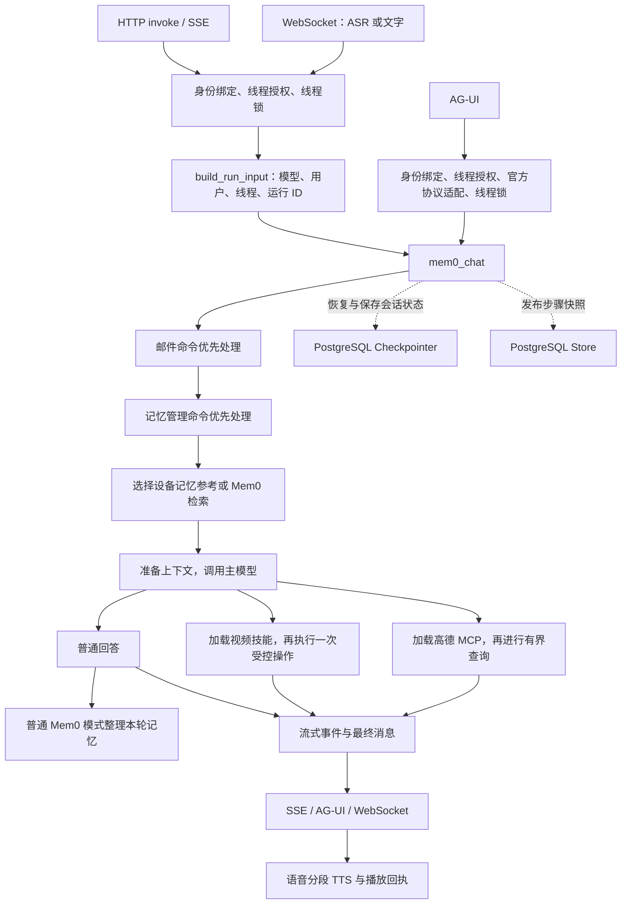

# Agent Harness 工程与 Agent Voice Server 实现对照

分析日期：2026-11-15。代码基准：60957f0（2026-11-13，fix(location): reuse foreground fixes and bound Amap MCP requests）。本报告分析当前工作区代码，不代表线上配置或生产验收结论。

核心判断

本项目已经实现一套有明确领域边界的 Agent harness：它围绕一个主对话 Agent，提供身份与线程控制、会话状态、记忆、按需能力加载、受控业务操作、执行状态、流式输出和语音交付。它适合“持续对话 + 少量受控动作 + 异步业务任务”。

与面向开放目标、跨多个上下文窗口自主工作的通用 harness 相比，本项目尚缺目标与任务规划、通用工作区、可恢复的任务调度、统一运行预算以及任务质量评测闭环。两者的产品目标不同，不能把通用 coding harness 的每个功能都当成本项目的必选项。

下文的“已实现”表示存在实际接线和代码路径；“部分实现”表示仅有局部能力或基础设施；“未见实现”限定于本次检查的当前仓库。它们不是生产成熟度评分，也不构成完成百分比。

1、联网资料中的 harness，至少有三种讨论范围

Agent harness 是围绕模型、让模型能够在环境中执行任务的运行系统。LangChain 的概括是“Agent = Model + Harness”：模型之外的提示词、工具、状态、执行逻辑与约束都属于这一范围。这是一种有用的工程定义，并非统一行业标准。[LangChain，The Anatomy of an Agent Harness，2026-03-10](https://www.langchain.com/blog/the-anatomy-of-an-agent-harness)

需要把以下三个范围分开：

| 范围 | 解决的问题 | 与本项目的关系 |
| --- | --- | --- |
| 运行时 harness | 模型拿到什么上下文，可以调用什么工具，如何执行、暂停、恢复和返回结果 | 主要对应 app/ 下的服务运行代码 |
| 研发环境中的 harness engineering | 让编码 Agent 能理解仓库、启动应用、验证修改，并获得可操作的反馈 | 对应 AGENTS.md、项目技能、架构测试、协议契约和开发脚本 |
| Evaluation harness | 固定任务、环境、模型与评分方式，反复运行并比较效果 | 本项目有大量工程测试和局部性能基准，尚未形成完整任务质量评测系统 |

OpenAI 的 harness engineering 文章主要讨论第二个范围：将仓库知识、执行计划、架构规则和可验证的反馈组织成编码 Agent 能使用的研发环境。不能因为项目有 AGENTS.md，就认为应用里的主 Agent 已经自动获得这些能力。[OpenAI，Harness engineering，2026-02-11](https://openai.com/index/harness-engineering/)

Anthropic 对 evaluation harness 和 agent harness 也作了明确区分；评测的对象实际是模型与运行系统共同形成的行为，最终应核查环境中的真实结果，而非只读助手的成功声明。[Anthropic，Demystifying evals for AI agents，2026-01-09](https://www.anthropic.com/research/demystifying-evals-for-ai-agents)

2、几组一手资料提供了什么参照

| 资料 | 与本项目最相关的工程观点 | 本报告采用的对照角度 |
| --- | --- | --- |
| [LangChain：Agent Harness Anatomy](https://www.langchain.com/blog/the-anatomy-of-an-agent-harness) | 将上下文、工具、状态、执行环境与约束作为整体设计 | 项目是否真的接线，而非只声明支持 |
| [LangChain：Deep Agents overview](https://docs.langchain.com/oss/python/deepagents/overview) | 组合文件系统上下文、长程上下文管理、子 Agent 等能力；规划、技能等按需求扩展 | 通用长任务能力与业务专用能力的差别 |
| [Anthropic：Effective harnesses](https://www.anthropic.com/research/effective-harnesses-for-long-running-agents) | 长任务需要增量进展、明确验收项与跨会话交接产物，仅压缩上下文仍不够 | 项目有没有持久目标和下一步，而不只是聊天历史 |
| [Anthropic：Harness design](https://www.anthropic.com/research/harness-design-long-running-apps) | 引入可检验的质量标准与外部反馈，避免仅靠生成者自评 | 本项目的成功状态如何产生 |
| [Anthropic：Managed Agents](https://www.anthropic.com/research/managed-agents) | 分离持久会话记录、模型执行循环与动作环境 | 进程、连接、业务任务是否能独立存续 |
| [Anthropic：Context engineering](https://www.anthropic.com/research/effective-context-engineering-for-ai-agents) | 每轮选择有限上下文，兼顾信息价值与资源约束 | 滑动窗口、记忆检索、按需加载与预算 |
| [LangGraph：Fault tolerance](https://docs.langchain.com/oss/python/langgraph/fault-tolerance) | 重放执行不保证外部副作用恰好一次，稳定幂等键与未知结果处理属于应用责任 | 邮件、视频的防重复与失败恢复 |

这些资料不是要求照搬某种框架。可借鉴的是它们解决的失效模式，例如提前宣布完成、跨窗口丢失任务、执行重复、没有证据却声称成功。

3、当前运行链路：一个主 Agent，多个受控分支

直接阅读的核心包括 agents、chat/agent_runner/execution 服务、认证与路由、持久化生命周期、记忆服务、邮件/视频 Skill、视频后台任务、语音连接协调、相关 schema，以及相邻测试。README 用于核对设计意图，结论以代码为准。

[Agent 注册](../../app/agents/runtime.py)只返回 mem0-chatbot。旧 chatbot 在 [API 依赖](../../app/api/dependencies.py)中解析到同一主 Agent，内部注册表不接收旧值。旧线程继续保留其原始 agent_id metadata 与所有权约束；这体现的是协议兼容，不是多 Agent 路由。



图中的邮件与记忆命令可以提前返回，视频和地图结果也走各自分支提前返回。邮件、视频或地图请求不会在该分支结束后继续按普通聊天流程自动提取记忆。

HTTP/SSE 与实时语音通过 [agent_runner.py](../../app/services/agent_runner.py)共享 LangGraph 事件规范化；AG-UI 使用 [agui.py](../../app/api/agui.py)中的官方 LangGraphAgent 适配器。三者共享主 Agent 与检查点，但并非所有传输都经过同一事件生成函数。

这套执行图的主要控制结构由程序确定，模型在受限范围中选择回答或工具。因此，它更接近“确定性业务流程包住局部模型决策”，而非任意目标驱动的开放执行循环。

4、已实现能力的代码级解释

4.1 会话持久化已经落地，长任务执行恢复仍是另一层能力。

[mem0_chat.py](../../app/agents/mem0_chat.py)使用 LangGraph Functional API 的 entrypoint。Mem0ChatState 保存完整会话消息、记忆/邮件/视频对话状态，以及设备记忆遗忘代次。entrypoint.final 的 value 返回本轮结果，save 保存下一轮要恢复的状态。

[lifecycle.py](../../app/lifecycle.py)把 PostgreSQL saver 与 store 接到唯一主 Agent；[persistence.py](../../app/core/persistence.py)和 [database.py](../../app/core/database.py)选择真实 PostgreSQL 实现。服务启动不会因数据库不可用而悄悄回退到 SQLite 或内存。

这能支撑多轮历史、草稿和确认状态恢复，但当前主流程没有把模型调用和各个外部操作拆成独立、可重放缓存的 task，也没有通用后台 worker 接管中断的主模型请求。不能由“用了 LangGraph + PostgreSQL”推导出“所有步骤都能从崩溃点自动续跑”。

LangGraph 自身也要求开发者处理重执行与副作用，检查点不能替外部系统提供恰好一次语义。[LangGraph，Fault tolerance](https://docs.langchain.com/oss/python/langgraph/fault-tolerance)

4.2 上下文工程已经做了多层选择，但没有统一 token 预算。

[聊天提示词构造](../../app/agents/mem0_chat.py)中的 CHAT_MESSAGE_LIMIT 为 20，保留的是最近 20 条用户/助手消息，通常约 10 轮，不是 20 轮。检查点仍保存完整会话。

记忆事实以名为 retrieved_memories 的独立 HumanMessage、通过 untrusted_user_memories 字段进入上下文，没有被提升为系统命令。固定规则、运行日期和记忆状态由 [prepare_chat_prompt](../../app/core/chat_context.py)分开组织；百炼显式缓存启用时，在固定规则部分设置缓存边界，减少动态内容对稳定前缀的影响。

局部预算也存在：

| 内容 | 当前限制 | 实现位置 |
| --- | --- | --- |
| 普通聊天历史 | 最近 20 条用户/助手消息 | mem0_chat.py 的 _chat_prompt |
| Mem0 检索参考 | 默认总计 6000 字符，可配置 | mem0_service.py 的 search |
| 设备记忆参考 | 至多 8 条、总计 3000 字符 | schemas/local_memory.py |
| 视频技能补充历史 | 最近 12 条，每条最多 3000 字符、合计最多 12000 字符 | services/skills/video.py 的 _history |
| 高德单次工具结果 | 8000 字符，超出标记截断 | agents/amap_chat.py |
| 记忆提取辅助历史 | 有字符预算，最多 10 条 | mem0_chat.py 的 _extraction_context |

但“限制条数/字符数”与“适配模型上下文窗口”不同。长消息仍可能让 20 条历史超过窗口。Settings 明确将 MEM0_CHAT_CONTEXT_TOKENS 标为兼容设置，不再限制聊天上下文；测试也验证完整长输入不会因此被裁剪。

本次未见按模型计算整体 token、自动压缩摘要、将大工具结果卸载到工作区并保留可检索引用的统一机制。现有设计更适合保持近期完整对话，而不是长程开放任务的跨窗口工作记忆。

4.3 至少要区分五类状态，不能把它们统称为 memory。

| 状态 | 当前载体 | 作用 | 不能据此推导的能力 |
| --- | --- | --- | --- |
| 会话与待处理业务状态 | LangGraph PostgreSQL Checkpointer | 消息、草稿、确认、最近列表等 | 通用目标规划和自动续跑 |
| 个人长期事实 | 可选 Mem0/pgvector，或客户端提供的设备记忆参考 | 个性化与事实召回 | 完整任务工作区 |
| 执行展示状态 | PostgreSQL LangGraph Store | 查询某次运行步骤与最终文本 | 全量事件日志或确定性重放 |
| 外部业务任务状态 | PostgreSQL 视频记录、Redis 邮件预约 | 已提交任务跨连接运行 | 主 Agent 持续推理 |
| 语音交付状态 | voice_turns 与音频分段记录 | 生成、合成、取消、播放回执 | 用户理解或实际听到内容的保证 |

[Mem0Service](../../app/services/memory/mem0_service.py)的查询与写入按 user_id、agent_id 限定；可选 reranker 对候选重排。修改/删除再次检查所有权，并以目标内容、更新时间或全量快照 revision 检测确认期间的变化。

设备记忆是另一套模式。[local_context.py](../../app/services/memory/local_context.py)通过运行作用域绑定用户和线程；原参考不会作为状态或配置写入检查点。[local_extraction.py](../../app/services/memory/local_extraction.py)只提议候选，并检查证据是否真正在本轮文本中、目标是否来自上传参考，非新增变更强制确认。

设备记忆的实际文件写入、原子替换和 App 内确认属于相邻前端仓库的行为。本次只核查后端协议、实现和项目说明，未审计前端源码。设备记忆参考未被直接持久化，不代表模型回答、历史或可选追踪绝不会包含相关个人信息。

4.4 视频 Skill 已经实现渐进加载，技能系统仍是固定业务能力。

[VideoSkillSession](../../app/services/skills/video_chat.py)一开始只提供 load_video_skill 的名称和描述。主模型选择加载后，运行时才补充完整技能参考、受限近期历史、本人草稿/列表上下文，以及 VideoSkillIntent 对应的 video_operation schema。

随后仅允许一次受控视频操作。非法工具、多个工具、非法参数或模型失败会停止该分支。实际业务结果由运行时构造，不再交给模型润色成另一个“成功故事”。

需要区分两种加载：Nacos Skill 包在服务启动时下载；主模型上下文中的完整 Skill 在当前请求需要时才加入。后者才是此处减少上下文负担的渐进披露。

[core/skills.py](../../app/core/skills.py)限制 ZIP 总大小、文件数量、路径、SKILL.md 大小和能力名称，计算摘要，只读取指令，不执行包内代码。[Nacos 接线](../../app/core/nacos.py)支持按版本或标签下载。

邮件分支则由关键词与待处理草稿触发，再使用独立结构化意图识别；它与视频不是完全相同的加载流程。当前也没有任意 Skill 发现、动态注册工具、通用 hook/middleware 链、Skill 自学习发布等完整扩展机制。

4.5 当前确有联网查询能力，但不是通用研究 Agent。

[answer_chat](../../app/agents/chat.py)在配置开启、所选模型属于 AlibabaModelName 且模型实例为 ChatOpenAI 时，通过 enable_search 启用百炼供应商内置搜索。实际是否搜索由模型/供应商决定，开关不等于已经取得搜索证据。

[answer_amap](../../app/agents/amap_chat.py)按需连接真实高德 MCP，发现工具后只开放本地白名单中的天气、地点、地理编码、距离和路线等查询。它会去掉供应商 schema 中的描述性内容，使用本地描述；限制工具目录分页、参数与结果大小，总工具调用不超过 4 次，整个流程共用超时预算。同一轮的独立查询可并发执行。

这已经是一个局部的“模型选择动作 → 执行 → 返回观察 → 再调用模型”循环，不能把本项目概括成完全没有 agent loop。

但当前没有通用网页浏览、研究计划、跨来源证据归档、引用质量评测等完整研究流程。旧的 MEM0_RESEARCH、RAG、GitHub MCP 配置字段仍可能保留兼容；它们不代表相应运行能力仍已接入。

4.6 权限控制不只写在提示词里，但语义授权仍部分依赖模型。

[auth.py](../../app/services/auth.py)实现可信服务密钥与用户 JWT 认证，bind_user 限制普通用户冒充他人，authorize_thread 校验用户与 agent 对线程的归属。[build_run_input](../../app/services/chat.py)阻止 agent_config 覆盖身份、线程、检查点和执行关联等保留键。

邮件收件人由当前注册用户记录查询，不能由模型填写其他地址。视频查询/编辑/列表按认证用户隔离，模型不能凭一个编号跨用户读取记录。高德仅开放查询白名单。这些是实际执行层的约束。

也有明确边界：

- 未配置 AUTH_SECRET 与 APP_TOKEN_SECRET 时，authenticate 返回管理员 Principal；生命周期只记录提示。因此安全结论依赖部署时确实配置了认证。
- 模型把当前请求解释为哪种动作、VideoSkillIntent.authorized 是否为真，仍包含模型语义判断。后端验证参数和身份，不意味着已经独立证明用户的自然语言意图。
- 历史、记忆、地图结果、技能参考虽有信任标签和规则边界，但这些组织方式不等于提示注入已被彻底解决。
- 当前主路径未见单独调用 Safeguard 的实际接线；模型目录保留一个安全模型枚举，不能算已部署审查链。

因此，可肯定的是权限边界与业务限制已代码化；不能直接宣称所有语义越权和提示注入均被防住。

4.7 人类确认有实际操作绑定，尚未成为统一审批策略。

[handle_memory_command](../../app/agents/memory_commands.py)对修改、删除、批量删除和清空提供目标预览与确认。确认有效期为 5 分钟；confirmation_id 从当前 pending 操作内容计算，绑定动作、候选、内容和有效期。服务端恢复检查点后校验当前确认，旧按钮或内容变化会被拒绝。

[MemoryConfirmation](../../app/schemas/execution.py)要求 approved 为严格布尔值。确认后的执行由 [Mem0Service._apply_mutation](../../app/services/memory/mem0_service.py)在同一用户锁下重新检查目标或快照，避免预览与实际修改之间发生变化。

通用传输层还支持 LangGraph interrupt/resume；相关测试使用真实编译图验证该协议。不过当前主 Agent 的记忆确认主要通过业务状态机完成，并未在主流程中调用 interrupt。不能把传输支持等同于每项业务都已经接入通用审批。

邮件和视频在用户明确请求且参数满足后可执行；当前没有覆盖所有副作用的统一“预览—批准—执行”策略。这是业务产品选择，是否扩展应由动作成本、可撤销性与实际误操作数据决定。

4.8 邮件和视频的防重复是亮点，但保证有作用域。

[EmailSkillService](../../app/services/skills/email.py)使用 Redis Lua 原子预占请求和额度，先把结果记为 unknown，再调用 SMTP；成功后记 sent。相同用户和 request_id 的重放不会再投递，失败或取消也不会盲目重发；当前邮件限额为每用户每天 10 次。

预约邮件写入 Redis 队列，worker 原子认领任务后才投递。服务重启后可继续处理仍保留的预约，但依赖 Redis 数据可用。认领后崩溃或 SMTP 回执丢失仍可能导致未知结果；该系统优先避免重复发送，不承诺每封邮件必达。

[VideoService._submit](../../app/services/video/service.py)先通过 [VideoRepository.reserve](../../app/repositories/video.py)保留任务；数据库部分唯一索引按用户与幂等键兜底。同一键配不同请求摘要会冲突，提交结果不确定则保留 SUBMISSION_UNKNOWN，不自动再次生成。

稳定键是条件：语音使用已持久化 turn 身份；视频 Skill 的键由用户、线程和输入身份生成。专用视频 HTTP 接口要求 Idempotency-Key，专用邮件接口接收 request_id。普通 invoke/stream 请求本身没有统一的客户端 request_id；每次创建新的运行和 HumanMessage，所以不能承诺跨所有 HTTP 重试的统一去重。

同样的文字也可能表示用户有意再次发起，不能简单按文本相等全局去重。未来若需要统一重试语义，应引入兼容的稳定请求身份，并区分“重试原请求”和“新建同内容请求”。

4.9 执行快照是可恢复的产品状态，不是完整审计事件流。

[ExecutionTrace](../../app/services/execution.py)围绕真实阶段记录 running、waiting_input、waiting_confirmation、unknown 等状态，发布单调序号；[GET /executions](../../app/api/chats.py)经过原有线程授权查询。

publish 使用同一个 namespace/run_id 写入最新快照。这意味着它保留步骤汇总与最终状态，而非逐条追加保存所有历史事件、工具输入和工具结果。不能据此实现完整事件重放。

取消时，正在进行的邮件、视频或记忆写入步骤可以标为 unknown，避免把“没收到确认”解释为“没有发生”。超过五分钟未更新的运行在查询时显示 unknown；这是展示层的保守解释，不是持久调度器或真实 worker 心跳判定。

ExecutionTrace.finish 根据 response_metadata 中的业务状态生成展示结果，初始默认 succeeded。这个状态表示当前代码定义的运行结果，不是独立验收器对自然语言任务质量的判分。例如 scheduled 表示预约已记录，PENDING 视频表示提交已接受，都不代表最终邮件入箱或视频已可播放。

4.10 视频后台任务实现了局部跨连接执行，不能替代长程 Agent。

[VideoService](../../app/services/video/service.py)与后台 worker 查询供应商状态、转存视频、补标题和封面。任务状态在 PostgreSQL，worker 使用 advisory lock 协调；生成成功但归档失败时重试归档，而非再次生成。

它正确区分提交、生成、视频归档和封面归档。客户端断开后，后台任务仍可以处理已持久化任务；进程重启后也可根据数据库继续查询待处理记录。

但这是确定性的媒体任务状态机。模型没有在后台持续思考，也没有基于最终视频内容进行质量评分、自动重写提示词或接续一个跨能力总目标。

4.11 语音交付状态是本项目最有领域特色的 harness 能力。

[VoiceConnection](../../app/api/voice_connection.py)把输入、Agent、TTS 和 WebSocket 输出放在有界队列及独立协程中；它包含音频序号验证、输入去重、背压、插话取消、过期检查和关闭清理。

执行状态与音频状态分开保存。TTS 失败不会抹掉已发生的业务动作；停止播放也不会撤回供应商接收的邮件或视频任务。TTS 只有在某分段尚未产生音频且错误可重试时才尝试重连，已经产生音频的分段不会被当作未交付内容重复合成。

客户端通过 playback.progress / playback.finished 提供播放回执。[delivery_context](../../app/services/agent_runner.py)在后续请求中补充中断交付记录，只把完整确认播放的分段作为已交付内容，避免助手假定整段回复已被听完。

这里可验证的是客户端报告的播放完成，不能再推导为用户已经听见、理解或同意。这比单纯把模型输出接到 TTS 多了一层产品交付语义。

4.12 可观测性有基础，质量闭环还未形成。

[invoke_chat_model](../../app/core/model_metrics.py)记录阶段、模型、提示词/工具摘要、输入输出 token、缓存使用、首个文本/工具输出和总耗时。主调用、视频与地图调用接入该辅助层；邮件/记忆结构化意图与 Mem0 SDK 有各自调用路径，指标覆盖并非全系统统一。

可选 LangFuse callback 和 LangSmith feedback 已接线。它们为排障和后续评测提供基础，但未见“线上失败轨迹 → 脱敏评测样本 → 新模型/Prompt 对比 → 质量门禁 → 灰度或回滚”的完整闭环。

[模型工厂](../../app/core/llm.py)支持多个供应商和用户选择，并使用缓存复用模型实例；这不等于自动模型路由、按能力选择、统一降级或成本优化策略。

5、综合能力对照

| 能力 | 常见 harness 实践 | 本项目状态 | 实际边界 |
| --- | --- | --- | --- |
| 模型调用与工具循环 | 多轮动作和观察 | 已实现局部循环 | 地图可多步，视频为加载后单操作，无通用开放循环 |
| 身份、线程与用户隔离 | 运行身份与权限绑定 | 已实现 | 依赖认证配置；可信服务身份与普通用户策略不同 |
| 会话持久化 | 检查点、恢复上下文 | 已实现 | 不自动恢复中断中的每个模型/工具步骤 |
| 长期个人记忆 | 跨会话检索与变更 | 已实现、可选 | Mem0 与设备参考模式分开，不能混同任务记忆 |
| 上下文选择 | 截取、检索、按需注入 | 已实现 | 尚无统一按模型 token 预算或摘要压缩 |
| Skill 渐进加载 | 先发现、按需读完整指令 | 已实现视频分支 | 邮件路径不同，未形成通用插件运行时 |
| MCP 接入 | 外部工具发现与执行 | 已实现高德 | 固定来源与查询白名单，不是任意 MCP 平台 |
| 联网信息 | 受控查询或搜索 | 已实现、按配置 | 百炼内置搜索与地图；没有完整研究证据流水线 |
| 参数和动作约束 | 结构化调用、确定性检查 | 已实现 | 自然语言意图仍部分依赖模型 |
| 人类审批 | 预览、确认、过期、恢复 | 部分实现 | 记忆变更较完整，无覆盖所有动作的统一政策 |
| 副作用防重复 | 稳定键、预占、结果核实 | 已实现领域机制 | 键和存储有作用域，非全链路恰好一次 |
| 跨连接异步任务 | 耐久任务与 worker | 部分实现 | 视频、邮件预约具备；主 Agent 总目标不具备 |
| 目标规划与进度 | 待办、依赖、验收项、下一步 | 未见通用实现 | execution.progress 是发生过的步骤，不是未来计划 |
| 通用工作区与产物 | 文件工具、结果卸载、检索 | 未见通用实现 | 文件上传与用户 MEMORY.md 不等于 Agent 工作区 |
| 沙箱、代码/浏览器执行 | 隔离的可编程动作环境 | 未见运行时实现 | 研发脚本可以用浏览器，但未开放给产品 Agent |
| 子 Agent 与委派 | 上下文隔离、任务交接 | 未见当前实现 | 唯一主 Agent，多次模型调用不等于多 Agent |
| 失败恢复 | 重试分类、重放与补偿 | 部分实现 | 受控错误、unknown、领域 worker；无统一续跑系统 |
| 资源预算 | token、费用、工具次数、期限 | 部分实现 | 局部超时/额度/队列齐全，缺统一运行预算 |
| 可观测性 | trace、关联、耗时与资源 | 已有基础 | 展示快照非完整事件日志，调用指标覆盖不统一 |
| 任务质量 eval | 固定任务、真实结果、多次试验 | 部分实现 | 工程测试强；质量样本、评分和发布门禁尚缺 |
| 语音交付控制 | 取消、分段、回执、上下文修正 | 已实现 | 属领域优势，最终依赖客户端提供正确回执 |

这张表按能力分类，不进行简单加总。没有沙箱对于当前受控邮件/视频助手并不构成缺陷；若产品要承接任意编码或资料处理任务，它才成为需要补齐的运行环境。

6、对照 OpenAI 的研发 harness，本仓库有哪些基础

[AGENTS.md](../../AGENTS.md)定义分层职责、信任边界、数据库要求与验证方法；项目维护依赖刷新、模型刷新和基础设施冒烟技能。它们服务于修改本仓库的编码 Agent，不是产品 Agent 的运行技能。

[架构测试](../../tests/core/test_architecture.py)通过 AST 检查业务层不能导入 FastAPI/路由/应用装配、仓储不能反向依赖业务服务。这是将架构规则变成机械反馈的实际例子，强于只有文档约定。

[协议契约测试](../../tests/schema/test_api_contract.py)对照保存的 OpenAPI 和 WebSocket 客户端协议；[真实编译图测试](../../tests/api/test_service_real_graphs.py)检查 LangGraph 的实际事件与中断行为。SQLite 出现在这些隔离测试里，不意味着支持的生产启动路径会退回 SQLite。

仓库还包含浏览器回归、真实模型可用性检查、聊天延迟/缓存对照与 PostgreSQL/AG-UI/LangFuse 冒烟入口。但脚本存在不等于这些检查已经自动进入发布门禁；本次跟踪文件中未见 .github 工作流或 pre-commit 配置，无法据此确认外部 CI 的实际执行情况。

OpenAI 的做法还包括工作树隔离启动、Agent 可查询的日志指标、版本化执行计划与文档维护反馈。本仓库有若干相关基础，但没有证据证明这些能力已全部组成自动闭环。[OpenAI，Harness engineering](https://openai.com/index/harness-engineering/)

7、用三个真实需求看能力差别

| 用户需求 | 当前能力是否匹配 | 原因 |
| --- | --- | --- |
| “帮我生成十秒视频，场景稍后补充” | 匹配已实现流程 | 保存有期限的草稿，后续补充参数，再受控提交 |
| “查北京和上海的天气，再回答我怎么安排出行” | 可在地图调用限额内处理 | 支持工具观察和后续模型回答；是否覆盖全部要求仍取决于模型与返回数据 |
| “持续研究目的地，产出多版视频，验收后发邮件通知我，失败自己调整，明天继续” | 超出当前通用编排能力 | 缺持久目标、跨能力依赖、验收器、自动续跑与完成事件触发 |

最后一种需求不是简单多调用几次模型。它需要回答：整体完成标准是什么，视频什么时候算验收通过，邮件是否已经发过，进程重启后下一步是什么，用户取消时哪些动作仍可发生。

当前每轮主要选一类能力，邮件和记忆命令优先返回；没有编排整条“查询 → 创作 → 验收 → 通知”依赖链的通用任务模型。

8、下一步应补什么：按收益排序

以下是基于代码与资料的设计建议，不是已实现功能，也没有在本次分析中修改业务代码。

优先一：建立任务质量 eval 和运行版本指纹。

先围绕当前产品能力建立小而真实的任务集，复用现有 fake provider 和业务结果校验。覆盖普通聊天、仅讨论不执行、引用命令、跨用户诱导、草稿修正、误确认、超时后重试、空地图结果、语音中断和设备记忆遗忘。

评分分别看动作选择、参数、所有权、真实状态、结果表述、延迟与费用。已有单元测试可以保证后端执行机制，但模拟模型返回正确 action 的测试，不能测出真实模型是否会错误地选择该 action。必要时单独运行授权的真实模型评测，并对随机行为做多次试验。

记录运行时的代码版本、模型、Prompt 模板版本/摘要、Skill 摘要、工具 schema 摘要和非秘密配置指纹。当前 Nacos Prompt 加载虽检查发布版本，但 Mem0Prompts 主要保留模板内容，尚未把完整版本清单关联到每次运行。仅记录一次 prompt_digest 不足以复现整条链路。

若要比较新旧 harness，固定模型与任务；若比较新旧模型，固定 harness。避免把同时更换 Prompt、模型和工具产生的变化全部归因于某一个因素。

优先二：统一运行预算和外部结果语义。

保留已有局部预算，增加按运行关联的输入/输出 token、工具次数、期限和必要费用上限。结合产品对完整对话的要求制定“超过预算时追问、明确拒绝、保留摘要并可回查”的策略，不应直接恢复一个悄悄截断用户输入的旧开关。

对每个动作明确区分“意图已识别、参数已校验、请求已保留、供应商已接受、最终业务已完成、结果已交付”。现有邮件、视频、语音已做了不少区分，可统一成工具回执契约，供展示、测试与后续工作流使用。

若需要跨 HTTP 重试保证，补稳定请求身份；若要证明崩溃恢复，再做真实持久存储下的故障注入，覆盖“外部操作完成但检查点未写入”的时刻。不要把增加重试次数当作通用恢复方案。

优先三：只有出现跨能力长任务需求时，再引入任务层。

保留当前主对话体验，为明确的长任务增加持久目标、任务步骤、依赖、验收条件、产物引用和下一步。先实现一个具体链路，例如“生成视频完成并归档后，按原授权给本人发一次通知”。

把可重复的查询与不可盲重试的提交分开，保证稳定业务身份在副作用前落盘。主 Agent 的会话状态与业务任务生命周期解耦；连接关闭后，worker 可以继续确定性的后续步骤。

若新增第一方表或迁移，需另外设计数据生命周期与兼容方案，遵守本仓库 PostgreSQL 方言、审计字段和 schema 迁移规则。本报告不建议把破坏性变更塞进启动建表代码。

优先四：按具体瓶颈引入工作区、压缩、沙箱或委派。

处理长文档、大工具结果和跨会话产物时，工作区及按需回查比单纯加大聊天历史更合适。只有需要执行用户/模型生成的代码或通用浏览器动作时，才引入隔离沙箱。

只有独立子任务的并行度或上下文相互干扰成为实测瓶颈时，再引入子 Agent。现有视频与地图按需加载已经减少工具和指令干扰；不必为了术语完整性恢复被移除的 Supervisor、RAG 或研究 Agent。

Anthropic 的后续实践同样提醒：harness 中为旧模型缺陷设置的机制可能随模型升级失效，应通过评测验证每层复杂度是否仍有收益。[Anthropic，Managed Agents](https://www.anthropic.com/research/managed-agents)

9、是否需要改成 Deep Agents

当前没有必要仅为了“拥有 harness”重写项目。项目已经实现 harness，只是它围绕语音和受控业务动作设计。直接迁移到更通用的库，也不会自动带来用户所有权、SMTP 不确定结果、视频归档、播放回执等领域语义。

如果未来需要文件系统上下文、跨窗口任务、委派和长任务规划，可以选择一个隔离场景验证 Deep Agents，沿用现有受控服务和认证接口，对比完成率、延迟、token、错误动作率与代码复杂度。是否采用应由这些结果决定。[Deep Agents 官方概览](https://docs.langchain.com/oss/python/deepagents/overview)

本项目最值得保留的架构是：模型负责理解与选择，业务服务负责约束与执行，仓储负责持久化，传输层负责交付。需要扩展的主要是可测量的质量反馈和长任务状态，而不是把更多权限交给模型。

10、本次实际验证与证据边界

本次使用现有 .venv 运行针对性测试，没有调用真实模型、SMTP、高德、视频供应商或真实基础设施：

```sh
PYTHONDONTWRITEBYTECODE=1 .venv/bin/python -m pytest -p no:cacheprovider \
  tests/core/test_architecture.py \
  tests/core/test_execution.py \
  tests/core/test_chat_context.py \
  tests/core/test_model_metrics.py \
  tests/agents \
  tests/memory/test_mem0_mutations.py \
  tests/api/test_auth.py \
  tests/api/test_single_agent.py \
  tests/api/test_service_real_graphs.py \
  tests/api/test_email_skill.py \
  tests/api/test_email_scheduling.py \
  tests/api/test_local_memories.py \
  tests/api/test_agui.py \
  tests/video/test_video_service.py \
  tests/voice/test_realtime_service.py -q
```

结果为 **571 passed，45 warnings，12.22 秒**。警告主要来自 Nacos/AG-UI 的弃用 API 与语音测试中模拟数据的枚举序列化。

这验证了所选测试中的编排、结构化边界、确认、隔离、防重放、状态和语音协议行为。多数业务测试使用模拟模型/供应商；部分协议测试使用真实编译图与隔离检查点，并非真实 LLM 或真实 PostgreSQL 验收。

未运行 PostgreSQL/AG-UI/LangFuse 基础设施冒烟、真实模型质量评测、真实语音设备验收；未读取线上 Nacos Prompt 与 Skill 的实际内容，无法判断部署中的模板是否与本地参考一致。已检查外部模板加载与约束代码，不能因此推断部署内容已审计。

本文仅新增分析文档，未修改应用、测试、配置或依赖。

11、便于继续阅读的代码入口

| 问题 | 文件与关键符号 |
| --- | --- |
| 当前到底有哪些 Agent | [runtime.py](../../app/agents/runtime.py)：get_agent、get_all_agent_info |
| 一轮对话完整走向 | [mem0_chat.py](../../app/agents/mem0_chat.py)：_mem0_chat、mem0_chat |
| 当前开放哪些工具与搜索 | [chat.py](../../app/agents/chat.py)：answer_chat |
| 地图多步循环如何限制 | [amap_chat.py](../../app/agents/amap_chat.py)：answer_amap |
| 模型上下文如何组装 | [chat_context.py](../../app/core/chat_context.py)：prepare_chat_prompt |
| 运行身份与保留配置 | [services/chat.py](../../app/services/chat.py)：build_run_input |
| 鉴权和线程所有权 | [auth.py](../../app/services/auth.py)：authenticate、bind_user、authorize_thread |
| SSE/语音事件与交付补偿 | [agent_runner.py](../../app/services/agent_runner.py)：graph_events、delivery_context |
| 展示步骤与恢复状态 | [execution.py](../../app/services/execution.py)：ExecutionTrace、execution_history |
| 记忆确认与版本检查 | [memory_commands.py](../../app/agents/memory_commands.py)、[mem0_service.py](../../app/services/memory/mem0_service.py) |
| 设备参考与证据检查 | [local_context.py](../../app/services/memory/local_context.py)、[local_extraction.py](../../app/services/memory/local_extraction.py) |
| 视频按需加载与受控执行 | [video_chat.py](../../app/services/skills/video_chat.py)、[skills/video.py](../../app/services/skills/video.py) |
| 邮件防重复与预约 | [skills/email.py](../../app/services/skills/email.py)：send、process_due |
| 视频持久任务与恢复 | [video/service.py](../../app/services/video/service.py)、[repositories/video.py](../../app/repositories/video.py) |
| 语音取消、背压和回执 | [voice_connection.py](../../app/api/voice_connection.py)：submit、cancel_response、speak、generate、receiver |
| 模型耗时与资源记录 | [model_metrics.py](../../app/core/model_metrics.py)：invoke_chat_model |
| 运行时配置/技能/Prompt 来源 | [nacos.py](../../app/core/nacos.py)：load_remote_config、load_remote_skills、load_remote_prompts |
| 资源的启动与关闭 | [lifecycle.py](../../app/lifecycle.py)：lifespan 及各子服务 lifespan |
| 架构规则是否可检查 | [test_architecture.py](../../tests/core/test_architecture.py) |
| 协议是否有回归基准 | [test_api_contract.py](../../tests/schema/test_api_contract.py) |

后续讨论最值得围绕一个具体问题展开：**在保持现有受控业务边界的前提下，如何让系统能证明任务做对了，并在失败后知道该核实什么、继续什么。** 这比按通用框架清单补齐所有功能，更贴近本项目下一阶段的工程收益。
