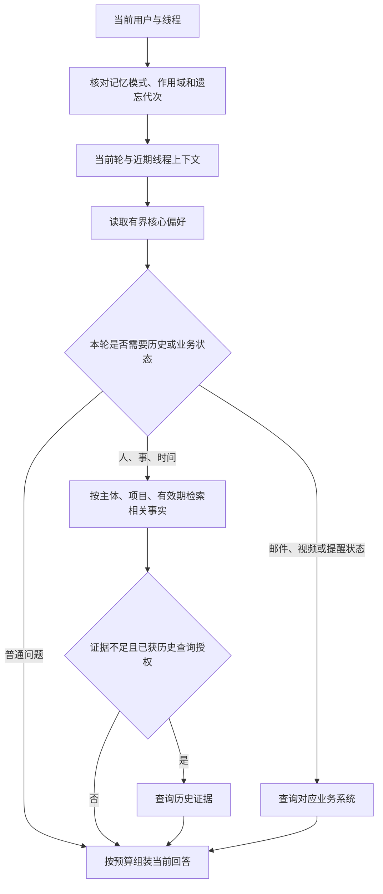

# 国内外 Agent 产品的记忆分层

调研日期为 2026-11-26。消费应用覆盖豆包、Kimi、ChatGPT、Claude、Gemini 和 Omi 等。办公、开发及低代码样本包括扣子、千问办公、Claude Code 和 GitHub Copilot。云端记忆服务样本包括腾讯云 Agent Memory、阿里云百炼、百度智能云、AWS AgentCore 和 Google Cloud Memory Bank。开源实现用于核查数据结构和读写流程。项目对照沿用服务端 `0e6e908` 和原稿记录的 Flutter 客户端 `069a5ca`。

实际产品的分层主要解决三件事。**当前有效的信息**需要稳定地影响回答，**过去发生的事**需要按需回查，**过去行得通的方法**需要按任务复用。腾讯云把这些信息逐级提炼，AWS 给事件、偏好、事实和经验配置不同的写入策略，Letta 则把上下文常驻内容与按需查阅的档案分开。它们分别回答了抽象程度、生命周期和读取时机三个问题。Agent Voice Server 已有手机端 `MEMORY.md`、画像优先选取和后台提炼，和这些实现对照，当前差距集中在保存回执、事实版本、项目作用域和历史回查。 [腾讯云 Memory 介绍](https://cloud.tencent.com/document/product/1813/132100) · [AWS 内置策略](https://docs.aws.amazon.com/bedrock-agentcore/latest/devguide/long-term-configuring-built-in-strategies.html) · [Letta 档案记忆](https://docs.letta.com/v1-sdk/memory/archival-memory)

## 1. 记忆分层由哪些决策决定

同一条语音可以在不同层产生不同记录。例如，“我以前通勤坐地铁，从下个月起每周二骑车”。当前会话保留完整表述供追问，来源记录保留原话与时间，长期记忆可记录有起始日期的计划。若用户还要求每周二提醒，提醒应由任务系统明确创建并维护状态。问“我以前怎么通勤”“今天怎么通勤”“提醒设好了吗”，应分别读取历史事实、时间有效的计划和任务系统。

| 维度 | 设计决策 | 常见失误 |
| --- | --- | --- |
| 生命周期 | 为当前轮、当前线程、当前项目和跨会话记忆分别约定保存与失效条件 | 只按新旧排序，把昨日安排写成永久习惯 |
| 抽象程度 | 原话、按事件切分的证据、单条事实、主题摘要、当前画像 | 用摘要回答要求原话的问题，或把摘要当作唯一证据 |
| 读取时机 | 核心偏好每轮有界读取，其他内容按需召回，历史可显式查询 | 用向量相似度决定称呼和回答风格，或把全部画像塞进每轮语音 |
| 来源与作用域 | 设备、账号、项目、线程、外部连接器分别控制使用范围 | 工作项目中的信息被家庭场景召回，或因同一账号而默认认为两端已同步 |
| 修改权与证据 | 用户的明确设置、自动提炼的事实、系统当前状态分别有变更规则 | 把助手的猜测写入画像，或从历史“计划发送”推断邮件已发送 |

研究上，记忆可按形态、功能和动态过程划分。LongMemEval 进一步把可测链路拆成索引、检索和读取三个阶段。工程上可以先给每类信息定义事实来源、读取方式和更新规则，再决定是否用独立文件、表或索引实现。一个文件可以承载多个逻辑层，同一条事实也可以有检索索引与画像投影。 [Agent 记忆研究综述](https://arxiv.org/abs/2512.13564) · [LongMemEval 论文](https://arxiv.org/abs/2410.10813)

### 四个实际产品从输入到下一次回答的链路

**Omi 可穿戴助手从语音转录提炼可查证的记忆。** 会话处理器把带说话人信息的转录交给 L1 提取器。每条候选须能把引用匹配到明确的转录片段，否则本条被丢弃。通过校验的候选带有来源会话、时间和主体归属，区分用户本人、第三方或未知。在公开代码的这条路径上，短期条目可进入晋升或归档流程。默认列表隐藏归档项。聊天查询按用户搜索记忆，排除锁定项，按上下文预算返回内容，并可为客户端提供结构化来源标识。举例说，会议里同事说“我每周一在家办公”，保存候选时先判定主体，再决定能否当作用户自己的习惯。 [转录提取与归因](https://github.com/BasedHardware/omi/blob/04c712c82e4593deb4724fafd0f870b2c6bce40e/backend/utils/conversations/process_conversation.py#L1795) · [短期生命周期](https://github.com/BasedHardware/omi/blob/04c712c82e4593deb4724fafd0f870b2c6bce40e/backend/utils/memory/short_term_lifecycle.py#L106) · [默认列表](https://github.com/BasedHardware/omi/blob/04c712c82e4593deb4724fafd0f870b2c6bce40e/backend/routers/memories.py#L712) · [聊天召回](https://github.com/BasedHardware/omi/blob/04c712c82e4593deb4724fafd0f870b2c6bce40e/backend/utils/retrieval/tool_services/memories.py#L160)

**Qwen Audio Agent 用不同的更新路径区分偏好和事实。** “以后回答短一点”可通过会话内的 `memory` 工具写入 `USER.md`；“我们把发布改到周五”这类长期决定可写进 `MEMORY.md`。默认 Markdown 实现还可在会话结束后从新对话提取遗漏信息。客户端编辑带 `expectedRevision`，版本过期返回 `409`，后台旧提炼结果也不能覆盖已成功的编辑。实际持久化发生变更后，Gateway 发 `memory.changed` 让客户端重读。支持更新活跃会话的实时供应商可以在下一个空闲点更新模型上下文。可选的会话主题简报则走另一条按需召回路径，默认关闭。 [长期记忆](https://qwenaudio.github.io/qwen-audio-agent/reference/memory) · [写入、版本及实时刷新](https://qwenaudio.github.io/qwen-audio-agent/reference/memory-provider)

**腾讯混元 MemHub 把多个编码 Agent 的轨迹汇入一处。** 用户授权来源并开启同步后，宿主会话通过扫描或捕获进入写入队列，再由 Hy Memory SDK 保存原始轮次并按配置提炼。MemHub 保存授权、任务状态和记忆 ID 回执，SDK 管理原文、记忆实体、向量和图。读取由宿主桥接先核验工具授权，再调用 SDK 搜索；可通过单独授权开放原文通道。例如在 Claude Code 里排查出的规则，可以在授权后的 Cursor 里搜索。是否继续从某客户端收集新数据，与是否允许它调用已经积累的记忆，是两项独立设置。 [MemHub 架构](https://github.com/Tencent-Hunyuan/Hy-Memory/blob/d8138b501a755f662a024f7e8eb879613eabf1d3/memhub/docs/ARCHITECTURE.md) · [宿主同步与读取](https://github.com/Tencent-Hunyuan/Hy-Memory/blob/d8138b501a755f662a024f7e8eb879613eabf1d3/memhub/docs/harness-support/README.md)

**OpenClaw 让当天记录和长期自动注入走不同路径。** 默认 Memory Core 将日记和会话转录放在可搜索的事件层，下次需要才查。上下文压缩前可把当下有用的内容先写进日记。后台 Dreaming 根据来源、是否反复命中以及跨日重复等信号挑选候选，再合并和替代旧条目，写入 `MEMORY.md` 或 `USER.md`。符合来源要求的精选条目才可在预算内自动载入，整理变更可在 `DREAMS.md` 核查。比如当天试过的一条临时命令先留在日记，多次确实奏效才可能成为后续会话可自动使用的结论。 [OpenClaw Memory Core 架构](https://docs.openclaw.ai/concepts/memory-architecture)

用同一条“会议从周三改到周五”对照，上述实现分别展示了四个不同问题。Omi 可以检查谁说的、证据在哪。Qwen Audio Agent 给出编辑成功与下一次实时模型读取的边界。MemHub 定义这条信息能从哪个客户端进入、在哪个客户端继续使用。OpenClaw 决定这条信息留在当天记录，还是在之后满足条件时进入长期上下文。示例用于解释公开链路，实际提取内容随部署配置和单次模型运行而变化。

## 2. 国内外消费级助手

本节以官方帮助、政策和产品发布为依据。它们可以说明用户能使用的路径和开关。存储引擎、在线召回算法和内部更新阈值，只有来源明确披露时才能归到具体产品。功能可能按账号、地区或版本逐步推出。

### 国内产品

| 产品 | 写入和读取 | 管理与作用域 |
| --- | --- | --- |
| **豆包** | 明确要求记住的信息实时变化，可逐条管理。系统对历史对话滚动提炼摘要，刷新有周期。还可提炼用户授权接入的资料与工具结果，推断可能包含在记忆中。 | 关闭停止使用和更新，已有记忆仍可保留，连接器读取有独立开关语义。删除聊天和删除记忆是不同操作，删除记忆到停止引用有传播时间。 [豆包记忆 FAQ](https://www.doubao.com/legal/memory_faq) |
| **Kimi** | 2026 年 10 月起逐步升级。记忆空间以文件展示已保存信息，过往会话也可被参考。新会话开启后可触发旧会话整理，命中引用会显示来源标识。 | 可查更新时间、导入导出和删除，记忆按账号同步。持续输出要求可写入会话设定，项目专属要求可写入项目指令。项目和定时任务的记忆可用范围与通用聊天存在差异。 [Kimi 记忆帮助](https://www.kimi.com/help/features/memory-space) |
| **千问** | 官方上线公告确认 Qwen Chat Memory 能保留重要信息与回忆过往对话。公开证据支持这两类能力的存在。 | 这份公告没有说明存储结构、刷新机制以及国内各客户端的当前开关。Qwen Audio Agent 是可核验的独立开源实现。 [千问大模型官方发布](https://www.sina.cn/news/detail/5222383166166363.html) |
| **Today** | 围绕人物、偏好、项目和目标延续上下文，并结合约定时间和授权信号做简报、提醒或建议。 | 官方说明可更正或移除受支持的记忆，并展示需批准的任务以及已完成等状态。公开材料足以确认产品按生活对象组织体验，具体底层分层和合并算法未披露。 [Today 产品能力](https://today.ai/articles/capabilities) |

豆包提供了明确保存与自动提炼各自何时生效的产品范例。Kimi 把文件、原会话和回答来源连起来，用户能检查实际使用了什么。Today 让项目和目标成为上一段对话之后仍可接续的对象。腾讯混元在下文另有可核验的开源实现，元宝公开入口没有给出同等细节。 [腾讯元宝](https://yuanbao.tencent.com/bot) · [腾讯混元 Hy-Memory](https://memory.hunyuan.tencent.com/)

### 海外产品

| 产品 | 写入和读取 | 管理与作用域 |
| --- | --- | --- |
| **ChatGPT** | 官方帮助列出已保存记忆、历史聊天、自定义指令、文件及连接应用等个性化来源。可用账号提供记忆摘要和回答来源。历史派生信息会随上下文更新。 | 删除聊天未必移除单独保存的记忆。项目专用记忆限制在项目内部且不参考已保存的账号记忆。若账号显示个性化选项，临时聊天可选择是否应用已有个性化，保持临时时不会写入或更新记忆。 [记忆帮助](https://help.openai.com/en/articles/8590148-memory-in-chatgpt) · [项目帮助](https://help.openai.com/en/articles/10169521-projects-in-chatgpt) · [临时聊天](https://help.openai.com/en/articles/8914046-temporary-chat-in-chatgpt) |
| **Claude** | 新版在聊天过程中按独立主题保存，可自动记录或由用户明确触发。历史会话搜索有独立开关，可见为一次工具调用，搜索范围分成项目内和项目外。 | 新版项目有自己的记忆，也可通过 `Use account memory` 与账号记忆互通。单次关闭记忆的聊天仍可能在其他聊天的历史搜索中被找到。隐身聊天有另一套历史行为。 [Claude 记忆与会话搜索](https://support.claude.com/en/articles/11817273-use-claude-s-chat-search-and-memory-to-build-on-previous-context) |
| **Gemini** | 有用户设定的指令、过去聊天派生的记忆与摘要、符合条件账号的任务记忆，以及授权连接的 Gmail、Google Photos 等来源。任务记忆用于延续工作流和项目背景。 | 可编辑摘要、管理任务记忆和来源设置。仅断开连接器后，从前已进入历史聊天的资料可能仍可被引用。由连接器读到的信息和在历史里留下的副本需要分别管理。 [Gemini 隐私说明](https://support.google.com/gemini/answer/13594961?hl=en) · [记忆摘要](https://support.google.com/gemini/answer/18617127?hl=en) · [连接应用](https://support.google.com/gemini/answer/16598406?hl=en) |
| **Omi** | 把可穿戴设备录音产生的材料整理为会话、转录和摘要，从会话提炼人物、地点、偏好、承诺等记忆，并单独抽出任务。聊天可组合会话、记忆和任务。 | 支持按词、日期等定位部分会话记录，也可管理单条会话或记忆。这是语音证据、提炼事实和待办并存的直接示例。 [Omi 会话与记忆帮助](https://help.omi.me/en/articles/13153612-conversations-memories-and-chats) · [Omi 开源仓库](https://github.com/BasedHardware/omi) |

一个对私人助手影响很大的差异是“关闭记忆”的具体含义。Claude 的单聊关闭仍允许该聊天被其他聊天的历史搜索找到。ChatGPT 支持个性化的临时聊天可以参考已有记忆，同时暂缓形成新记忆。Gemini 的连接器撤销与已形成的历史副本各自管理。设计开关时，分别说明本轮能读什么、会写到哪里、以后能否通过历史重新看到。 [Claude 记忆帮助](https://support.claude.com/en/articles/11817273-use-claude-s-chat-search-and-memory-to-build-on-previous-context) · [ChatGPT 临时聊天](https://help.openai.com/en/articles/8914046-temporary-chat-in-chatgpt) · [Gemini 连接应用](https://support.google.com/gemini/answer/16598406?hl=en)

### ChatGPT、Claude 和 Kimi 如何处理同一个跨会话问题

例如，用户先说“我住杭州”，几个月后说“我搬到上海了”。“现在帮我找附近的地方”“我搬家前住在哪”“我当时怎么说的”分别需要当前事实、历史事实和原始对话。以下是按公开机制推演的使用方式。

- **ChatGPT** 可参考已保存的记忆、相关历史和其他可用个性化来源。支持的账号可从记忆摘要更正信息，或从回答下方的 Sources 检查过去聊天、文件等引用。删除聊天与处理单独保存的记忆是不同操作。项目专用记忆给召回加了一层边界，同一项目的对话可互相参考。官方帮助公开了这些入口与可见行为。 [ChatGPT 记忆](https://help.openai.com/en/articles/8590148-memory-in-chatgpt) · [项目记忆](https://help.openai.com/en/articles/10169521-projects-in-chatgpt)
- **Claude** 把常用记忆与历史会话搜索做成两条可见路径。新版按主题维护记忆，可在聊天时更新，搜索命中可链接回原对话。项目可通过 `Use account memory` 控制与账号记忆的互通。官方同页还描述了旧体验的每日综合摘要，其中 24 小时的更新时间适用于旧体验。两种体验对删除源会话后如何处理已有记忆的说明也有差异。 [Claude 记忆与会话搜索](https://support.claude.com/en/articles/11817273-use-claude-s-chat-search-and-memory-to-build-on-previous-context)
- **Kimi** 将精选信息整理成记忆空间文件，另可按相关性参考过往会话。新会话启动可触发对旧会话的整理，变更存在等待时间。喜欢的回答格式这一类长效要求则可作为显式的会话设定，项目规则和资料也有各自的入口。回答引用标识让用户看到本次用了记忆，但官方帮助未公开底层检索或事实合并算法。 [Kimi 记忆空间](https://www.kimi.com/help/features/memory-space)

同一句“记住了”可以对应不同承诺。对语音产品而言，若要在用户说完“我现在住上海”后确认保存成功，当轮需要等到可验证的提交回执。后台逐步整理适合从多轮交互提炼非紧急事实，与前台回执采用不同的时机。豆包公开区分了主动指定的记忆和滚动更新的背景摘要。 [豆包记忆 FAQ](https://www.doubao.com/legal/memory_faq)

Claude 的新版体验还把聊天记忆与云端 Cowork 共享。官方示例是把“帮我写一份给经理的进展”交给 Cowork，它可沿用从聊天获得的经理身份和沟通偏好，任务中形成的记忆也能回到聊天。文档明确将这一能力限定于云端 Cowork。共享范围因此要同时考虑产品表面、项目范围以及运行位置。 [Claude Chat 与 Cowork 记忆](https://support.claude.com/en/articles/11817273-use-claude-s-chat-search-and-memory-to-build-on-previous-context)

## 3. 办公、编程与低代码 Agent

| 产品 | 数据与读取方式 | 更新和使用边界 |
| --- | --- | --- |
| **扣子 Agent** | 按用途维护 `USER.md`、`MEMORY.md` 等 Markdown。长期信息以文件持久化，检测到相关任务时走向量检索。 | 支持显式记忆、自动抽取和定期整理。网页、飞书、微信的会话彼此独立，产品支持在相应身份范围内共享记忆。 [扣子记忆机制](https://docs.coze.cn/cozespace_memory) |
| **扣子编程** | 低代码智能体可自动采集用户画像及记忆点，入指定记忆库，再由 Prompt 直接召回或由工作流检索节点显式调用。用户变量另存可直接读取的值。 | 新版用用户 UID 和渠道 ID 组合隔离库内数据。同一库可绑定多个低代码智能体或工作流。关闭 Prompt 直接召回仍可继续写入。 [记忆库](https://docs.coze.cn/guides_long_term_memory) · [变量](https://docs.coze.cn/guides_variable) |
| **千问办公 QwenWork** | `USER.md` 存个人画像，`MEMORY.md` 存跨会话的重要结论，`memory/` 存按天记录的摘要和临时笔记。 | 自动维护记忆文件，支持导出和导入记忆目录。官方提供了目录、用途和开关，召回算法细节留待披露。 [千问办公记忆](https://help.aliyun.com/zh/qwenwork/awareness) |
| **Claude Code** | 手工维护的 `CLAUDE.md` 提供约定。开启自动记忆时，每个会话启动会加载 `MEMORY.md` 的前 200 行或 25 KB，先到限制为准。详细主题保存在其他文件里并按需读取。 | 运行过程中学习构建命令、调试经验和代码约定。索引文件接近预算时提示把细节移到主题文件，合并或清理过时记录。 [Claude Code 记忆文档](https://code.claude.com/docs/en/memory) |
| **GitHub Copilot** | 仓库事实与个人偏好分开存。仓库事实引用代码并在当前分支复核。个人偏好跨仓库使用。可在有权限的界面间复用，例如云端 Agent 学到的事实可用于代码审查。 | Copilot 根据验证结果强化或降低记忆权重，默认未经强化 90 天过期，仅检索不会续期。仓库事实的作用域由仓库及相应权限控制。 [GitHub Copilot Memory](https://docs.github.com/en/copilot/concepts/prompting-and-context/copilot-memory) |

以仓库的测试命令为例，Claude Code 可将常用命令放进会话启动时读到的简短索引，细节放入主题笔记。GitHub Copilot 会在需要时取出仓库事实，并检查当前分支中的代码引用是否仍支持这条事实。前一种做法使基本约定及时进入上下文，后一种做法提供了处理代码演进的具体路径。 [Claude Code 记忆文档](https://code.claude.com/docs/en/memory) · [GitHub Copilot Memory](https://docs.github.com/en/copilot/concepts/prompting-and-context/copilot-memory)

## 4. 云平台的写入、召回与更新

### 腾讯云 Agent Memory 从原始证据逐层提炼

短期内核管理当前任务上下文。任务完成后，有价值的内容进入长期记忆。长期的四层依次是原始对话及工具日志、可独立检索的原子事实、归纳多个事实的场景记忆，以及跨场景的核心记忆。每层保留下钻链接。召回把关键词和向量结果用 RRF 融合。团队层再用 Memory Hub 管理归属、版本和共享权限。 [腾讯云 Memory 介绍](https://cloud.tencent.com/document/product/1813/132100)

在售后 Agent 中，原始层可对应一段处理记录，原子层记某订单曾发生拆单，场景层记拆单缺件的排查顺序，核心层可以沉淀适用于多个场景的团队规范。询问“为什么当时这么判断”时可以查来源，询问“这次怎么排查”时优先取场景经验。当前物流状态仍以业务系统为准。这个例子是基于公开架构推演。 [腾讯云应用场景](https://cloud.tencent.com/document/product/1813/132100)

### 阿里云百炼按事实、画像与技能分流

百炼独立记忆库从对话提取可搜索的事实片段，可按规则更新或过期。画像由模板定义字段，调用 `AddMemory` 时传入模板后，服务可从对话抽取属性，再通过 `GetUserProfile` 定点读取。技能从可复用任务轨迹归纳，例如总结一次排查过程得到后续可检索的方法。平台还能对照来源消息和记忆变更查审计快照。百炼另有智能体应用的 `Memory ID` 接入，将自动提取的片段和可直接维护的记忆变量带入对话。 [百炼独立记忆库](https://help.aliyun.com/zh/model-studio/memory-library) · [智能体应用长期记忆](https://docs.bailian.console.aliyun.com/zh/model-studio/long-term-memory)

例如导购可把长期配送偏好放在画像字段，把上次购买记录作为有时间的事实，把处理复杂退换货的步骤作为技能。三类信息可以来自同一会话，读取触发、更新语义和权限各自独立。 [百炼记忆规则](https://help.aliyun.com/zh/model-studio/memory-library)

### 百度智能云把保留、召回和反思做成独立接口

百度 Agent 记忆服务公开了 `Retain`、`Recall` 和 `Reflect`，以及实体、心智模型等管理接口。应用可在任务完成后写入对话或材料，按问题检索相关记忆，也可以发起反思，从多条长期记忆中得到综合结果。以培训助手为例，“上次错在哪”适合查原有记忆，“这些错误有哪些共性”可以发起综合。固定自动提炼周期和统一逐层晋升规则缺少可核验的公开说明。 [百度 Agent 记忆接口](https://cloud.baidu.com/doc/VDB/s/ymw0126lq) · [记忆流程](https://cloud.baidu.com/discover/vector-agent-memory.html)

### AWS AgentCore 将事件与可复用经验分开

应用用 `actorId` 和 `sessionId` 记录短期事件。内置长期策略可以分别抽取用户偏好、语义事实、会话摘要和情景经验。AWS 的客服示例把摘要放在用户与会话共同限定的命名空间，把偏好放在跨会话的用户命名空间。下一次客服可分别取到“这个人喜欢怎样被联系”与“某一次工单聊到了什么”。 [AWS 内置策略](https://docs.aws.amazon.com/bedrock-agentcore/latest/devguide/long-term-configuring-built-in-strategies.html) · [官方客服示例](https://docs.aws.amazon.com/bedrock-agentcore/latest/devguide/memory-customer-scenario.html)

情景策略还会检测一次任务何时完成，把逐轮事件合成包含情境、意图、评估等内容的 `episode`，再在后台跨多个 `episode` 形成 `reflection`。因此“上次采取了哪个处理方案”和“这种工单一般哪种方案有效”有不同的数据来源。情景来自单个会话，反思可按命名空间配置跨会话归纳的范围。 [AWS 情景记忆策略](https://docs.aws.amazon.com/bedrock-agentcore/latest/devguide/episodic-memory-strategy.html)

### Google Cloud Memory Bank 保存当前值与历次合并结果

`Sessions` 保存按时间排列的会话事件。应用触发 `GenerateMemories` 后，Memory Bank 按配置的主题抽取信息，只在相同 `scope` 内合并。可依据新信息创建、更新或删除已有记忆，避免重复或矛盾。`RetrieveMemories` 可以按作用域获取全部内容或做相似度检索。每次变更会保存不可修改的 revision，生成请求的 revision 可同时回看抽取结果与合并后的事实。 [Memory Bank 概览](https://docs.cloud.google.com/gemini-enterprise-agent-platform/scale/memory-bank) · [生成与合并](https://docs.cloud.google.com/gemini-enterprise-agent-platform/scale/memory-bank/generate-memories) · [记忆版本](https://docs.cloud.google.com/gemini-enterprise-agent-platform/scale/memory-bank/revisions)

例如，将“周三开会”改成“周五开会”时，可以用当前记忆回答最新安排，用 revision 检查是哪次更新改变了结论。若同时需要保留工作项目与个人安排，需要在应用侧正确设置 `scope` 并配置读取权限。面向用户的 Gemini 与开发者的 Memory Bank 都有独立的公开文档。 [Memory Bank 作用域](https://docs.cloud.google.com/gemini-enterprise-agent-platform/scale/memory-bank) · [Gemini 隐私说明](https://support.google.com/gemini/answer/13594961)

## 5. 开源实现如何组织记忆

### Qwen Audio Agent 单独管理偏好、事实和会话简报

默认 Markdown provider 把交互偏好写入 `USER.md`，把稳定事实和决定写入 `MEMORY.md`。对话里明确编辑成功即可更新运行时，后台在会话结束后只从新对话学习。支持可变会话的实时供应商可在下一次空闲时刷新记忆，客户端修改使用 `expectedRevision` 避免覆盖并发变更。旧后台结果不能覆盖成功的编辑。 [长期记忆说明](https://qwenaudio.github.io/qwen-audio-agent/reference/memory) · [记忆与上下文接口](https://qwenaudio.github.io/qwen-audio-agent/reference/memory-provider) · [源码](https://github.com/QwenAudio/qwen-audio-agent)

可选的会话主题简报默认关闭，开启后默认保留 90 天，按需召回。简报说明过去谈过什么，任务台账提供当前仍可验证的状态。权限和执行规则由 voice frontend 的核心策略控制。对本项目最直接的启发是，客户端提交成功、实时模型刷新、界面显示已保存应各自有明确的事件和时机。 [长期记忆说明](https://qwenaudio.github.io/qwen-audio-agent/reference/memory) · [记忆与上下文接口](https://qwenaudio.github.io/qwen-audio-agent/reference/memory-provider)

### Hy-Memory 把原话、事实版本、摘要和计划建成不同对象

Chat 路径的公开定义含基础信息、追加式原始对话、版本化原子事实、会话摘要、图式以及带有效期的意图。`L4` 与 `L5` 在当前 README 表中为保留项。`lite` 只做原始内容向量化与检索，`pro` 增加提炼及冲突处理，`ultra` 增加更高层的认知加工。Working 路径则把会话事实与可复用经验分开，用来源 ID 双向关联，旧事实可以标记被替代，任务进展仍可回溯。 [Hy-Memory 2.0 开源说明](https://github.com/Tencent-Hunyuan/Hy-Memory/blob/main/README.zh.md)

可借鉴的是把“计划”和“已发生”存成有独立状态的事实，并保留版本沿革。例如“改到周五”会使周三的计划失效，周三的记录仍可用于回答“原来约的是哪天”。默认路径只读取当前有效版本，历史追问再使用旧版本。实现这一行为可以先用时间字段、稳定主体和替代关系。 [Hy-Memory 2.0 开源说明](https://github.com/Tencent-Hunyuan/Hy-Memory/blob/main/README.zh.md)

### ReMe 让文件层次、反向来源和检索索引并存

ReMe 先在 `session/` 或 `resource/` 保存来源材料，自动流程生成 `daily/`，再由 `auto_dream` 归纳到 `digest/`。长期节点可通过 frontmatter 和链接定位来源，也可交叉关联个人事实、程序经验和知识。默认搜索索引覆盖 daily 与 digest。词法和可选向量结果通过 RRF 融合，再沿文件链接补充邻近材料。文件修改或删除会驱动索引更新。 [ReMe 文件示意](https://github.com/agentscope-ai/ReMe/blob/main/docs/zh/memory_as_file.md) · [检索与索引](https://github.com/agentscope-ai/ReMe/blob/main/docs/zh/memory_search.md)

这种组织方式允许先根据主题找到“青岛行程”的整理条目，再打开相关日期和原始来源。`MEMORY.md` 可以继续承载本项目的权威内容，客户端检索结构可以独立重建。在索引追平前按当前条目版本校验命中，即可让界面编辑和后台索引各自推进。 [ReMe 文件示意](https://github.com/agentscope-ai/ReMe/blob/main/docs/zh/memory_as_file.md) · [检索与索引](https://github.com/agentscope-ai/ReMe/blob/main/docs/zh/memory_search.md)

### Hermes 和 OpenClaw 对比两种上下文预算

Hermes 把 `USER.md` 与 `MEMORY.md` 分别限制为 1,375 和 2,200 字符，并在会话开始时冻结为提示词快照。会话原文单独保存在 SQLite，通过 FTS5 按需搜索。内置文件有明确容量，写入超限会返回错误。快照稳定有利于重复使用相同前缀，要求纠正下一轮立即生效的语音产品则需要单独设计刷新时机。 [Hermes 持久记忆](https://hermes-agent.nousresearch.com/docs/user-guide/features/memory)

OpenClaw 的 Memory Core 将 `USER.md`、`MEMORY.md` 的精选内容与每日笔记、会话原文分别处理。合格的精选内容在预算内注入，事件和原文按需搜索。压缩前可把尚未保存的上下文写进笔记，后台 Dreaming 再去重并整理，来源符合条件的内容才可进入精选层。`DREAMS.md` 保留可检查的变更记录。 [OpenClaw 记忆架构](https://docs.openclaw.ai/concepts/memory-architecture)

### Letta 与 LangGraph 分别暴露上下文和持久化边界

Letta 的核心块始终可见，适合角色、当前工作摘要或高频偏好。档案记忆在上下文外，按标签与语义搜索，Agent 可通过工具写入或读取。这个分层让“始终要用的称呼”和“去年某工单的细节”拥有不同的预算。MemGPT 论文给出了将有限上下文和外部存储分开的设计来源。 [Letta 核心块](https://docs.letta.com/v1-sdk/memory/memory-blocks) · [档案记忆](https://docs.letta.com/v1-sdk/memory/archival-memory) · [MemGPT 论文](https://arxiv.org/abs/2310.08560)

LangGraph 的检查点按线程保存工作状态，长时 Store 用 `namespace` 和 `key` 保存可跨线程读取的 JSON。框架提供存储和检索接口，应用决定怎样提炼、何时写入、如何构建画像，以及哪些命名空间可读。检查点适合用来恢复一个中断的流程，画像适合用来个性化一个新流程。 [LangGraph 记忆概览](https://docs.langchain.com/oss/python/concepts/memory)

### Mem0 和 Graphiti 处理两类长期记忆问题

Mem0 的论文公开了从对话提取显著信息、整理并召回条目的方法。开源版本的行为要按版本核对。Mem0 目前的开源 v3 迁移文档描述的是单次抽取、`add()` 仅返回新增事件、语义加关键词和实体匹配的混合检索，图记忆属于托管平台。当前仓库固定 `mem0ai==2.2.1`，服务端另行提供更新与删除 API。讨论升级时要核验事件和 API 的兼容性。 [Mem0 论文](https://arxiv.org/abs/2504.19413) · [开源 v3 迁移说明](https://docs.mem0.ai/migration/oss-v2-to-v3) · [本项目依赖](../../pyproject.toml) · [Mem0 服务](../../app/services/memory/mem0_service.py)

Zep 的 Graphiti 将消息、文本或结构化事件保留为原始 episode，从中提取实体及关系，再为关联实体生成社区摘要。关系边同时记录系统何时知道这件事和事实何时有效。新证据与旧关系冲突时，引擎可以结束旧关系的有效期。搬家后“现在住哪里”和“搬家前住哪里”便可匹配不同时间区间，仍能从关系回查原始材料。 [Zep 论文与双时间模型](https://arxiv.org/html/2501.13956v1)

### EverMemOS 验证从事件聚合到主题召回的路径

ACL 2026 论文描述三步流程。先把对话变为含情景、原子事实与有效期线索的 `MemCell`，再汇总成主题 `MemScene` 并更新画像，最后由主题引导召回并构造供推理使用的上下文。该路线适合验证跨多次会话的项目和人物记忆。论文基准回答的是公开数据集上的推理表现，设备隐私、中文语音延迟和删除后的不可再召回需要在本项目独立测量。 [EverMemOS 论文](https://aclanthology.org/2026.acl-long.2125/)

## 6. 当前实现与下一步分层

| 逻辑层 | 当前实现 | 建议的边界 |
| --- | --- | --- |
| 当前轮和线程 | 服务端接收最终文字或 ASR，通过 LangGraph 保存会话状态。普通聊天提示词最多取最近 20 条人机消息，本机模式还按遗忘代次截断上下文。 | 优先保留本轮、上轮的指代和等待确认状态。需要长线程压缩时，摘要也应受线程与遗忘代次约束。 [主 Agent](../../app/agents/mem0_chat.py) |
| 核心画像 | 本机路径已先选 `profile`，最多 4 条、1,500 Unicode 码点，按更新时间排列。`profile` 是内容分类，当前检索没有进一步区分确认来源或敏感程度。 | 为低敏、长期、明确的偏好提供本机固定入口，保留小预算。场景偏好、推断和敏感内容按需读取。 [本机记忆说明](../local-memory.md) |
| 人物、项目与事件 | 已有 `person`、`project`、`episode`。设备对本轮文本做英文词与中文双字匹配，同分时按更新时间，全部参考合计最多 8 条、3,000 码点。 | 先增加别名、规范主体、项目作用域、状态与有效期。跨线程的“按老习惯”结合当前主题和近期实体，开放文本再试语义召回。 [设备上下文契约](../../app/schemas/local_memory.py) · [本机记忆说明](../local-memory.md) |
| 来源与可搜索历史 | 本机条目可保存证据片段、来源 ID、来源时间与线程。后端有会话历史视图。Agent 当前只消费预算内参考正文，普通回答没有按授权范围查询旧会话原文的通用路径。 | 先保留记忆 ID、版本与来源指针，让 UI 区分“来自你明确保存的偏好”和“来自某次聊天”。有原文需求时再启用权限独立的历史检索入口。 [设备上下文契约](../../app/schemas/local_memory.py) · [聊天记录服务](../../app/services/chat_records.py) · [主 Agent](../../app/agents/mem0_chat.py) |
| 业务事实 | 视频、邮件和语音等业务各有执行链和状态。 | 记忆记录用户的偏好、意图和任务标识。发送结果、视频状态或提醒是否创建应从对应系统读取。 [主 Agent](../../app/agents/mem0_chat.py) · [语音连接](../../app/api/voice_connection.py) |

本机写入已经有来源验证与冲突控制。最终输入用稳定 `turn_id` 排队，提炼返回原文证据和结构化候选，更新、删除和清空要求在 App 确认。App 串行更新文件，旧 `revision`、旧 `epoch` 的候选无法按原版本覆写。显式“记住”在当前语音链路中也走候选流程，服务端最多能确认已提出候选。若要达到豆包式的即时反馈，新增一条可核验的本机提交回执，成功后下一轮即可读取已生效偏好。 [提炼逻辑](../../app/services/memory/local_extraction.py) · [本机记忆说明](../local-memory.md)

### 推荐读取顺序

语音首响路径优先复用手机端现有词法匹配与小画像。给后台准备或按需查询保留更慢的语义召回、主题展开和原文回查。任何候选先过用户、设备或项目作用域和有效版本过滤，再比较匹配分数。查询“去年原来是怎么定的”允许读取旧版本，查询“现在”只接受当前有效记录。用 LongMemEval 的索引、检索、读取分段分别定位漏记、漏召回及命中后回答错误。 [LongMemEval 论文](https://arxiv.org/abs/2410.10813)

### 纠正、遗忘与语音超时

- **纠正**。为可变化的事实保留主体、事实字段、来源、发生时间、有效区间和替代关系。例如从杭州搬到上海，新增当前地址并使原地址退出当前画像。原地址的旧记录可用于明确的历史问题，前提是用户没有要求删除它。收到迟到的任务结果时先核对条目版本和遗忘代次。
- **遗忘**。区分停止个性化、删除派生记忆、删除历史来源。若获准保留历史但要阻止其重新生成同一记忆，应记录最小的失效标识与禁止重用的来源范围，并覆盖摘要、缓存、后台任务和索引。值已被遗忘但在后来被用户明确重新提交时，可以当作新来源。外部供应商或连接器的原始数据另有生命周期。 [ChatGPT 记忆删除说明](https://help.openai.com/en/articles/8590148-memory-in-chatgpt) · [Gemini 连接应用](https://support.google.com/gemini/answer/16598406?hl=en)
- **语音超时后遗忘代次未知**。当前语音超时返回默认 `LocalMemoryContext()`，`epoch` 为 `0`。若服务端上次也记录 `0`，手机刚删除并变为 `1`、本轮请求又超时，Agent 无法获知新代次。用合成对话、内存检查点和模拟模型回放，验证了空上下文仍会让旧文本进入模型提示词，传入真实的 `epoch=1` 后旧文本被排除。后续宜区分空记忆与代次未知，对失去版本确认的回合只使用本轮输入，并让会话历史保留其独立的展示行为。 [语音超时分支](../../app/api/voice_connection.py#L919) · [上下文截断](../../app/agents/mem0_chat.py#L42) · [代次默认值](../../app/schemas/local_memory.py#L21)

## 7. 实施顺序与验收

1. **先验证即时闭环**。保留手机文件与现有协议作为基线。验证低敏偏好显式保存后，用户跨线程问无关问题也能应用称呼或简洁风格。验证失败时的回执、同时编辑和任务重放，以及收到删除后的无引用行为。
2. **再验证场景和时间**。为人物、项目、事件引入别名、局部作用域和时间状态。用合成用例区分“我以前喝咖啡、现在喝茶”“我朋友喜欢咖啡”“今天团建临时点咖啡”，检验对新事实、旧事实及不同主体的召回。
3. **再验证历史证据**。用“上周那件事”“原话是什么”“我改过几次计划”等跨线程问题，对比现有词法匹配、增加实体与时间过滤、再加可重建的语义索引。只在明确提及历史且有授权时回查原文。引用应该能定位到用户可读且仍有权访问的来源。
4. **最后验证多日主题归纳**。当错过跨会话线索成为主要失败类型，再用 ReMe 的来源到主题路径或 EverMemOS 的事件聚合方案作对照。用户当前看到的项目状态仍由可追溯事实或业务系统提供。

| 验收场景 | 检查什么 |
| --- | --- |
| 同一姓名的两个人、同名工作与家庭项目 | 检索前应用作用域，最终回答没有混用 |
| 否定句、ASR 同音、识别中间结果、用户说“这句别记” | 写入准确率，主体识别，错误晋升率，中间或排除输入的持久化次数 |
| 改时间、取消计划、历史回溯 | 当前有效状态、旧值泄漏率、时间解析准确率和证据命中率 |
| 删除后并发提炼、旧索引返回、客户端超时 | 已删事实再出现次数，按来源/版本/代次分别检查，覆盖恢复和回放 |
| 指代问题、原话问题、证据缺失 | 相关证据 `Recall@k`，回答引用是否支持结论，以及无证据时能否明确说明 |
| 文字、语音和断线重连 | 同一合成输入的结果一致性，记忆读写耗时，最终 ASR 到首音 `p50/p95` 和超时降级率 |

固定同一模型、输入与上下文预算，依次比较现有本机基线、加入明确画像与时间状态、加入历史证据检索。参考 LongMemEval 的信息抽取、跨会话推理、时间推理、知识更新和无证据拒答，再用 PersonaMem-v2 的动态画像场景补偏好泛化。硬性边界用精确可重放的测试，优先覆盖串用户、跨项目越权、删除复活和仅凭记忆执行动作。实际收益以中文文字与语音回放、首响及错误率衡量。 [LongMemEval](https://arxiv.org/abs/2410.10813) · [PersonaMem-v2](https://arxiv.org/abs/2512.06688)

本轮扩展使用厂商帮助、平台 API 文档、开源资料和论文，并核对本仓库的实现。原稿记录的遗忘代次结果来自此前的离线合成回放。本轮未做登录后的跨产品同样本测试，也未测量真实模型提炼质量或语音延迟。实施基线以当前手机端方案为准。 [手机端方案](../local-memory.md)
